# Ana vizyon ve 180 ayrı gönderi

Yiğit'in resimlerini tek bir karakter ya da tekniğe indirgemeden tanınan, yeniden bakılmak istenen ve eser gövdesi olarak incelenebilen bir pratiğe dönüştüren Instagram hesabı: tanıdık figürler, değişken bedenler, etkili mekânlar; geçmiş ve güncel işlerde gerçek resimsel kararlar.

**Güncel kapsam:** 180 ayrı gönderi; haftada üç yayınlık başlangıç düzeni. Tarihler göreli günlerdir. İleri yayınlar taslaktır.

[Etkileşimli HTML sürümü](instagram-review/publication-plan-180-posts/VIZYON-VE-180-POST.html) · [İlk 14 gün](ILK-14-GUN.md) · [Kapaklar ve grid](KAPAKLAR-VE-GRID.md)


## P001 · Gün 1 · That dragon is standing over my childhood home.

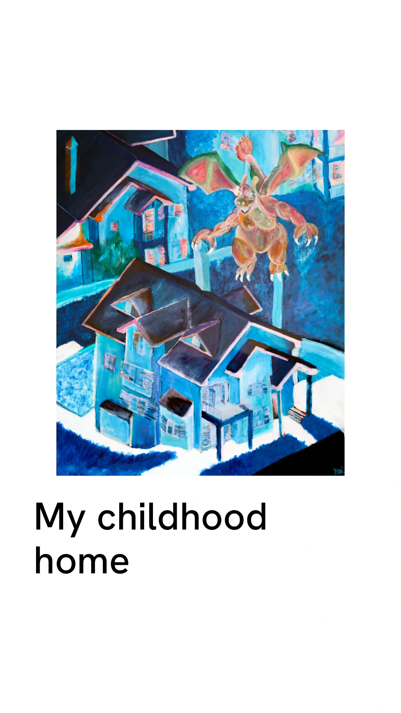

**Reel · 19:00 Europe/Paris · Hedef G1**

**İçerik:** Gerçek anlatıdan çocukluk evi ve ziyaret/tehdit ikiliği; ilk karede kendi resmindeki ev ve figür, ardından anlatıcı ve resim birlikte.

**Neden bu gönderi?:** Kişisel bağlamı kayıtta bulunan güçlü bir karşılaşma; resim, izleyiciye yalnız karakter tanımaktan fazla bir şey sunar.

**Neden bu sırada?:** Açılışta soyut manifesto yerine üst vizyonun mekân/bellek ayağını tek somut resimle kanıtlar; P002 aynı pratiği beden yönünden genişletecek.

**Yeni inceleme değeri:** İlk karşılaşma: kayıttaki ev bilgisi ve resimdeki kurmaca ziyaretçi.

**Üretim:** A1632 196–224,308–364,616–644 saniye anlatım dayanağı. Yeni İngilizce ses kaydı gerekli; özgün ağız hareketine İngilizce dublajmış gibi senkron iddiası yok.

**Ölçüm:** Karaktere ilişkin tepkiler ile eve/resme ilişkin soruları ayır; takipçi dışı erişim ve atfedilen takip birlikte okunur.

**English caption:**

```text
That is the house I grew up in. Putting a childhood character above it changes the feeling of a familiar place.

A visitor can suggest a return, but also a threat.

Angora Mergvs
2026 · Acrylic on canvas
120 × 100 cm (h × w).
```


## P002 · Gün 3 · gary grills cooper

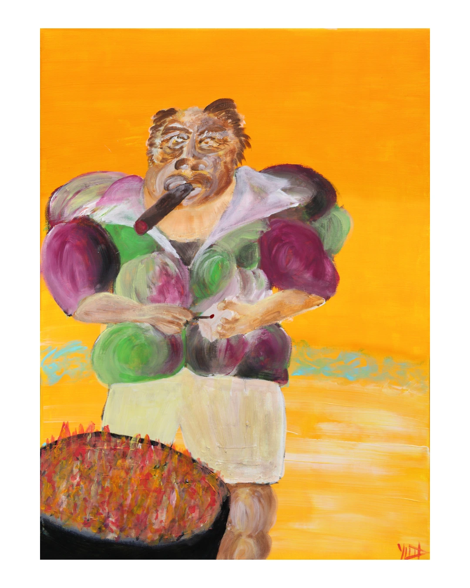

**Single · 19:00 Europe/Paris · Hedef G2**

**İçerik:** Bütünü tek görselde, kesmeden; yüz, oval beden, el ve ızgara aynı kompozisyonda okunur.

**Neden bu gönderi?:** İlk Reel’in kültürel karakterine bağımlı bir hesap olmadığını, bedenin resimsel kuruluşunu gösterir.

**Neden bu sırada?:** P001 mekânından bedene geçer; P003 bu oval kütlelerin altı yıl önceki farklı bir karşılığını getirecek.

**Yeni inceleme değeri:** Farklı eserde ortak ressam dilinin ilk kanıtı; Angora yeniden yayımlanmıyor.

**Üretim:** Belirtilen özgün arşiv görsellerinden hazırlanacak; fotoğraf hareketli üretim kaydı diye sunulmayacak.

**Ölçüm:** Yorumlarda gösterilen biçimsel ilişkiye ilişkin somut gözlemleri kaydet; yalnız beğeniyle tanınma sonucu çıkarma.

**English caption:**

```text
A familiar figure, rebuilt in coloured masses.

The cigar, hands and grill keep an ordinary scene in place around an unstable body.

gary grills cooper
2026 · Acrylic on canvas
75 × 55 cm (h × w).
```


## P003 · Gün 5 · cellular spleens · 2020

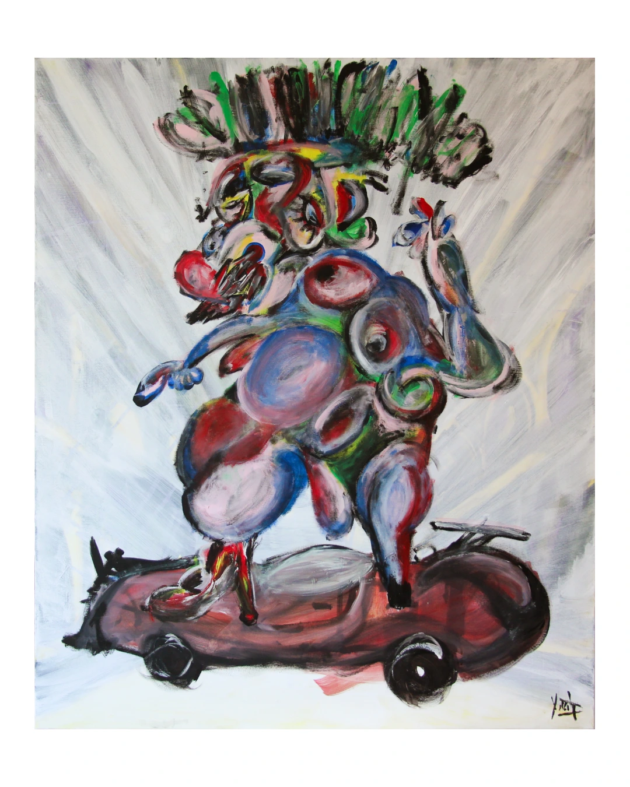

**Single · 19:00 Europe/Paris · Hedef G2**

**İçerik:** Tam eser; araç, üst üste yuvarlak biçimler ve açık zemin birlikte kalır.

**Neden bu gönderi?:** Y06 kartının Gary/Y05 ile kurduğu kütlesel beden bağı, hesabın yalnız güncel popüler referanslardan oluşmadığını gösterir.

**Neden bu sırada?:** Gary’nin yuvarlak bedeni ile açık biçimsel bağ kurar; hafta sonunda arşiv bir dolgu değil bu bağı sınayan ikinci eser olur.

**Yeni inceleme değeri:** 2020 tarihli ayrı kompozisyonda hacim dili; etkilenme veya ilerleme hikâyesi iddia edilmez.

**Üretim:** Belirtilen özgün arşiv görsellerinden hazırlanacak; fotoğraf hareketli üretim kaydı diye sunulmayacak.

**Ölçüm:** Yorumlarda gösterilen biçimsel ilişkiye ilişkin somut gözlemleri kaydet; yalnız beğeniyle tanınma sonucu çıkarma.

**English caption:**

```text
A body built from rounded forms, balanced above a car.

From the Milan archive, 2020.

cellular spleens
2020 · Acrylic on canvas
120 × 100 cm (h × w).
```


## P004 · Gün 8 · This body changed colour.

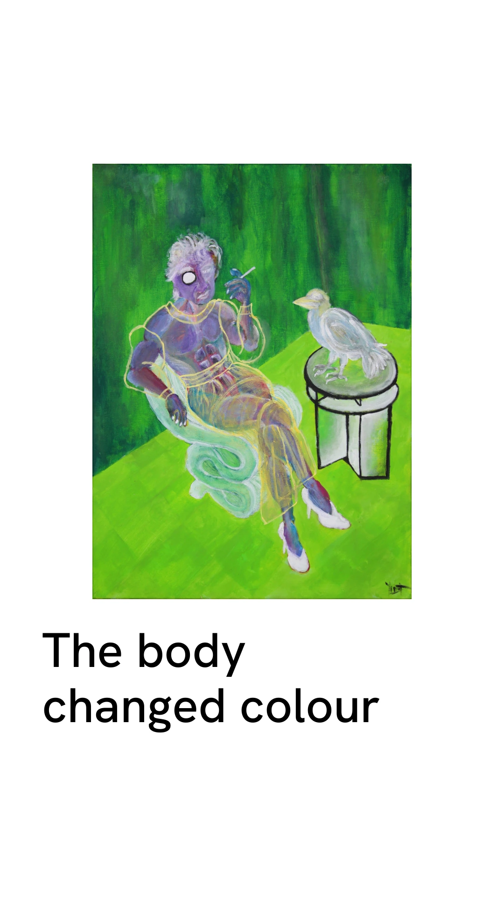

**Reel · 19:00 Europe/Paris · Hedef G1**

**İçerik:** Gerçek fırça kaydındaki sarı–mor değişimi göster; başlangıç, renk müdahalesi, değişmiş figür. Fotoğraf slaytı yok.

**Neden bu gönderi?:** İlk haftadaki bitmiş biçimlerin gerçekten alınan kararlardan oluştuğunu görünür eylemle kanıtlar.

**Neden bu sırada?:** P003’te sonucu gördük; şimdi başka bir resimde bedenin değişmesini izliyoruz. P005 bitmiş yüzlerin farklı kuruluşuna dönecek.

**Yeni inceleme değeri:** Canlı süreçte bir renk değişimi; Angora’daki sözlü hikâyeden farklı bir Reel işi.

**Üretim:** A1167 gerçek hareket:60–65,1170–1176,1686–1692,2900–2908sn. Kareler ayrıca kontrol edildi; sıcak alt renkten mora dönüşüm. Yeni İngilizce anlatım gerekli; arka plan medyası kapalı.

**Ölçüm:** Takipçi dışı erişim ile varsa gönderiye atfedilen takibi aynı ölçüm yaşında birlikte kaydet.

**English caption:**

```text
Warm tones give way to purple while the green room stays around the figure.

A recorded painting session from sept neuf. The finished painting appears at the end.

sept neuf
2026 · Acrylic on canvas
75 × 55 cm (h × w).
```


## P005 · Gün 10 · Three faces, three different balances.

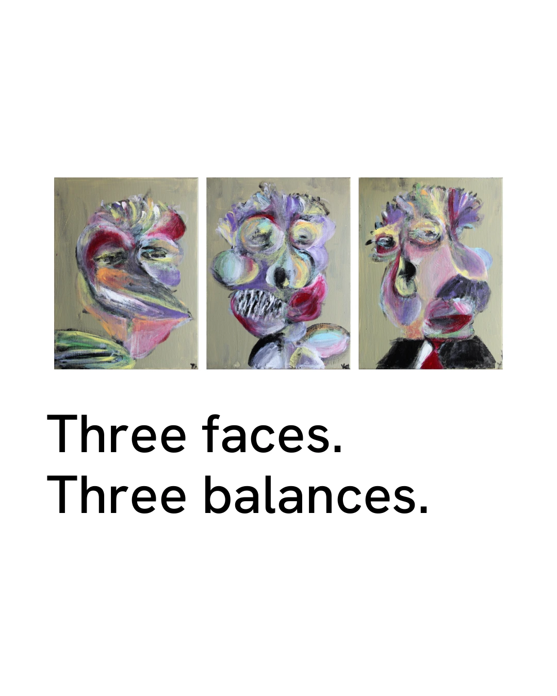

**Carousel · 19:00 Europe/Paris · Hedef G3**

**İçerik:** Dört sayfa: doğru sıradaki bütün triptik; sol panelin eğik ağız hattı; orta panelin göz/diş yoğunluğu; sağ panelin uzun burun/ağız ağırlığı.

**Neden bu gönderi?:** Yüzleri aynı şablonun üç kopyası yerine farklı parça dengeleri olarak karşılaştırmaya elverişli.

**Neden bu sırada?:** Sept’te tek bedenin değişiminden üç ayrı bitmiş çözüme geçer; P006 çizginin benzer işi renk öncesinde nasıl yaptığını açacak.

**Yeni inceleme değeri:** Painstaking ilk kez ve tek yayın olarak gelir; panel karşılaştırması yeni bilgi, beş güne yayılmış tekrar değil.

**Üretim:** Belirtilen özgün arşiv görsellerinden hazırlanacak; fotoğraf hareketli üretim kaydı diye sunulmayacak.

**Ölçüm:** Kaydetme/erişim ve esere özgü farklı kişi sorularını kaydet; yorum yoksa ilgi yok hükmü verme.

**English caption:**

```text
Three panels, three ways of arranging a face.

The left face leans across its mouth. The centre gathers eyes and teeth. The right face puts more weight into its nose and lips.

Read them together, then separately.

Painstaking
2026 · Acrylic on canvas
Triptych · 3 panels, each 40 × 30 cm (h × w).
```


## P006 · Gün 12 · Before the blue: a drawing stage.

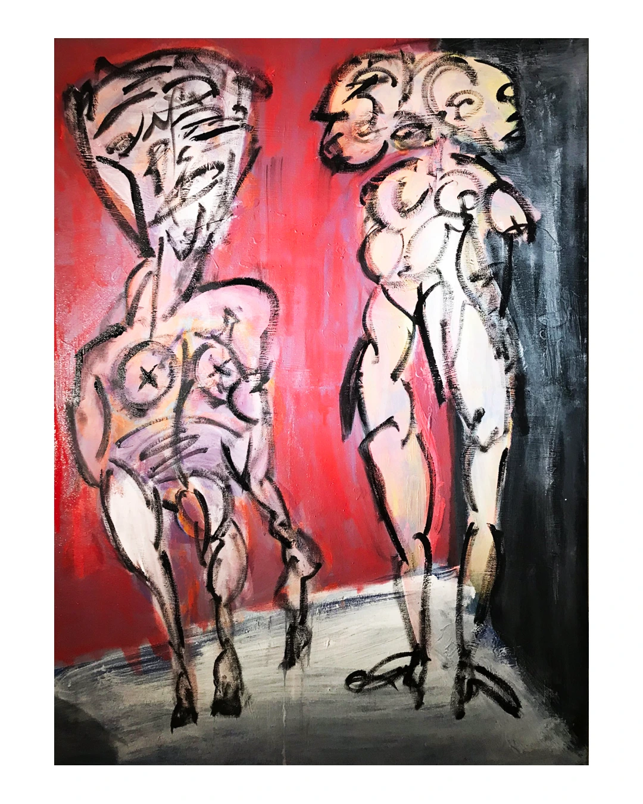

**Single · 19:00 Europe/Paris · Hedef G3**

**İçerik:** Gerçek konturlu ara aşamayı tek görsel olarak sun; son resim görüntüsü ve künye bu dosyaya yapıştırılmaz.

**Neden bu gönderi?:** P005’te görülen yüz/beden kuruluşuna farklı dönemden çizgisel bir karşılık; seçilmiş eskiz kendi başına okunuyor.

**Neden bu sırada?:** İki haftayı tamamlar: kişisel mekân → kütle → arşiv bağı → boyama kararı → yüz karşılaştırması → çizim. Sonraki hafta stüdyo kararının konuşmasına açılır.

**Yeni inceleme değeri:** Bitmiş 2020 eseri yerine tarihsiz ara aşama; konturun rengi beklemeden kurduğu beden.

**Üretim:** Belirtilen özgün arşiv görsellerinden hazırlanacak; fotoğraf hareketli üretim kaydı diye sunulmayacak.

**Ölçüm:** Kaydetme/erişim ve esere özgü farklı kişi sorularını kaydet; yorum yoksa ilgi yok hükmü verme.

**English caption:**

```text
An early drawing stage from the ciao capo, sono squalo archive.

Black contours already hold the two figures in place.

Study image undated. Related final painting: ciao capo, sono squalo, 2020.
```


## P007 · Gün 15 · What would you leave alone?

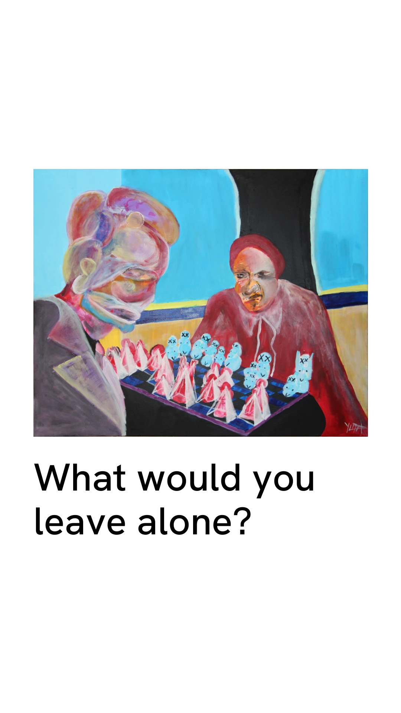

**Reel · 19:00 Europe/Paris · Hedef G1**

**İçerik:** İki kişinin gerçek incelemesi; koyulaştırılacak piyonlar ve korunacak arka plan karşı karşıya.

**Neden bu gönderi?:** Her yaratıcı kararı ekleme olarak göstermeyen, gerçek bir stüdyo ikilemi var.

**Neden bu sırada?:** P006 erken çizimden şimdi müdahalenin nerede durduğuna geçer; P008 bitmiş mekân sınırını görünür kılar.

**Yeni inceleme değeri:** Kaynak sahne anlatmak yerine gerçek karşılıklı geri bildirim.

**Üretim:** A0620 28–84sn kaynak konuşma dayanağı; çeviri uyarlaması için yeni İngilizce ses. Otomatik döküm son ses kontrolünde doğrulanır.

**Ölçüm:** Takipçi dışı erişim ile varsa gönderiye atfedilen takibi aynı ölçüm yaşında birlikte kaydet.

**English caption:**

```text
The pieces could become darker. The background was already working. A studio conversation around 7 fam board game.

7 fam board game
2026 · Acrylic on canvas
80 × 100 cm (h × w).
```


## P008 · Gün 17 · Virgil on Virtual Cage

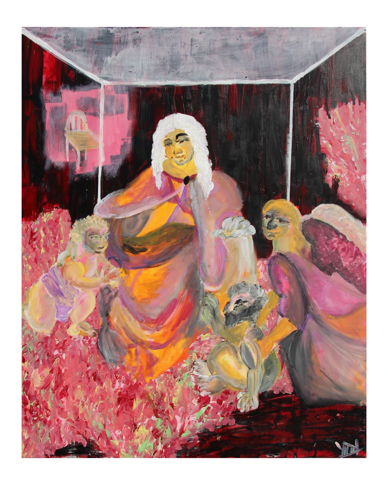

**Single · 19:00 Europe/Paris · Hedef G2**

**İçerik:** Bütünü sun; beyaz mekân kenarları, pembe çevre ve yumuşak figürler birlikte görülsün.

**Neden bu gönderi?:** Beden ve geometri karşıtlığı, hesabın mekân ayağını Angora dışında ikinci işle kurar.

**Neden bu sırada?:** Board konuşmasındaki arka plan kararından çizilmiş çevrenin etkin olduğu başka sahneye; P009 arşivdeki geometrik nesneye bağlanır.

**Yeni inceleme değeri:** Yeni eser: çevreleyen çizgi ile beden karşıtlığı.

**Üretim:** Belirtilen özgün arşiv görsellerinden hazırlanacak; fotoğraf hareketli üretim kaydı diye sunulmayacak.

**Ölçüm:** Yorumlarda gösterilen biçimsel ilişkiye ilişkin somut gözlemleri kaydet; yalnız beğeniyle tanınma sonucu çıkarma.

**English caption:**

```text
Soft bodies sit inside a room drawn with hard white edges.

Virgil on Virtual Cage (final_final-finalV9)
2026 · Acrylic on canvas
100 × 80 cm (h × w).
```


## P009 · Gün 19 · caprocorn sister · 2020

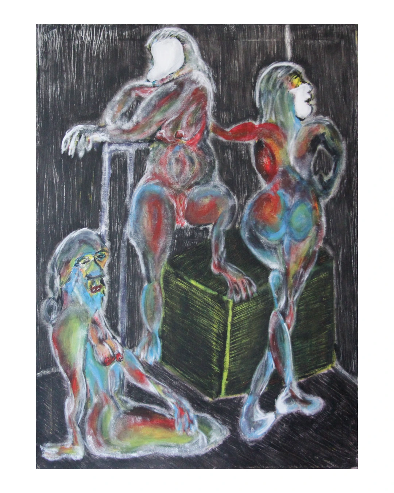

**Single · 19:00 Europe/Paris · Hedef G2**

**İçerik:** 2020 bütününü koyu son zeminle göster; üç beden ve geometrik nesne korunur.

**Neden bu gönderi?:** Araştırmadaki Y08–Y10 bağını kendi kaynaklarıyla görünür yapar.

**Neden bu sırada?:** Virgil’in çevreleyen kutusuna bir önceki dönemin geometrik nesne/beden karşılığı; sonraki hafta daha geniş sahneye geçiş.

**Yeni inceleme değeri:** Son koyu zeminli tam eser; ilerideki gerçek boyama kaydından farklı kanıt.

**Üretim:** Belirtilen özgün arşiv görsellerinden hazırlanacak; fotoğraf hareketli üretim kaydı diye sunulmayacak.

**Ölçüm:** Yorumlarda gösterilen biçimsel ilişkiye ilişkin somut gözlemleri kaydet; yalnız beğeniyle tanınma sonucu çıkarma.

**English caption:**

```text
Three bodies share a dark field with a green geometric seat. From the Milan archive, 2020.

caprocorn sister: war, plague, earthquake
2020 · Acrylic on canvas
90 × 65 cm (h × w).
```


## P010 · Gün 22 · Above the boat, the scene pulls in another direction.

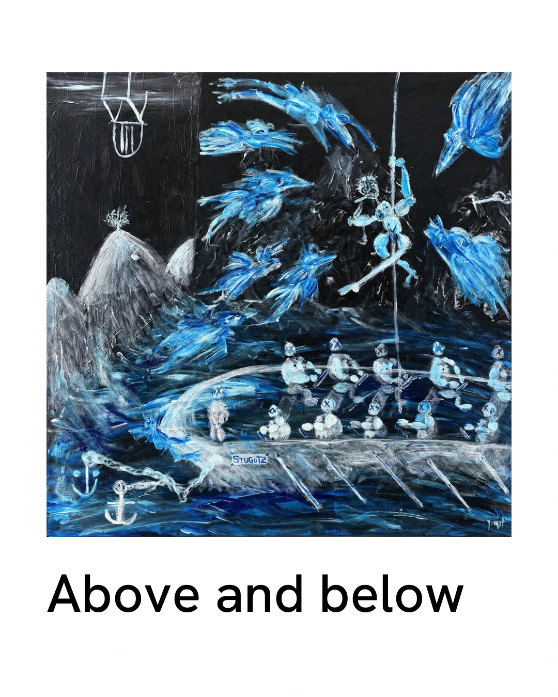

**Carousel · 19:00 Europe/Paris · Hedef G1**

**İçerik:** Bütün→üstte uçan mavi formlar→alttaki tekne/figür sırası. Detayların doğru konusu görüntüde işaretlenerek seçilir.

**Neden bu gönderi?:** Tek bir yüz yerine sahnedeki iki hareket düzeni geniş giriş sunar; kendi resminde cevabı var.

**Neden bu sırada?:** Capricorn’un durağan üçlüsünden hareketli kolektif sahneye geçer; P011 bu kalabalığı tek belirsiz bedene karşılaştırır.

**Yeni inceleme değeri:** Sahnenin üst/alt yön ilişkisi; mitolojik kaynak hikâyesi henüz anlatılmıyor.

**Üretim:** Belirtilen özgün arşiv görsellerinden hazırlanacak; fotoğraf hareketli üretim kaydı diye sunulmayacak.

**Ölçüm:** Takipçi dışı erişim ile varsa gönderiye atfedilen takibi aynı ölçüm yaşında birlikte kaydet.

**English caption:**

```text
A row of figures gathers below a field of flying forms. The boat and the upper movement pull the painting in different directions.

articulo attack on mandarin
2026 · Acrylic on canvas
80 × 80 cm (h × w).
```


## P011 · Gün 24 · s(t)lop

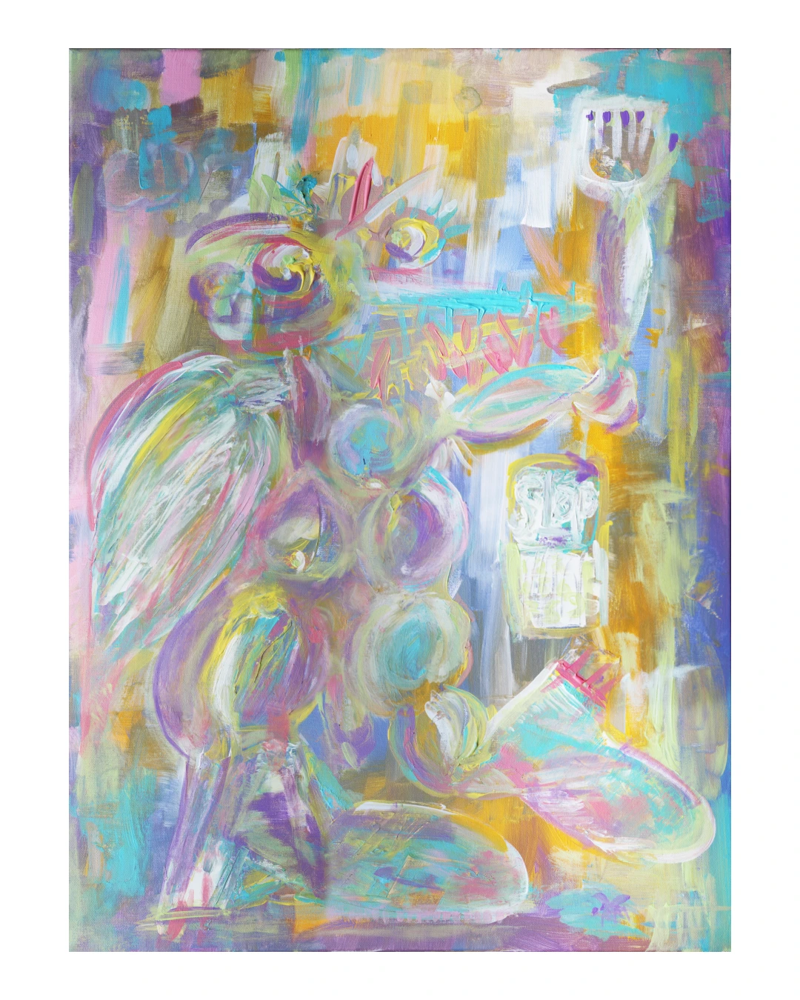

**Single · 19:00 Europe/Paris · Hedef G2**

**İçerik:** Tam eser; figür ile açık renkli alanın karışması tek görüntüde.

**Neden bu gönderi?:** Gary’nin ayrılmış oval parçalarına karşı daha eriyen bir beden çözümü; ressamın aralığını genişletir.

**Neden bu sırada?:** Mandarin’in ayrılabilen figürlerinden figür/zemin sınırı daha belirsiz olan işe geçer; P012 çizimde başka bir yaratığın sınırlarını gösterir.

**Yeni inceleme değeri:** Yeni eser; tanıdık karakter anlatmadan da aynı hesap vaadi çalışıyor.

**Üretim:** Belirtilen özgün arşiv görsellerinden hazırlanacak; fotoğraf hareketli üretim kaydı diye sunulmayacak.

**Ölçüm:** Yorumlarda gösterilen biçimsel ilişkiye ilişkin somut gözlemleri kaydet; yalnız beğeniyle tanınma sonucu çıkarma.

**English caption:**

```text
Pale strokes and red marks give the figure different points of definition.

s(t)lop
2026 · Acrylic on canvas
75 × 55 cm (h × w).
```


## P012 · Gün 26 · A creature in lines.

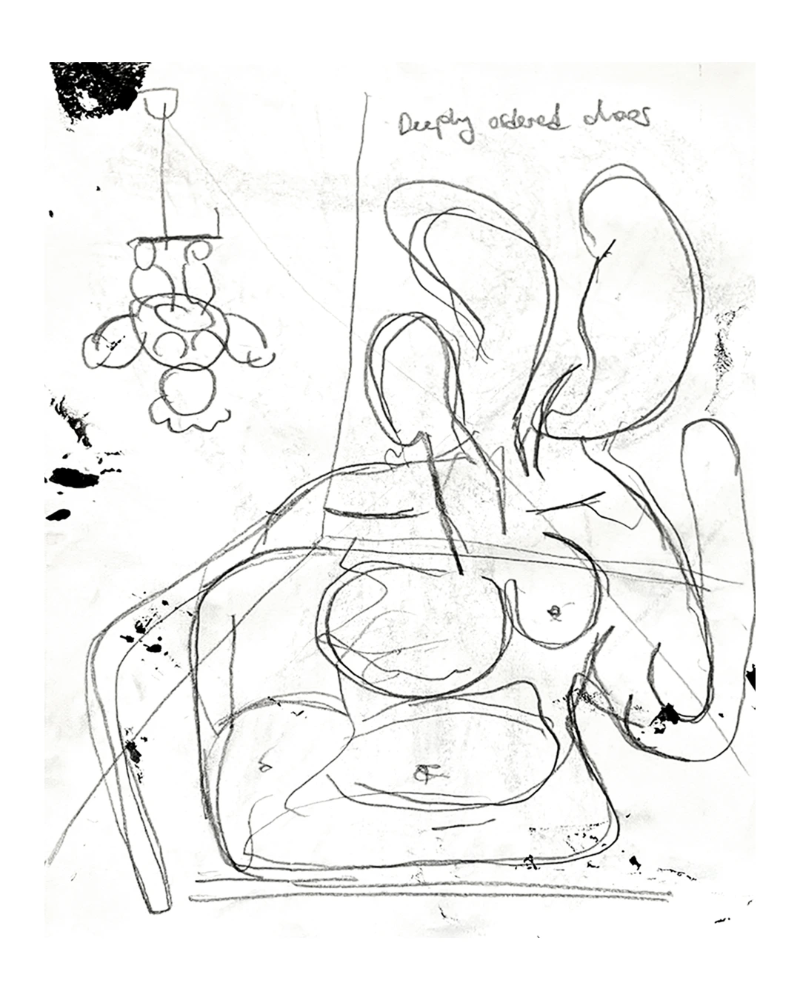

**Single · 19:00 Europe/Paris · Hedef G3**

**İçerik:** Kök eskizi tam sayfa; kâğıt notlarını dekoratif slogan gibi yeniden yazmadan koru.

**Neden bu gönderi?:** Yaratığın çizim halinde nasıl kurulduğu STLOP’un boya içinde beliren bedenine gerçek karşılık verir.

**Neden bu sırada?:** P011 boya sınırının ardından çizgi sınırı; sonraki hafta gerçek boyama hareketine geçmek için erken aşama durak.

**Yeni inceleme değeri:** Daha önce gösterilmemiş çalışma çizimi; bitmiş eserin yılı eskize atanmaz.

**Üretim:** Belirtilen özgün arşiv görsellerinden hazırlanacak; fotoğraf hareketli üretim kaydı diye sunulmayacak.

**Ölçüm:** Kaydetme/erişim ve esere özgü farklı kişi sorularını kaydet; yorum yoksa ilgi yok hükmü verme.

**English caption:**

```text
An undated drawing from the wings of abyss archive. The drawing is shown as a study, rather than the finished painting.
```


## P013 · Gün 29 · Watch the lower figure change.

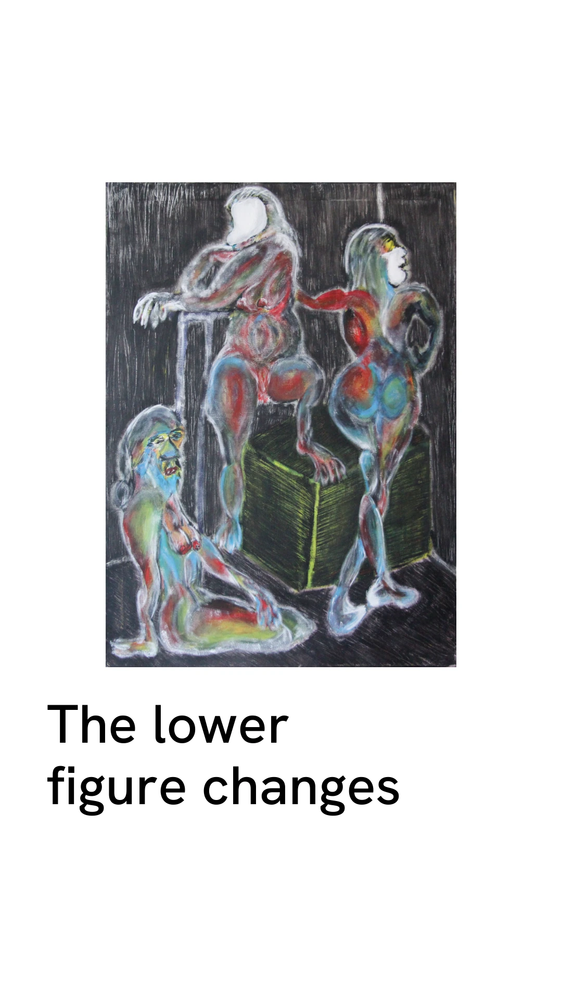

**Reel · 19:00 Europe/Paris · Hedef G1**

**İçerik:** Hızlandırılmış gerçek kayıtta alt figürde siyah alanın büyümesi; sonunda daha sonraki bütün ayrı etiketle.

**Neden bu gönderi?:** Kaynakta görünen dönüşüm hareket izleme nedeni yaratır; sonuca sahte kesintisiz süreç atfedilmez.

**Neden bu sırada?:** P012 çizim durağından gerçek yüzey eylemine; P014 bu aşağıda taşınan/bükülen beden ilgisini grup düzenine taşır.

**Yeni inceleme değeri:** P009 tamamlanmış kompozisyondan farklı olarak tek boyama müdahalesinin gerçek kaydı.

**Üretim:** A2802 120sn editin alt figürde müdahale taşıyan bölümü; kaynak60–100sn aday pencere, son kurgu öncesi hareket seçimi. A1832 later completed state etiketiyle.

**Ölçüm:** Takipçi dışı erişim ile varsa gönderiye atfedilen takibi aynı ölçüm yaşında birlikte kaydet.

**English caption:**

```text
Recorded painting footage from caprocorn sister. The final dark background belongs to a later state, beyond the change shown here.

caprocorn sister: war, plague, earthquake
2020 · Acrylic on canvas
90 × 65 cm (h × w).
```


## P014 · Gün 31 · Gxd is AFK, We banned it

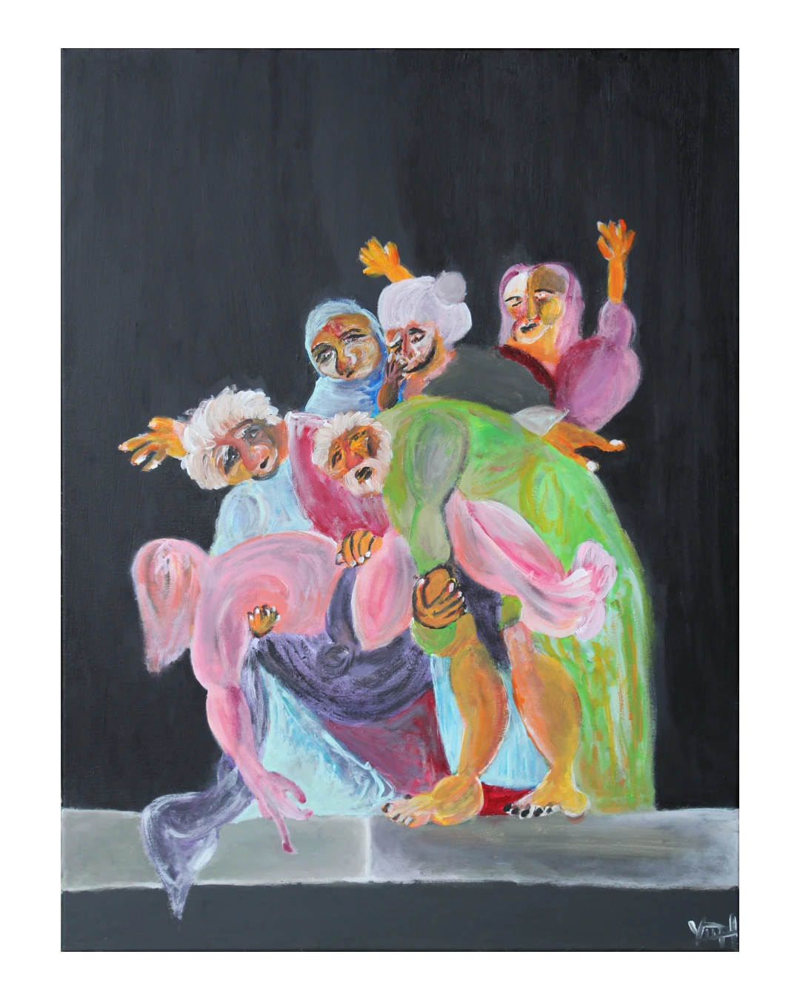

**Single · 19:00 Europe/Paris · Hedef G2**

**İçerik:** Tam eserde taşıyan, taşınan ve yükselen eller bir arada.

**Neden bu gönderi?:** Sahne sütununa farklı bir grup ilişkisi ekler; kaynak isimleri olmadan resmin kendisi incelenir.

**Neden bu sırada?:** Capricorn’un alt bedeninden taşıma düzenine geçer; P015 kolektif gerilimi tek figür ve nesneye daraltır.

**Yeni inceleme değeri:** Bu eserin ilk bütün sunumu; albüm/ressam referansı sonraki ayrı içerik işi.

**Üretim:** Belirtilen özgün arşiv görsellerinden hazırlanacak; fotoğraf hareketli üretim kaydı diye sunulmayacak.

**Ölçüm:** Yorumlarda gösterilen biçimsel ilişkiye ilişkin somut gözlemleri kaydet; yalnız beğeniyle tanınma sonucu çıkarma.

**English caption:**

```text
A carried body sits beneath a large dark field, held inside a group of different gestures.

Gxd is AFK, We banned it
2026 · Acrylic on canvas
80 × 60 cm (h × w).
```


## P015 · Gün 33 · walls of perception

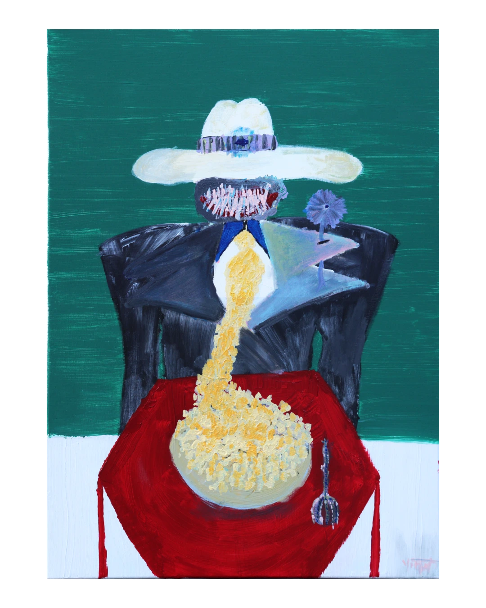

**Single · 19:00 Europe/Paris · Hedef G2**

**İçerik:** Bütün; şapka, yüz, sarı akış ve kırmızı masa.

**Neden bu gönderi?:** Figürün sınırını nesneye bağlayan görünür motif beden sütununa farklı bir çözüm ekler.

**Neden bu sırada?:** Gxd’de bedenler arası bağdan tek beden ile kap arasındaki bağa; P016 bu kez figürün çevresinin nasıl boyandığını gösterecek.

**Yeni inceleme değeri:** Yeni eserde ağız–nesne bağlantısı; psikolojik niyet atfedilmez.

**Üretim:** Belirtilen özgün arşiv görsellerinden hazırlanacak; fotoğraf hareketli üretim kaydı diye sunulmayacak.

**Ölçüm:** Yorumlarda gösterilen biçimsel ilişkiye ilişkin somut gözlemleri kaydet; yalnız beğeniyle tanınma sonucu çıkarma.

**English caption:**

```text
A yellow stream connects the face to the bowl below.

walls of perception
2026 · Acrylic on canvas
70 × 50 cm (h × w).
```


## P016 · Gün 36 · Painting the room before filling the figure.

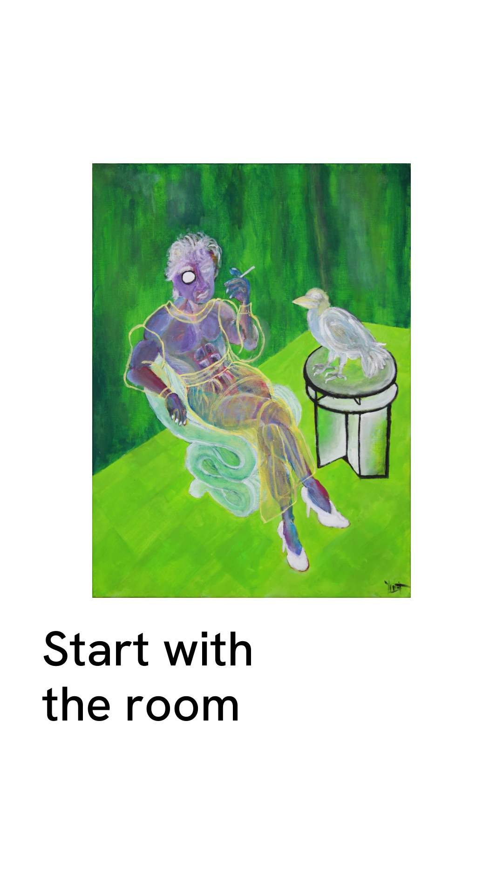

**Reel · 19:00 Europe/Paris · Hedef G1**

**İçerik:** Yeşil zeminin beyaz siluetin çevresine boyandığı gerçek el/fırça görüntüsü; boş kalan bedenin kompozisyondaki yerini göster.

**Neden bu gönderi?:** Beden yalnız kendisine sürülen boyayla değil çevresinin kurulmasıyla da beliriyor; hareketle anlaşılır.

**Neden bu sırada?:** Wall’da sınırın dışarı akışından çevrenin bedeni ayırmasına geçer; P017 fiziksel tuval ölçeğini tanıtır.

**Yeni inceleme değeri:** P004 renk değişiminin yerine erken negatif alan kararı; farklı oturum, farklı soru.

**Üretim:** A1159 beyaz tuval→yeşil zemin kaydı; yalnız gerçekten fırçanın kadrajda olduğu bölüm. Arka plan sesi kapalı.

**Ölçüm:** Takipçi dışı erişim ile varsa gönderiye atfedilen takibi aynı ölçüm yaşında birlikte kaydet.

**English caption:**

```text
Green paint builds a room around a figure left white. A recorded early session from sept neuf.

sept neuf
2026 · Acrylic on canvas
75 × 55 cm (h × w).
```


## P017 · Gün 38 · A painting at its actual scale.

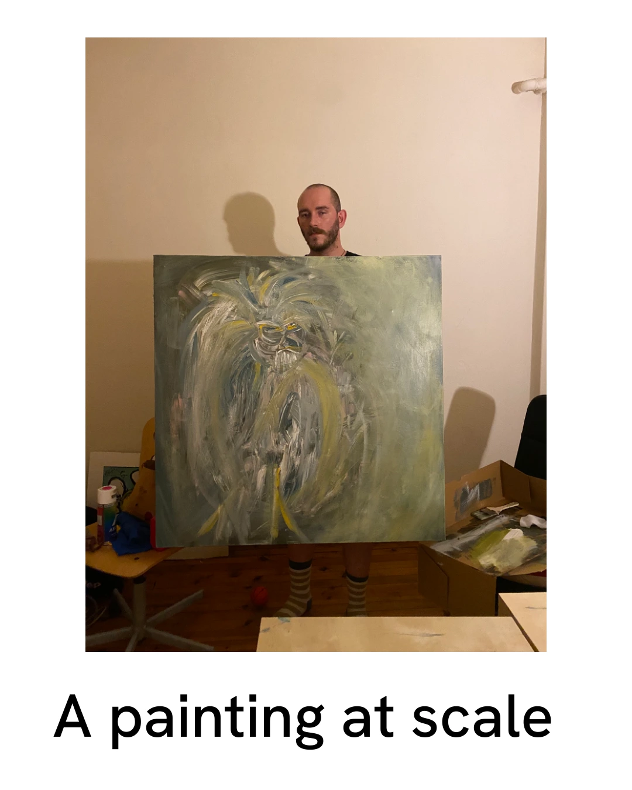

**Carousel · 19:00 Europe/Paris · Hedef G4**

**İçerik:** Gerçek kişiyle ölçek fotoğrafı, ardından düzeltilmiş bütün; dekoratif sahte oda ekleme.

**Neden bu gönderi?:** Telefon ekranında eşit görünen resimleri fiziksel nesne olarak incelemeye açar; 2023 arşivine gerçek giriş.

**Neden bu sırada?:** Boyama eyleminden bu eylemin gerçekleştiği nesnenin büyüklüğüne; P018 küçük panellerdeki yüze dönerek ölçek çeşitliliğini kurar.

**Yeni inceleme değeri:** Yeni dönem ve gerçek ölçek kaydı; arşiv yalnız 2020’yle sınırlı değil.

**Üretim:** Belirtilen özgün arşiv görsellerinden hazırlanacak; fotoğraf hareketli üretim kaydı diye sunulmayacak.

**Ölçüm:** Gönderiden izlenebiliyorsa seçki/portföy ziyareti ve gerçek eser bilgisi talebini ayrı kaydet.

**English caption:**

```text
penguin is not a friend, only a sinner, 2023. A 120 × 120 cm painting, shown beside a person and then on its own.

penguin is not a friend, only a sinner
2023 · Acrylic on canvas
120 × 120 cm (h × w).
```


## P018 · Gün 40 · The eyes do not balance the same way.

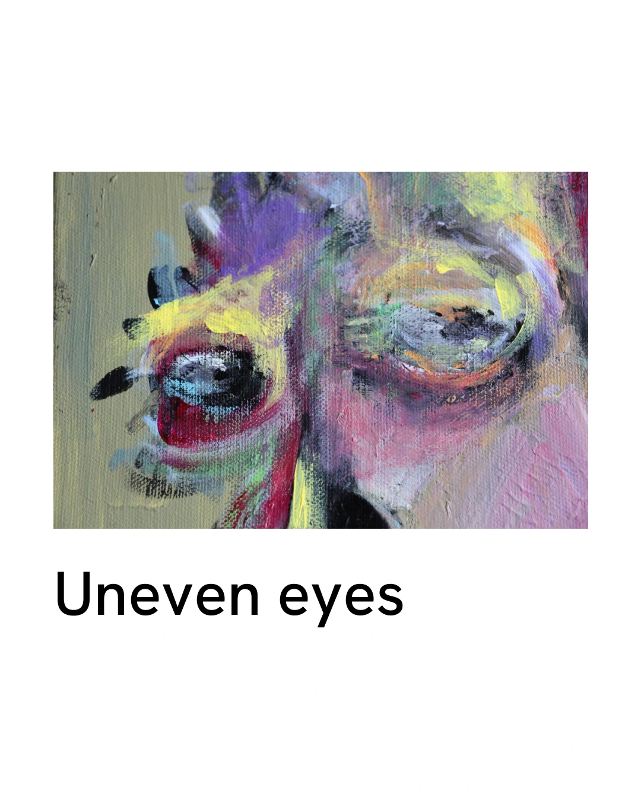

**Carousel · 19:00 Europe/Paris · Hedef G3**

**İçerik:** Göz ayrıntılarını doğru panele bağlayan küçük yer gösterimi; sonunda bütün triptik.

**Neden bu gönderi?:** İlk panel karşılaştırmasından sonra yüzü tanımayı sağlayan belirli parçanın dengesini inceletir.

**Neden bu sırada?:** P017 geniş yüzeyden küçük panel içindeki yoğunluğa; P019 başka dönemin tek karikatür bedenine geçer.

**Yeni inceleme değeri:** P005 panel bütünleri yerine göz–ağız eksenindeki somut fark; yanlış panel eşleştirmesi yapılmaz.

**Üretim:** Belirtilen özgün arşiv görsellerinden hazırlanacak; fotoğraf hareketli üretim kaydı diye sunulmayacak.

**Ölçüm:** Kaydetme/erişim ve esere özgü farklı kişi sorularını kaydet; yorum yoksa ilgi yok hükmü verme.

**English caption:**

```text
Across the three faces, the eyes pull against different mouths and contours.

Painstaking
2026 · Acrylic on canvas
Triptych · 3 panels, each 40 × 30 cm (h × w).
```


## P019 · Gün 43 · cute but unemployed cartoon figure · 2020

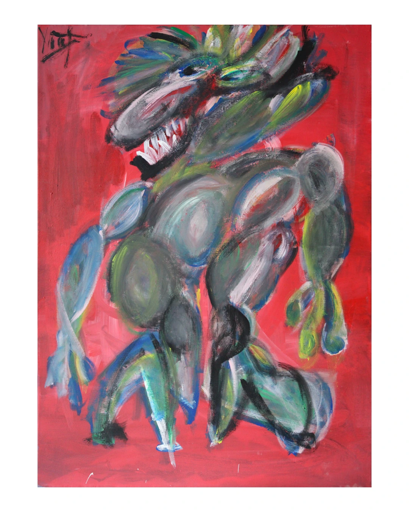

**Single · 19:00 Europe/Paris · Hedef G2**

**İçerik:** Efektsiz bütün; dişler, yuvarlak beden ve kırmızı fon aynı görüntüde.

**Neden bu gönderi?:** Tanıdıklık/bedensel bozulma ilişkisini başka eski karakterle genişletir; yalnız Gary’ye dayanmaz.

**Neden bu sırada?:** Painstaking’in gözlerinden tek figürün sivri ağız/yuvarlak gövde karşıtlığına; P020 gündelik nesnelerin kimliği nasıl sabitlediğini açacak.

**Yeni inceleme değeri:** İlk kez ayrı arşiv eseri, farklı kırmızı/yeşil çözüm.

**Üretim:** Belirtilen özgün arşiv görsellerinden hazırlanacak; fotoğraf hareketli üretim kaydı diye sunulmayacak.

**Ölçüm:** Yorumlarda gösterilen biçimsel ilişkiye ilişkin somut gözlemleri kaydet; yalnız beğeniyle tanınma sonucu çıkarma.

**English caption:**

```text
A green-grey figure stands against red, its rounded body interrupted by pointed teeth.

cute but unemployed cartoon figure
2020 · Acrylic on canvas
90 × 65 cm (h × w).
```


## P020 · Gün 45 · The cigar, the match, the grill.

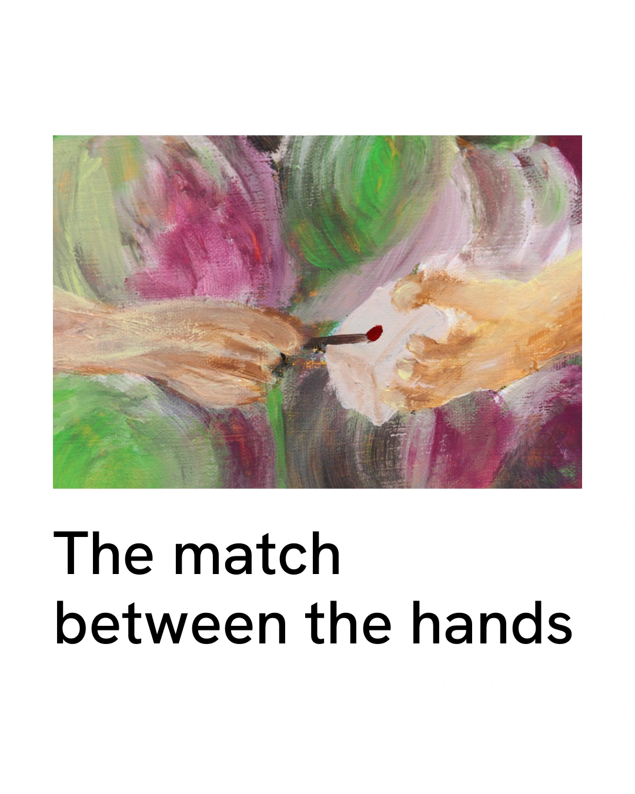

**Carousel · 19:00 Europe/Paris · Hedef G3**

**İçerik:** Bütün ve üç nesneye bağlanan detaylar; puro, kibrit/eller, ızgara.

**Neden bu gönderi?:** Beden bozulsa da gündelik hareketi okunur kılan nesneleri gösterir; biçimsel yorum görüntüyle denetlenebilir.

**Neden bu sırada?:** P019 belirsiz karakterden Gary’nin tanınabilir gündelik eylemine geçer; P021 Angora’da okunmayı sağlayan mimari yapıyı ele alır.

**Yeni inceleme değeri:** P002 gövde kütlelerinden nesnelerin sahne kurma işine geçiş; sadece yeni crop değil.

**Üretim:** Belirtilen özgün arşiv görsellerinden hazırlanacak; fotoğraf hareketli üretim kaydı diye sunulmayacak.

**Ölçüm:** Kaydetme/erişim ve esere özgü farklı kişi sorularını kaydet; yorum yoksa ilgi yok hükmü verme.

**English caption:**

```text
Three small objects keep an unstable body inside an ordinary scene.

gary grills cooper
2026 · Acrylic on canvas
75 × 55 cm (h × w).
```


## P021 · Gün 47 · The house takes shape.

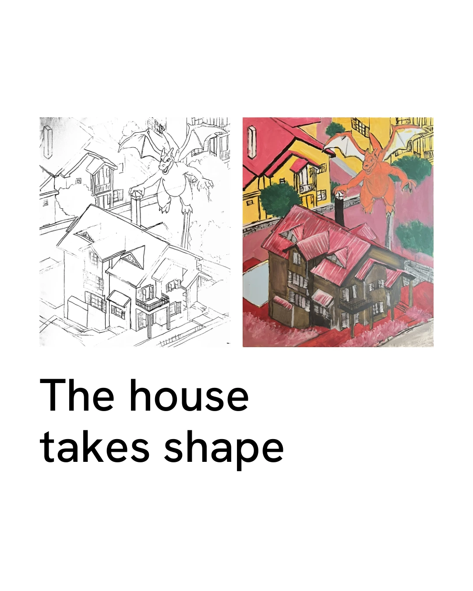

**Carousel · 19:00 Europe/Paris · Hedef G3**

**İçerik:** Aynı perspektife oturtulmuş üç gerçek aşama; çizimdeki çatı/geçit düzeninin boyalı kütleye dönüşümü.

**Neden bu gönderi?:** Kişisel hikâyeyi bu kez gerçek resim yapısıyla destekler; mevcut düzgün process kaynağını doğru formatta kullanır.

**Neden bu sırada?:** Gary’nin nesnelerle sahne kurmasından mimari kütlelerin sahne kurmasına; sonraki yayın başka bir kaynağın resme gelişini anlatacak.

**Yeni inceleme değeri:** P001 anı anlatısından çizim–boya aşamaları arasındaki yapı farkına geçiş; slayt Reel yapılmaz.

**Üretim:** Belirtilen özgün arşiv görsellerinden hazırlanacak; fotoğraf hareketli üretim kaydı diye sunulmayacak.

**Ölçüm:** Kaydetme/erişim ve esere özgü farklı kişi sorularını kaydet; yorum yoksa ilgi yok hükmü verme.

**English caption:**

```text
Three recorded stages: the drawn structure, a painted middle state, and the completed scene.

Angora Mergvs
2026 · Acrylic on canvas
120 × 100 cm (h × w).
```


## P022 · Gün 50 · An album cover was a way into this painting.

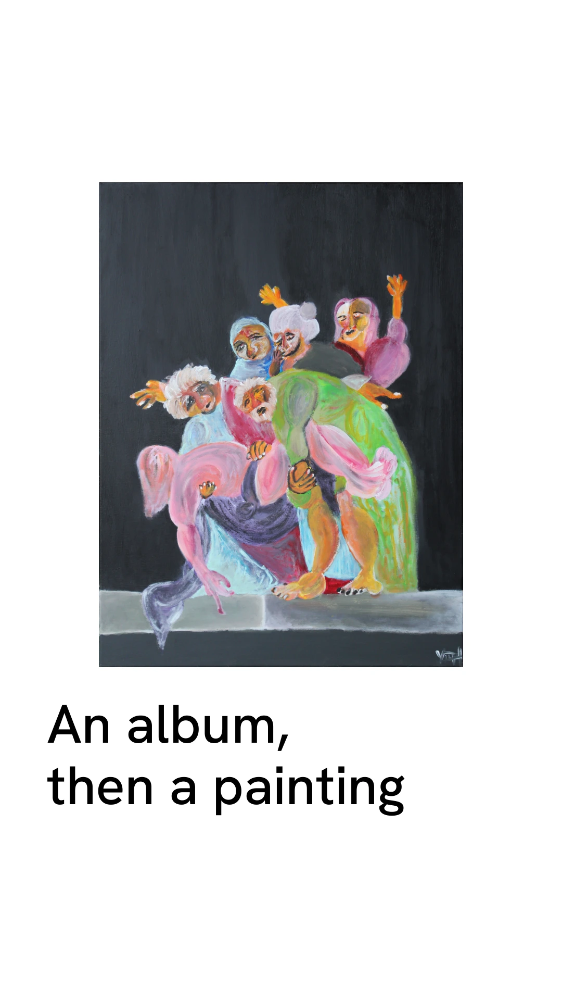

**Reel · 19:00 Europe/Paris · Hedef G1**

**İçerik:** Sanatçının kayıtlı kaynak zinciri; üçüncü taraf görselleri kopyalamadan kendi resmindeki taşıma düzenine dönen anlatı.

**Neden bu gönderi?:** Müzikle ilgilenen kişiye giriş sunar, devamı mevcut resme bağlar.

**Neden bu sırada?:** P021 çizimden resme yolun ardından burada kültürel karşılaşmadan resme yol gelir; P023 başka sahneyi anlatısız inceleme alanı açar.

**Yeni inceleme değeri:** P014 bütün eser sunumuna daha önce anlatılmayan kaynak ilişkisi eklenir.

**Üretim:** A1340 56–196sn anlatı dayanağı; isimleri ASR’dan körlemesine kopyalama. Yeni İngilizce anlatım gerekir; çekilmiş Türkçe konuşma İngilizceymiş gibi gösterilmez.

**Ölçüm:** Takipçi dışı erişim ile varsa gönderiye atfedilen takibi aynı ölçüm yaşında birlikte kaydet.

**English caption:**

```text
An album cover led back to an older composition, and then into this group of painted bodies.

Gxd is AFK, We banned it
2026 · Acrylic on canvas
80 × 60 cm (h × w).
```


## P023 · Gün 52 · 7 fam board game

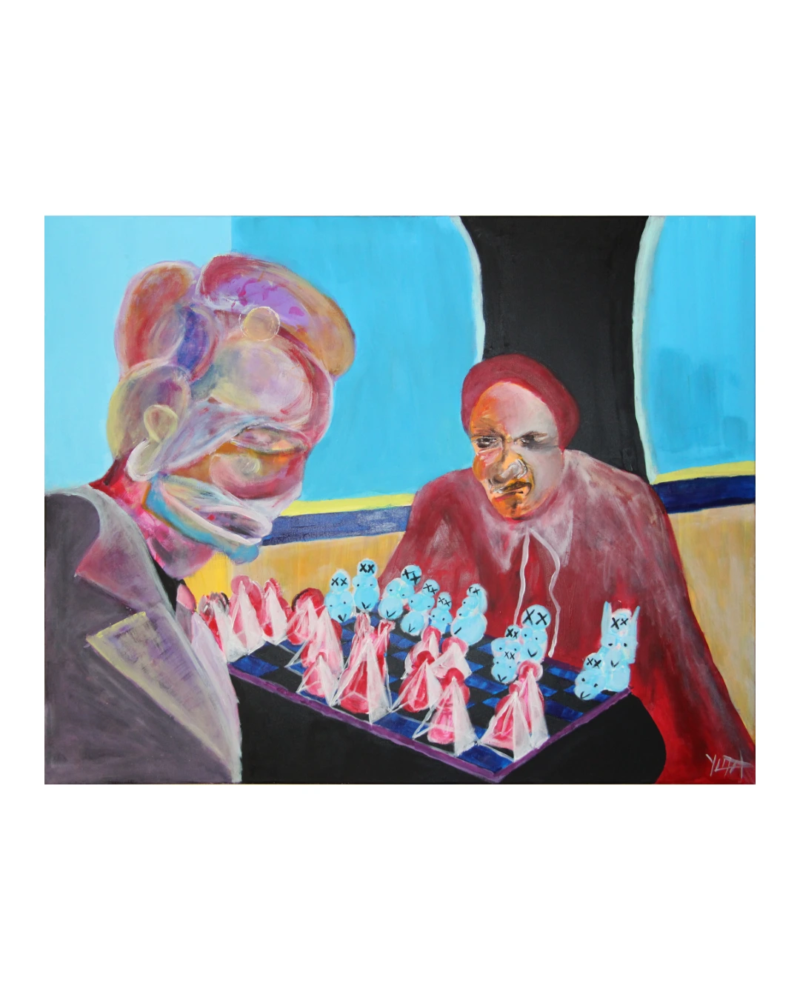

**Single · 19:00 Europe/Paris · Hedef G3**

**İçerik:** Bitmiş eser tek görsel; yatay kompozisyon korunur.

**Neden bu gönderi?:** Sahnenin tamamına kesintisiz bakış, daha önceki stüdyo kararı videosunda görünmeyen ilişkileri inceleme fırsatı.

**Neden bu sırada?:** Gxd’de taşıma grubundan yüz yüze karşılaşmaya; P024 bu çoklu beden ilişkisini eski çizime taşır.

**Yeni inceleme değeri:** P007 konuşması yerine tamamlanmış iki taraf ve aradaki küçük bedenler; aynı sesin tekrar yayını değil.

**Üretim:** Belirtilen özgün arşiv görsellerinden hazırlanacak; fotoğraf hareketli üretim kaydı diye sunulmayacak.

**Ölçüm:** Kaydetme/erişim ve esere özgü farklı kişi sorularını kaydet; yorum yoksa ilgi yok hükmü verme.

**English caption:**

```text
Two facing figures meet across a board filled with smaller bodies.

7 fam board game
2026 · Acrylic on canvas
80 × 100 cm (h × w).
```


## P024 · Gün 54 · A study for connected bodies.

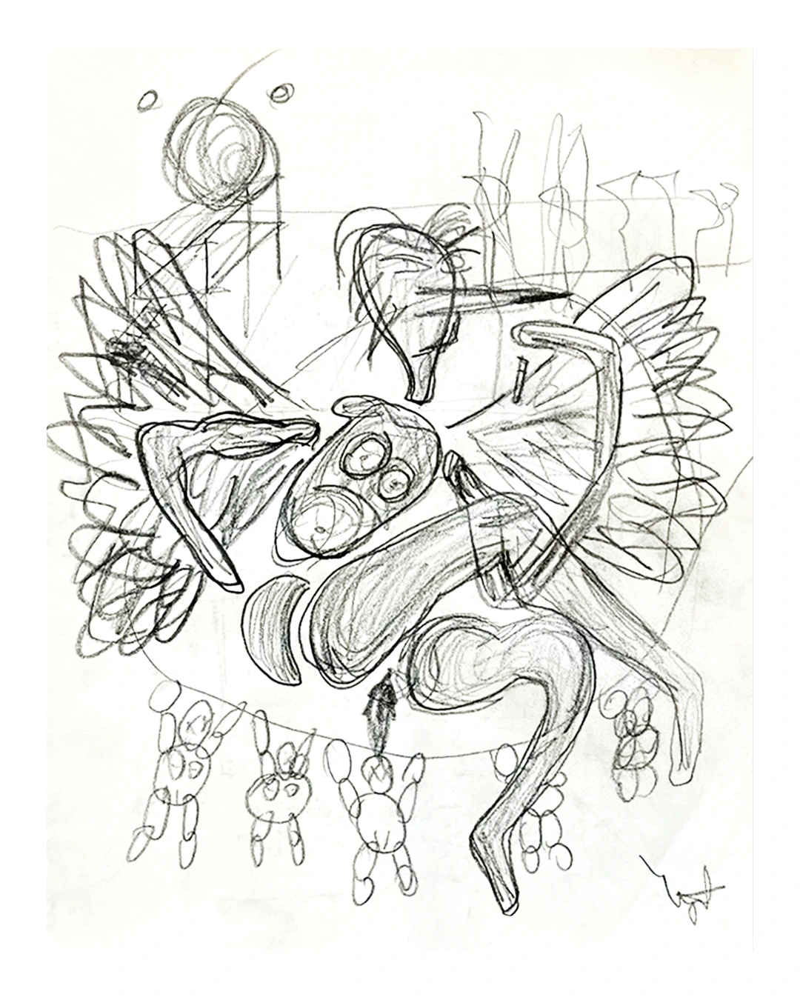

**Single · 19:00 Europe/Paris · Hedef G3**

**İçerik:** Karakalem çalışma bütünü; erken çizimi bitmiş akrilik eserden ayır.

**Neden bu gönderi?:** Çoklu figür ilişkilerinin eski taslaktaki kuruluşu, stüdyo konuşması ve bitmiş grup resimleriyle ilişki kurar.

**Neden bu sırada?:** Board’daki iki taraf/küçük beden düzeninden arşivde bağlantılı figür taslağına; P025 mekân içindeki nesneye daralma.

**Yeni inceleme değeri:** Yeni arşiv çizimi; nihai 2019 tarihini çizim tarihine taşımıyor.

**Üretim:** Belirtilen özgün arşiv görsellerinden hazırlanacak; fotoğraf hareketli üretim kaydı diye sunulmayacak.

**Ölçüm:** Kaydetme/erişim ve esere özgü farklı kişi sorularını kaydet; yorum yoksa ilgi yok hükmü verme.

**English caption:**

```text
An undated study from the good people helping bad ones archive.
```


## P025 · Gün 57 · A chair inside a drawn room.

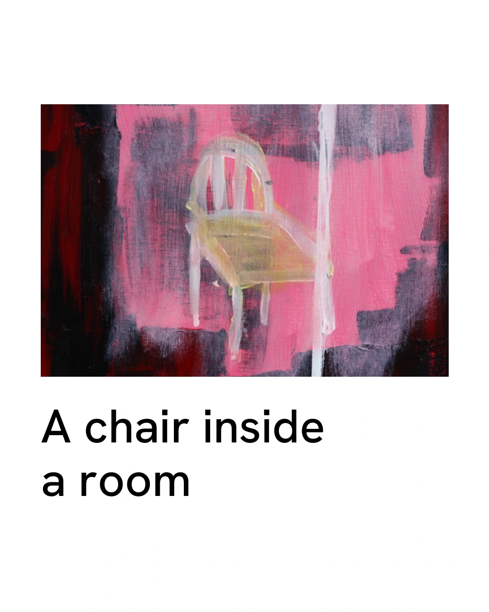

**Carousel · 19:00 Europe/Paris · Hedef G3**

**İçerik:** Bütün, asılı sandalye, çizgili köşe; her detayın bütün içindeki yeri küçük işaretle.

**Neden bu gönderi?:** Mekânın soyut çerçeveden nesneye geçtiği iki görünür kanıt var.

**Neden bu sırada?:** Çizimden çevreleyen çizgilerin bitmiş odasına; P026 başka dönemde çizgisel sandalye karşılığı.

**Yeni inceleme değeri:** P008 genel kutu/beden karşıtlığından belirli sandalye ve köşe okumaya geçer.

**Üretim:** Belirtilen özgün arşiv görsellerinden hazırlanacak; fotoğraf hareketli üretim kaydı diye sunulmayacak.

**Ölçüm:** Kaydetme/erişim ve esere özgü farklı kişi sorularını kaydet; yorum yoksa ilgi yok hükmü verme.

**English caption:**

```text
The hanging chair and the white corner make the room legible beside the softer bodies.

Virgil on Virtual Cage (final_final-finalV9)
2026 · Acrylic on canvas
100 × 80 cm (h × w).
```


## P026 · Gün 59 · The body bends; the chair stays drawn.

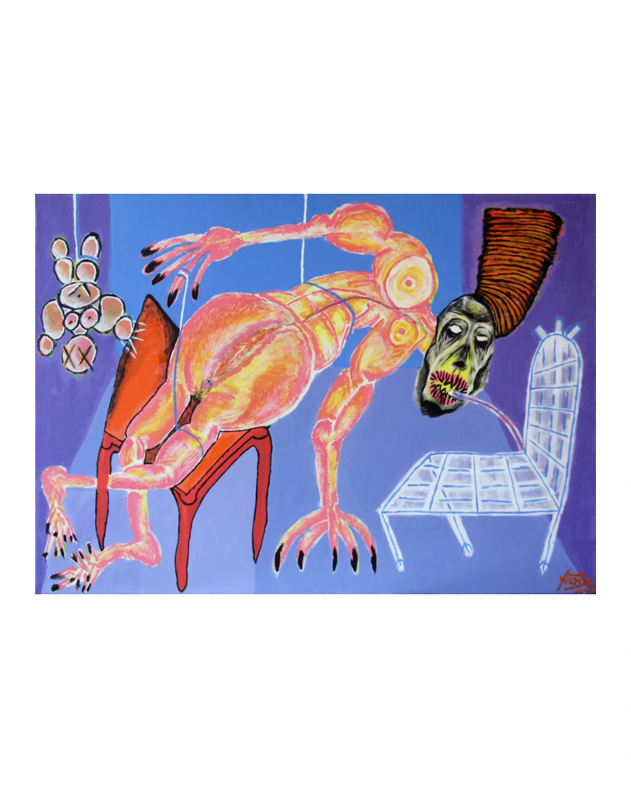

**Single · 19:00 Europe/Paris · Hedef G2**

**İçerik:** Yatay bütün, eğilen beden ve beyaz sandalye korunur.

**Neden bu gönderi?:** Virgil’deki sandalye üzerine arşivde farklı bir beden–mobilya düzeni getirir.

**Neden bu sırada?:** P025’teki nesne/çerçeve sorusunun 2019 karşılığı; P027 dikey asılı figürü başka sahnede genişletir.

**Yeni inceleme değeri:** Yeni arşiv işi; benzer nesne üzerinden fark gösterir, gelişim sırası iddiası yok.

**Üretim:** Belirtilen özgün arşiv görsellerinden hazırlanacak; fotoğraf hareketli üretim kaydı diye sunulmayacak.

**Ölçüm:** Yorumlarda gösterilen biçimsel ilişkiye ilişkin somut gözlemleri kaydet; yalnız beğeniyle tanınma sonucu çıkarma.

**English caption:**

```text
An elongated body bends through a purple-blue field beside a chair drawn in white. From 2019.

victim psycho-logique II : the peachy pharaoh connects with the chair
2019 · Acrylic on canvas
65 × 90 cm (h × w).
```


## P027 · Gün 61 · How the scene gathers around the boat.

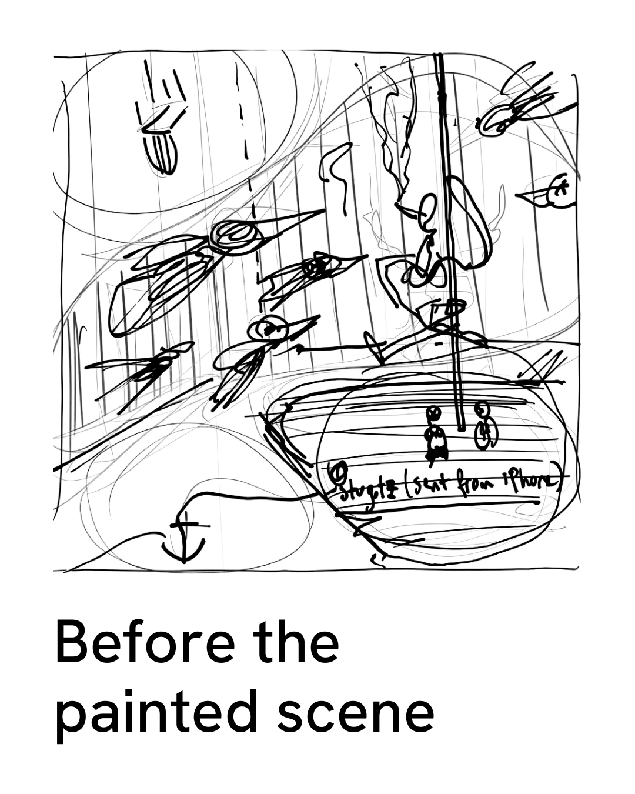

**Carousel · 19:00 Europe/Paris · Hedef G3**

**İçerik:** Temiz siyah çizim A0218 → boyalı ara aşama A0214 → bitmiş A0192. Üç durum aynı esere ait; süreç fotoğrafları carousel olarak etiketli.

**Neden bu gönderi?:** P010’daki hareket ayrımının süreçte nasıl yer tuttuğunu incelemek için ek kanıt.

**Neden bu sırada?:** Peachy’de tek asılı bedenin ardından kalabalık yerleştirmeye; P028 gerçek boyama görüntüsüyle kütlenin kuruluşuna geçer.

**Yeni inceleme değeri:** P010 bitmiş üst/alt karşıtlığı yerine kayıtlı aşamalar; aynı montajın hız varyantı değil.

**Üretim:** A0218 aaaaa.png bitmiş resim değil temiz çizimdir. Sıra A0218/A0214/A0192; bütün aşamaların kamera önünde boyandığı iddia edilmez.

**Ölçüm:** Kaydetme/erişim ve esere özgü farklı kişi sorularını kaydet; yorum yoksa ilgi yok hükmü verme.

**English caption:**

```text
Recorded stages of articulo attack on mandarin: a drawn arrangement becomes a painted scene.

articulo attack on mandarin
2026 · Acrylic on canvas
80 × 80 cm (h × w).
```


## P028 · Gün 64 · Building the red body.

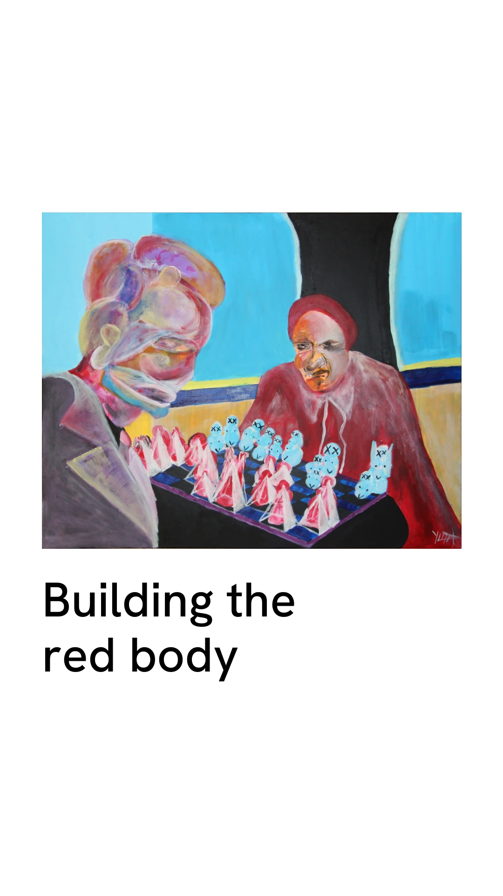

**Reel · 19:00 Europe/Paris · Hedef G1**

**İçerik:** Kırmızı gövde üzerinde gerçek fırça hareketi; geniş hareket ve elin değiştirdiği yer birlikte.

**Neden bu gönderi?:** Konuşmanın dışında yapılan işin kendisi yeni izleyici için anlaşılır eylem sunar.

**Neden bu sırada?:** Mandarin aşama fotoğraflarından kesintisiz fiziksel harekete; P029 boya yapma eyleminden eski çoklu beden sonucuna geçer.

**Yeni inceleme değeri:** P007 karar konuşması ve P023 bütününden farklı olarak gerçek kırmızı boya müdahalesi.

**Üretim:** A0630 kırmızı gövde ham oturumu. Yeni video icat edilmez; kesim noktaları bu uzun vadeli kartın üretim aşamasında seçilecek. Arka plan medyası kapalı.

**Ölçüm:** Takipçi dışı erişim ile varsa gönderiye atfedilen takibi aynı ölçüm yaşında birlikte kaydet.

**English caption:**

```text
A recorded session from 7 fam board game: the red figure develops through actual brushwork.

7 fam board game
2026 · Acrylic on canvas
80 × 100 cm (h × w).
```


## P029 · Gün 66 · baby rights 101 · 2020

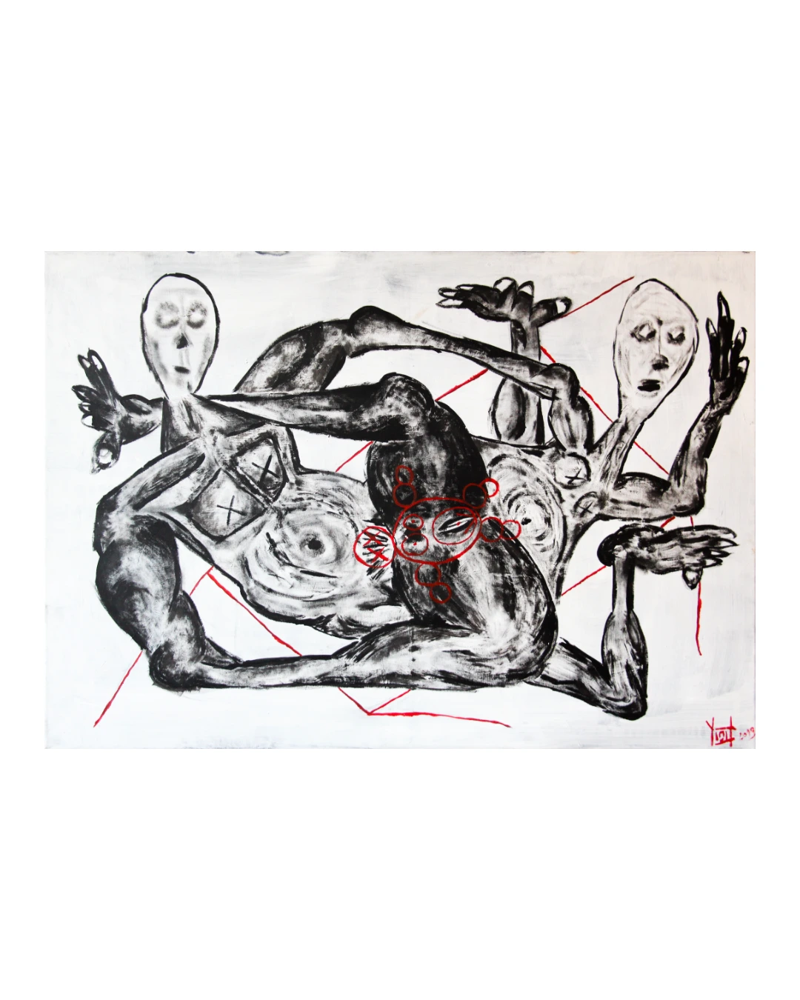

**Single · 19:00 Europe/Paris · Hedef G2**

**İçerik:** Tam eser; iç içe figürler ve ince kırmızı çizgiler korunur.

**Neden bu gönderi?:** Sıcak kırmızı kütleye karşı ağırlıkla siyah/beyaz ve çizgisel bağ kuran önceki dönem çözümü.

**Neden bu sırada?:** P028’de tek kırmızı beden kurulurken burada beden sınırları birlikte katlanır; P030 ilk dönemin üç alanını toparlar.

**Yeni inceleme değeri:** Yeni arşiv eseri; farklı malzeme dili değil aynı medium içinde farklı çizgi/alan ilişkisi.

**Üretim:** Belirtilen özgün arşiv görsellerinden hazırlanacak; fotoğraf hareketli üretim kaydı diye sunulmayacak. Baby Rights: kaynak fotoğrafın oranı katalogdaki80×100cm oranıyla birebir eşleşmiyor; resmi ölçüye uydurmak için esnetme. Künye katalog beyanı; fiziksel teyit ayrı.

**Ölçüm:** Yorumlarda gösterilen biçimsel ilişkiye ilişkin somut gözlemleri kaydet; yalnız beğeniyle tanınma sonucu çıkarma.

**English caption:**

```text
Black and white bodies fold through each other, crossed by thin red lines.

baby rights 101
2020 · Acrylic on canvas
80 × 100 cm (h × w).
```


## P030 · Gün 68 · Three ways into the paintings.

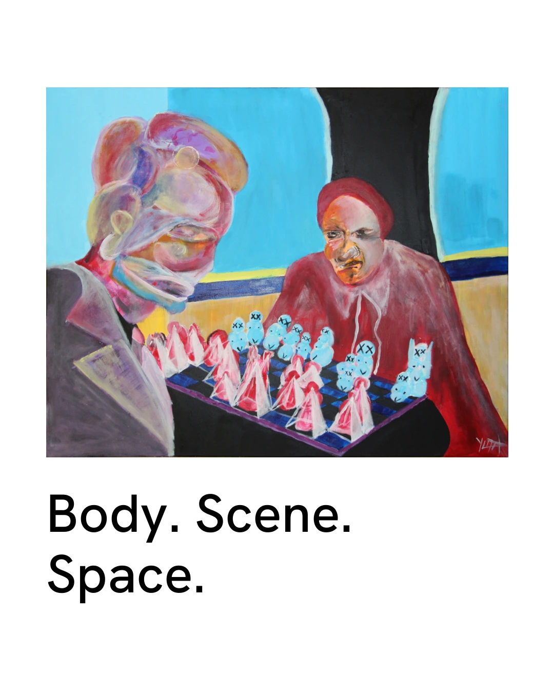

**Carousel · 19:00 Europe/Paris · Hedef G4**

**İçerik:** Angora mekân/bellek; Gary beden; Board karşılaşma sahnesi. Üç bütün, üç doğru künye, seçki yolu.

**Neden bu gönderi?:** Yeni gelenin hesabı tek eser üzerinden okumamasını sağlayan kısa, kullanılabilir portföy girişi.

**Neden bu sırada?:** İlk29 gönderinin mekân/beden/sahne kanıtını üç okunur esere toplar; ikinci bölüm bu vaatlerin içindeki somut kararları daha yakından açacak.

**Yeni inceleme değeri:** Üç farklı soruyu üç ayrı eserle açık eşler: mekân, beden, karşılaşma. İkinci mekân işini sahne sütunu yerine koymaz.

**Üretim:** Kapakta A0592 Board karşılaşma sahnesi ve Body. Scene. Space. başlığı. Sonraki üç sayfada Angora, Gary ve Board ayrı bütünleri ve doğru künyeleriyle yer alır. P001 ile aynı Angora kapak görselini sabit üst sırada tekrar etme.

**Ölçüm:** Gönderiden izlenebiliyorsa seçki/portföy ziyareti ve gerçek eser bilgisi talebini ayrı kaydet.

**English caption:**

```text
A house, a body, a meeting. Three paintings from 2026, with their titles, materials and dimensions.

Angora Mergvs
2026 · Acrylic on canvas
120 × 100 cm (h × w).

gary grills cooper
2026 · Acrylic on canvas
75 × 55 cm (h × w).

7 fam board game
2026 · Acrylic on canvas
80 × 100 cm (h × w).
```


## P031 · Gün 71 · Red marks, pale edges. What changes when one part disappears?

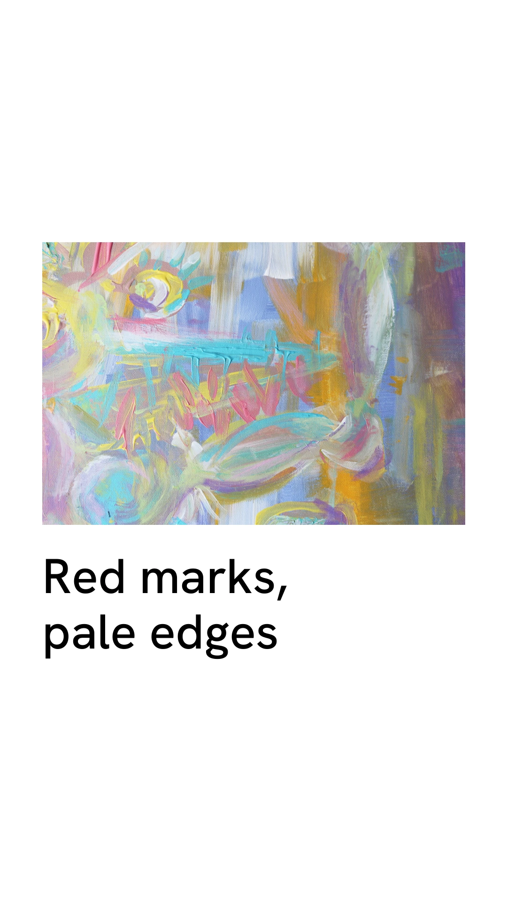

**Reel · 19:00 Europe/Paris · Hedef G1**

**İçerik:** Sanatçı basılı s(t)lop reprodüksiyonunda küçük nötr kartla A0101 ayrıntısında görülen kırmızı zikzak alanını birkaç saniye kapatıp açar. Tek gerçek çekimde çevredeki açık izlerle ilişkisini gösterir; orijinal tuvale müdahale etmez. İşaretlerin anatomik olarak ağız olduğu iddia edilmez.

**Neden bu gönderi?:** İlk tanışıklığı tek gözle denetlenebilir inceleme kararına dönüştürür.

**Neden bu sırada?:** P030 geniş seçkiden bir resimdeki tek tutunma noktasına; P032 başka bedende küçük nesnenin benzer işi nasıl yaptığını açar.

**Yeni inceleme değeri:** P011 genel bütün sunumundan kırmızı işaretler ile açık çevre izleri ilişkisine geçiş. Bir alanı geçici kapatma eylemi sabit detaydan farklı bir görme deneyi sunar; sonucu herkes aynı algılıyormuş gibi anlatma.

**Üretim:** YENİ ÇEKİM: A0134 baskısı, nötr küçük kart, üstten/karşıdan telefon ve yeni İngilizce açıklama. A0101 hareketin hedef alanını doğrular. Şimdiki arşivde bu hareketin videosu yok. Kayıt yapılmazsa A0134 bütün ve A0101 hazır detayıyla carousel yedeği kullanılır.

**Ölçüm:** Takipçi dışı erişim ve varsa gönderiye atfedilen takip; açıklanan kenar/alan/beden ilişkisine ilişkin gerçek devam soruları. Yalnız görüntülenme kazanımı yeterli değil.

**English caption:**

```text
A closer look at the red marks and the pale strokes around them. Briefly covering this area on a reproduction lets us compare what remains visible.

s(t)lop
2026 · Acrylic on canvas
75 × 55 cm (h × w).
```


## P032 · Gün 73 · The small car changes the size of the body.

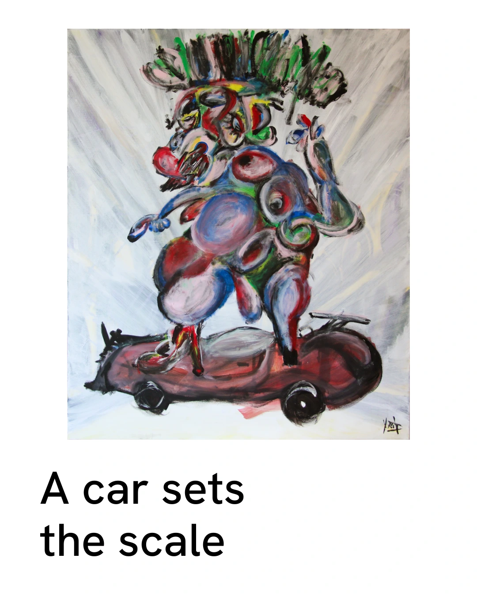

**Carousel · 19:00 Europe/Paris · Hedef G3**

**İçerik:** Bütün ve aynı dosyadan araç/bacak bölümü; sayfada önce ölçek etkisi sonra bütüne dönük işaret.

**Neden bu gönderi?:** Aracın sadece ek motif değil beden ölçeğini okumaya yarayan karşılık olduğunu gösterir.

**Neden bu sırada?:** STLOP’ta ağız tanınmayı sabitlerken burada araç boyut algısını değiştirir; P033 bu kütlelerin yeni bir resimde kuruluşuna geçer.

**Yeni inceleme değeri:** P003 oval kütle benzerliğinden araç ile bedenin orantı ilişkisine; farklı ve somut soru.

**Üretim:** Belirtilen özgün arşiv görsellerinden hazırlanacak; fotoğraf hareketli üretim kaydı diye sunulmayacak.

**Ölçüm:** Kaydetme/erişim ve esere özgü farklı kişi sorularını kaydet; yorum yoksa ilgi yok hükmü verme.

**English caption:**

```text
The car beneath the figure changes how large the rounded body feels. cellular spleens, 2020.

cellular spleens
2020 · Acrylic on canvas
120 × 100 cm (h × w).
```


## P033 · Gün 75 · A figure before and after its coloured masses.

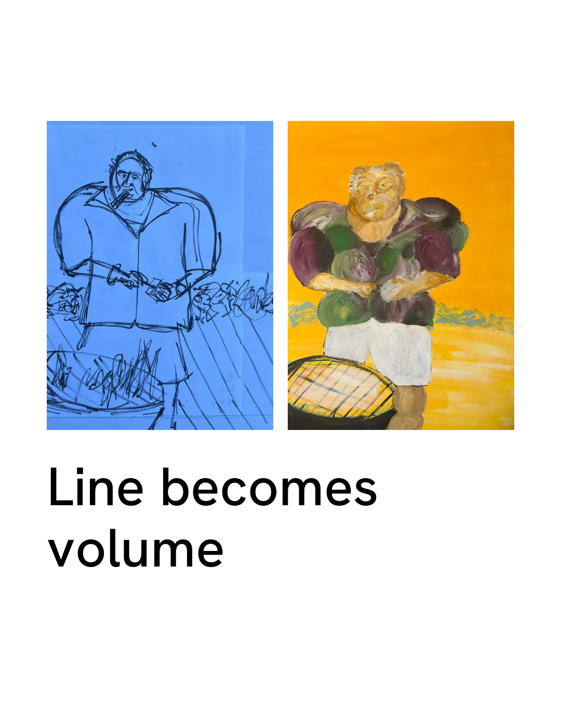

**Carousel · 19:00 Europe/Paris · Hedef G3**

**İçerik:** Çizim ve boyalı süreç dosyalarını adlarındaki aşama numarasına göre doğrula; iki aşama ve son bütün.

**Neden bu gönderi?:** Yuvarlak kütlelerin sırf figür konusu değil resim kurma kararı olduğunu kayıtlı aşamayla gösterir.

**Neden bu sırada?:** P032 bitmiş eski kütleden Gary’nin çizgi–kütle ayrımına; P034 tam kapanmayan konturun başka karşılığını getirir.

**Yeni inceleme değeri:** P002 sonuç ve P020 nesnelerden farklı olarak gerçek çizim/renk aşaması. Referans fotoğrafı süreç diye gösterilmez.

**Üretim:** Belirtilen özgün arşiv görsellerinden hazırlanacak; fotoğraf hareketli üretim kaydı diye sunulmayacak.

**Ölçüm:** Kaydetme/erişim ve esere özgü farklı kişi sorularını kaydet; yorum yoksa ilgi yok hükmü verme.

**English caption:**

```text
The line structure and the painted body offer two different ways of reading the same figure.

gary grills cooper
2026 · Acrylic on canvas
75 × 55 cm (h × w).
```


## P034 · Gün 78 · A contour can stay visible through a body.


**Reel · 19:00 Europe/Paris · Hedef G1**

**İçerik:** Açık/mavi kontur üzerinde gerçek boyama; çizginin tamamlanmış gövde boyunca nasıl okunduğunu son karede göster.

**Neden bu gönderi?:** Harekette görülen açık çizgi, bedenin kapalı bir renk lekesi olmamasını anlatır.

**Neden bu sırada?:** Gary’de dolan hacimden Sept’te açık kalan kontura; P035 eski çift yüzün silinen sınırlarıyla karşılaştırma.

**Yeni inceleme değeri:** P004 renk değişimi/P016 zemin ayrımı yerine açık çizgi ilişkisi.

**Üretim:** A1165 açık/mavi konturlar ham oturumu; yalnız çizgiyle ilgili görünen müdahale. Şimdiden kesin saniye aralığı seçilmiş sayılmaz; üretimde hareket eşleştirilecek.

**Ölçüm:** Takipçi dışı erişim ile varsa gönderiye atfedilen takibi aynı ölçüm yaşında birlikte kaydet.

**English caption:**

```text
Light lines keep moving across the purple figure and the chair. Recorded work on sept neuf.

sept neuf
2026 · Acrylic on canvas
75 × 55 cm (h × w).
```


## P035 · Gün 80 · duality of the angelic summarization · 2019

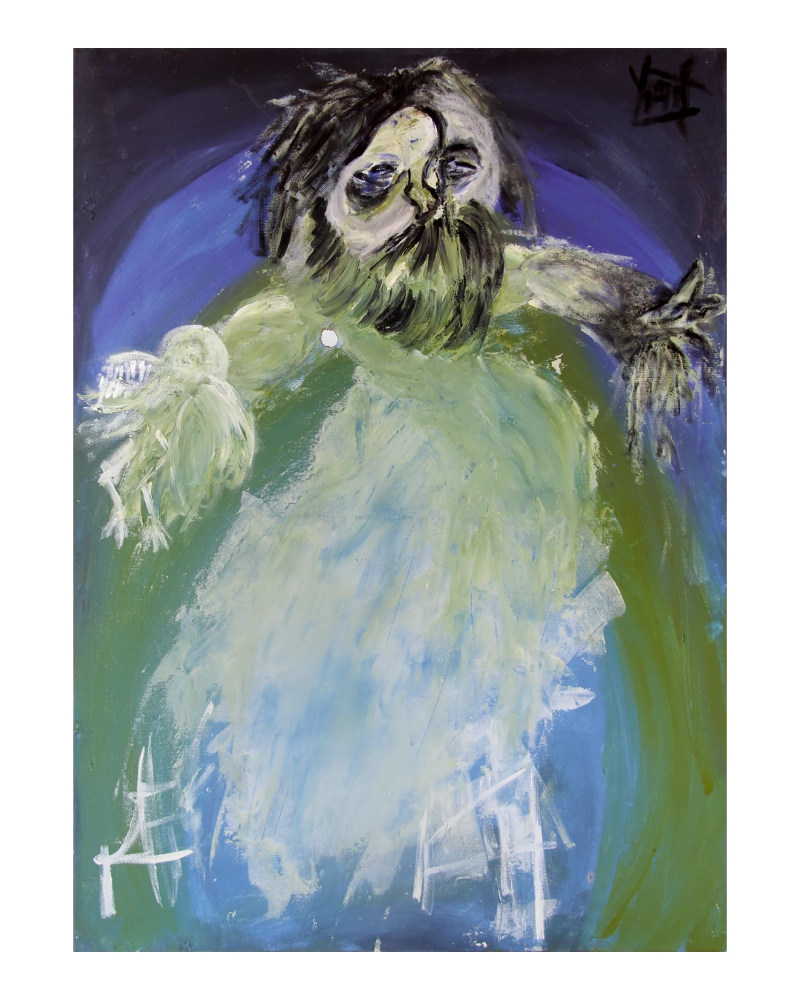

**Single · 19:00 Europe/Paris · Hedef G2**

**İçerik:** Tam eser, çift yüz/beden silinmeleri ve küçük figür ilişkisi.

**Neden bu gönderi?:** Açık sınırın eski bir işte farklı, daha silinen karşılığını gösterir.

**Neden bu sırada?:** P034 çizginin görünür devamından burada gövdenin çevreye karışmasına; P036 daha keskin yüz parçalarına dönülür.

**Yeni inceleme değeri:** İlk arşiv bütün sunumu; benzerlik kadar sınır farkı da görünür.

**Üretim:** Belirtilen özgün arşiv görsellerinden hazırlanacak; fotoğraf hareketli üretim kaydı diye sunulmayacak.

**Ölçüm:** Yorumlarda gösterilen biçimsel ilişkiye ilişkin somut gözlemleri kaydet; yalnız beğeniyle tanınma sonucu çıkarma.

**English caption:**

```text
A bearded face, another small figure, and a body that fades into its surroundings.

duality of the angelic summarization
2019 · Acrylic on canvas
90 × 65 cm (h × w).
```


## P036 · Gün 82 · Teeth in one face, a heavy mouth in another.

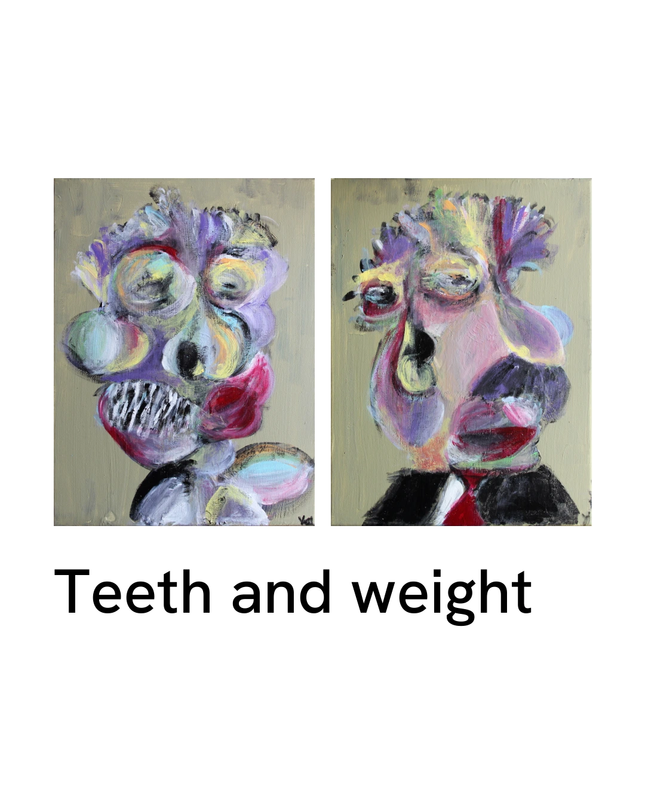

**Carousel · 19:00 Europe/Paris · Hedef G3**

**İçerik:** Orta ve sağ panel tam; küçük konum göstergesi; son bütün.

**Neden bu gönderi?:** Yüzdeki ağız parçalarının iki farklı ağırlık kurduğunu kanıtlayan doğrudan karşılaştırma.

**Neden bu sırada?:** Duality’de eriyen yüz kenarından Painstaking’de ağız parçalarının yoğunluğuna; P037 ağırlığı bütün bedenin taşınmasına büyütür.

**Yeni inceleme değeri:** P018 göz ekseni yerine diş alanı ve burun/ağız ağırlığı; ayrı inceleme iddiası.

**Üretim:** Belirtilen özgün arşiv görsellerinden hazırlanacak; fotoğraf hareketli üretim kaydı diye sunulmayacak.

**Ölçüm:** Kaydetme/erişim ve esere özgü farklı kişi sorularını kaydet; yorum yoksa ilgi yok hükmü verme.

**English caption:**

```text
The centre panel gathers its teeth into a tight field. The right panel gives more weight to the mouth and nose.

Painstaking
2026 · Acrylic on canvas
Triptych · 3 panels, each 40 × 30 cm (h × w).
```


## P037 · Gün 85 · Where does the weight go?

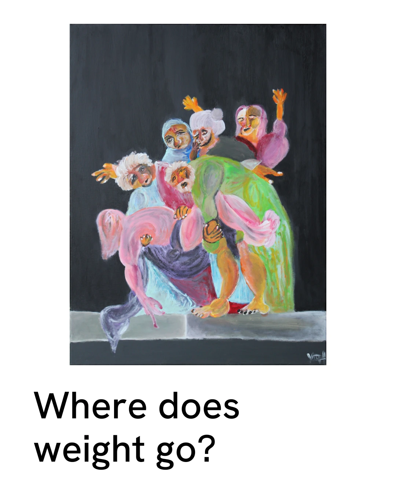

**Carousel · 19:00 Europe/Paris · Hedef G3**

**İçerik:** Bütün→taşınan beden/taşıyıcı→açılan eller; kendi görselinde yönleri hafif çizgiyle göster, yeni şekil ekleme.

**Neden bu gönderi?:** Taşıma sahnesinde bedenin ağırlığı ve bakışın yönü ayrılabilir görünür kanıtlar.

**Neden bu sırada?:** P036 yüz içindeki ağırlıktan figürler arası yük ilişkisine; P038 ters asılı bedenle bu yönü sınar.

**Yeni inceleme değeri:** P022 kaynak zinciri yerine kendi kompozisyonundaki yük/yön ilişkisi.

**Üretim:** Belirtilen özgün arşiv görsellerinden hazırlanacak; fotoğraf hareketli üretim kaydı diye sunulmayacak.

**Ölçüm:** Kaydetme/erişim ve esere özgü farklı kişi sorularını kaydet; yorum yoksa ilgi yok hükmü verme.

**English caption:**

```text
The carried body leans into the group, while the raised hands pull the eye upwards.

Gxd is AFK, We banned it
2026 · Acrylic on canvas
80 × 60 cm (h × w).
```


## P038 · Gün 87 · guarding holy mountains from malice · 2019

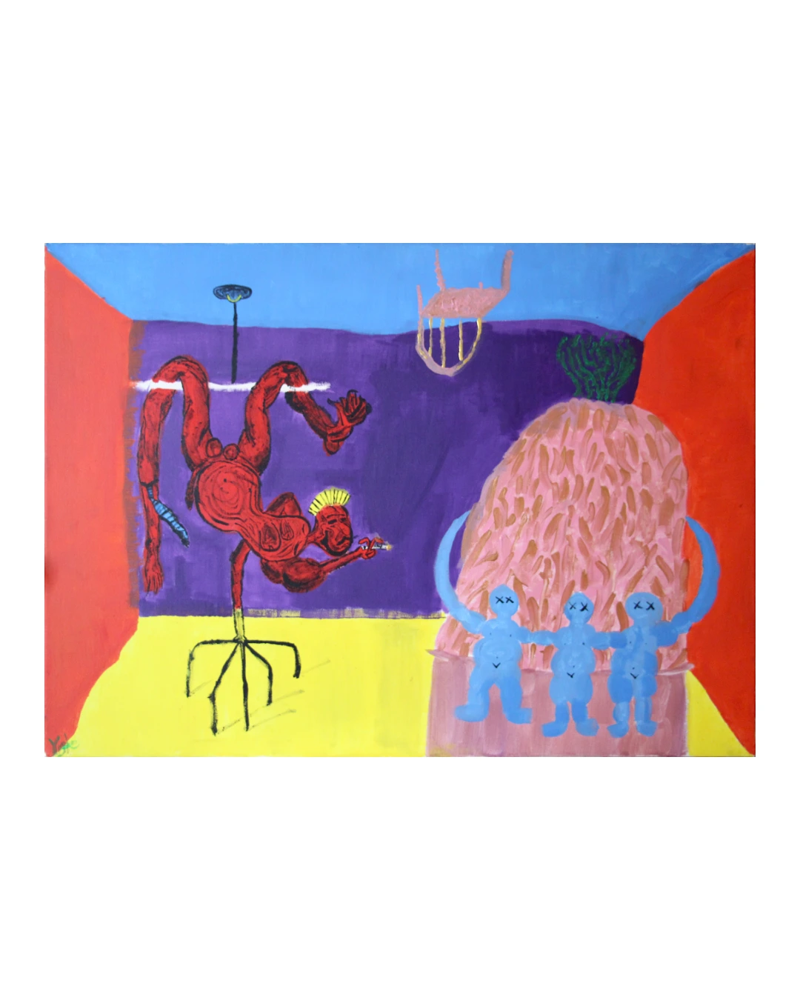

**Single · 19:00 Europe/Paris · Hedef G2**

**İçerik:** Tam yatay sahne; ters kırmızı figürle aşağıdaki grup birlikte.

**Neden bu gönderi?:** Yük ve yön sorusunun eski sahnede asılmasının farklı bir karşılığını verir.

**Neden bu sırada?:** Gxd’de taşınandan burada ters asılana; P039 küçük figürün büyük figürle merkez kurmasına geçer.

**Yeni inceleme değeri:** Yeni arşiv sahnesi; iş başlığından siyasi/kişisel niyet çıkarılmaz.

**Üretim:** Belirtilen özgün arşiv görsellerinden hazırlanacak; fotoğraf hareketli üretim kaydı diye sunulmayacak.

**Ölçüm:** Yorumlarda gösterilen biçimsel ilişkiye ilişkin somut gözlemleri kaydet; yalnız beğeniyle tanınma sonucu çıkarma.

**English caption:**

```text
An inverted red figure hangs above a group of blue figures and a broad pink mass.

guarding holy mountains from malice
2019 · Acrylic on canvas
65 × 90 cm (h × w).
```


## P039 · Gün 89 · A smaller body changes the centre.

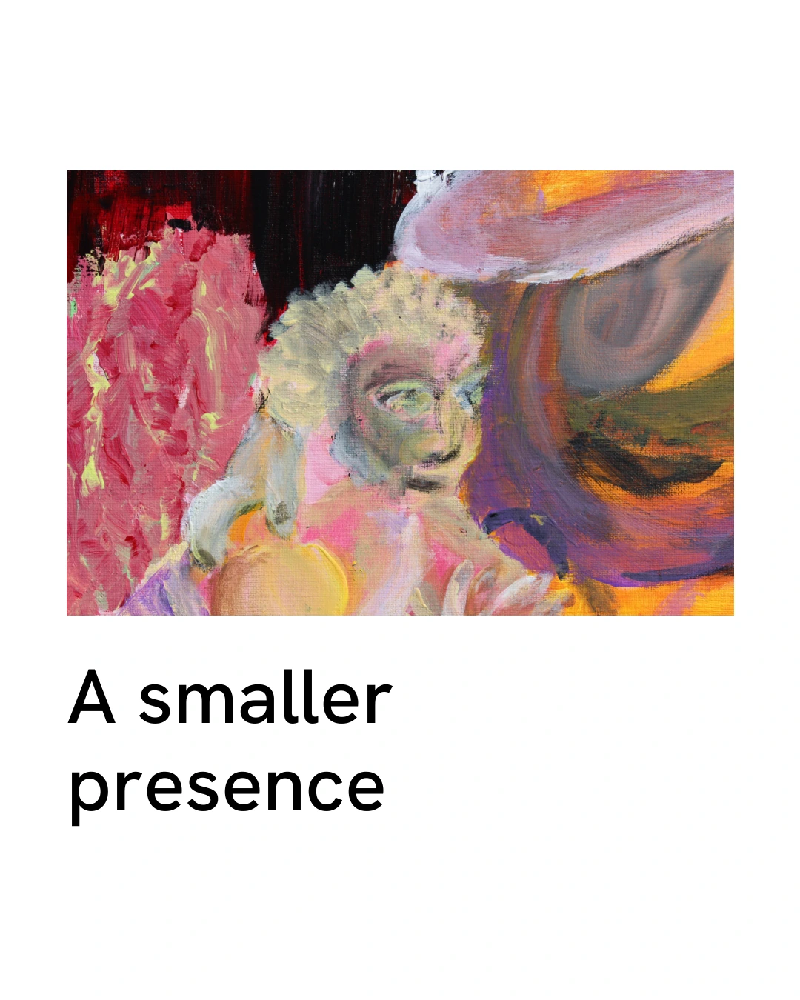

**Carousel · 19:00 Europe/Paris · Hedef G3**

**İçerik:** Bütün ve küçük figür detayları; çevredeki figürlerin ana gövdeye göre yerlerini açıkça koru. Yaş veya kimlik tahmin etme.

**Neden bu gönderi?:** İlk mekân okumasını grup ilişkisine genişletir; aynı kutunun içinde farklı inceleme görevi.

**Neden bu sırada?:** P038 grubun yukarı/aşağı düzeninden merkezi büyük ve küçük bedenlerin ilişkisine; P040 tek büyük yaratığın farklı ölçü düzeni.

**Yeni inceleme değeri:** P025 sandalye/köşeden küçük figürün grup içindeki yerine geçiş. Fotoğraflar carousel; kaynakta bulunmayan ham video yok.

**Üretim:** Belirtilen özgün arşiv görsellerinden hazırlanacak; fotoğraf hareketli üretim kaydı diye sunulmayacak.

**Ölçüm:** Kaydetme/erişim ve esere özgü farklı kişi sorularını kaydet; yorum yoksa ilgi yok hükmü verme.

**English caption:**

```text
The smaller figures change how the central body meets the room around it.

Virgil on Virtual Cage (final_final-finalV9)
2026 · Acrylic on canvas
100 × 80 cm (h × w).
```


## P040 · Gün 92 · wings of abyss · 2019

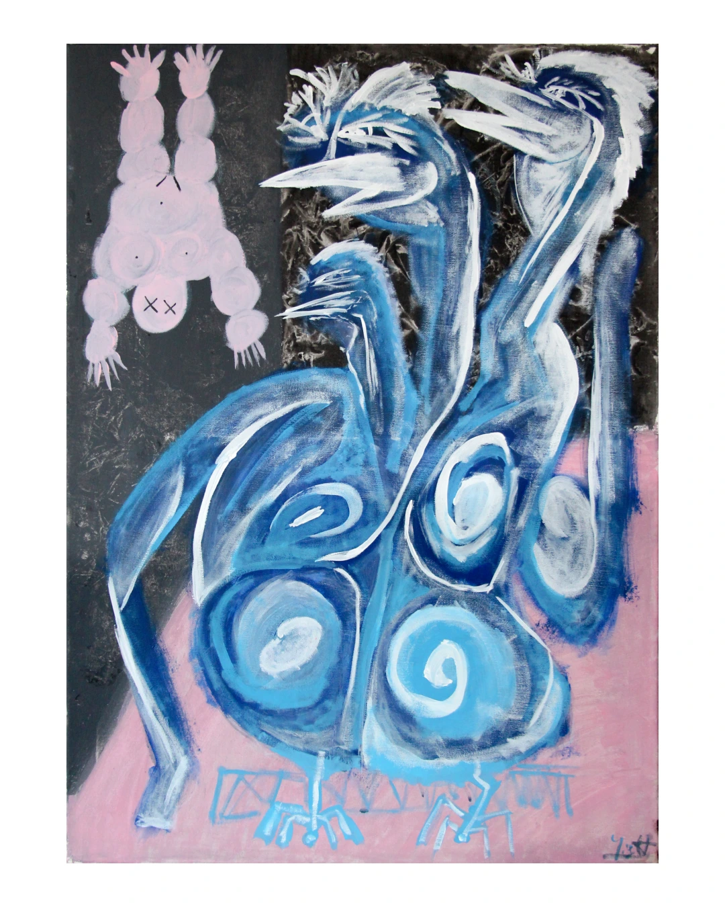

**Single · 19:00 Europe/Paris · Hedef G3**

**İçerik:** Tamamlanmış bütün ilk kez; P012 eskizini tekrar slayta dönüştürmeden resim kendi başına.

**Neden bu gönderi?:** Eskizdeki biçimlerin tamamlanmış resimde renk ve yön kazanmasını görme fırsatı.

**Neden bu sırada?:** Virgil’de küçük/büyük beden karşıtlığından burada terslik ve spiral gövdeye; P041 sahnede yönlerin çoğalmasına.

**Yeni inceleme değeri:** P012 yalnız eskizdi; bu yayın bitmiş eserin yeni renk/yön kanıtını sunar.

**Üretim:** Belirtilen özgün arşiv görsellerinden hazırlanacak; fotoğraf hareketli üretim kaydı diye sunulmayacak.

**Ölçüm:** Kaydetme/erişim ve esere özgü farklı kişi sorularını kaydet; yorum yoksa ilgi yok hükmü verme.

**English caption:**

```text
A pointed white head and a spiralling body sit below an inverted pink figure.

wings of abyss
2019 · Acrylic on canvas
90 × 65 cm (h × w).
```


## P041 · Gün 94 · A vertical figure between two horizontal worlds.

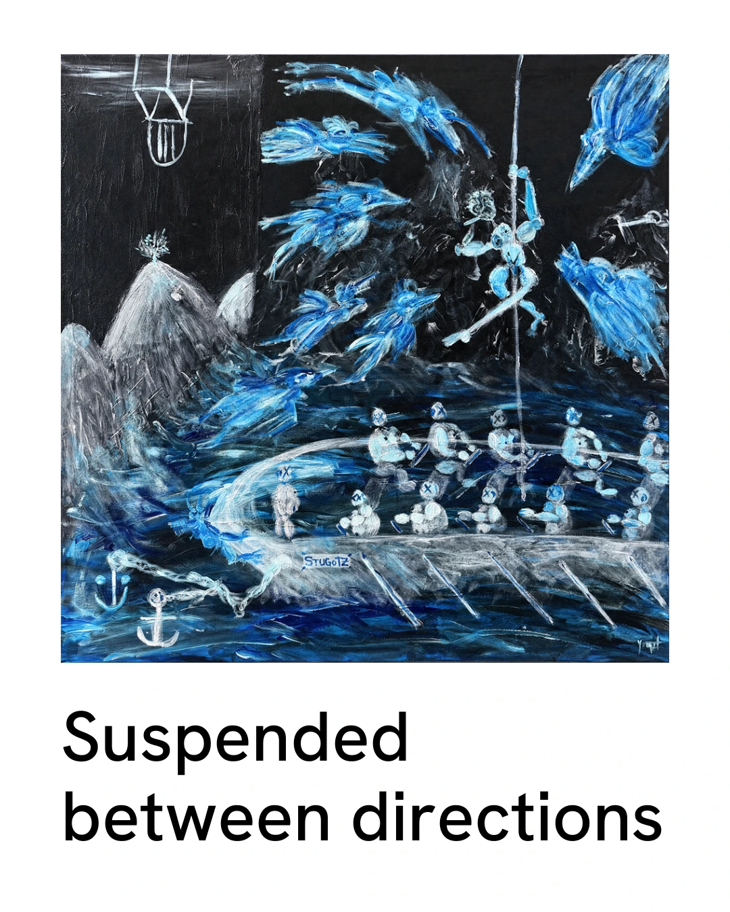

**Carousel · 19:00 Europe/Paris · Hedef G3**

**İçerik:** Bütün ve merkezdeki ince direk/asılı figürü kapsayan crop; üst/alt gruplar konum haritasında görünür.

**Neden bu gönderi?:** İlk üst/alt karşıtlığını bu iki alanı bağlayan üçüncü eksenle genişletir.

**Neden bu sırada?:** Wings’te ters asılı bedenin ardından asılı figürün sahne bağlama görevine; P042 mimari bakış yönünü açar.

**Yeni inceleme değeri:** P010 üst/alt/P027 süreçten farklı olarak dikey bağlantı ve asılı figür.

**Üretim:** Belirtilen özgün arşiv görsellerinden hazırlanacak; fotoğraf hareketli üretim kaydı diye sunulmayacak.

**Ölçüm:** Kaydetme/erişim ve esere özgü farklı kişi sorularını kaydet; yorum yoksa ilgi yok hükmü verme.

**English caption:**

```text
The hanging figure cuts through the distance between the upper forms and the boat below.

articulo attack on mandarin
2026 · Acrylic on canvas
80 × 80 cm (h × w).
```


## P042 · Gün 96 · Why show the house from above?

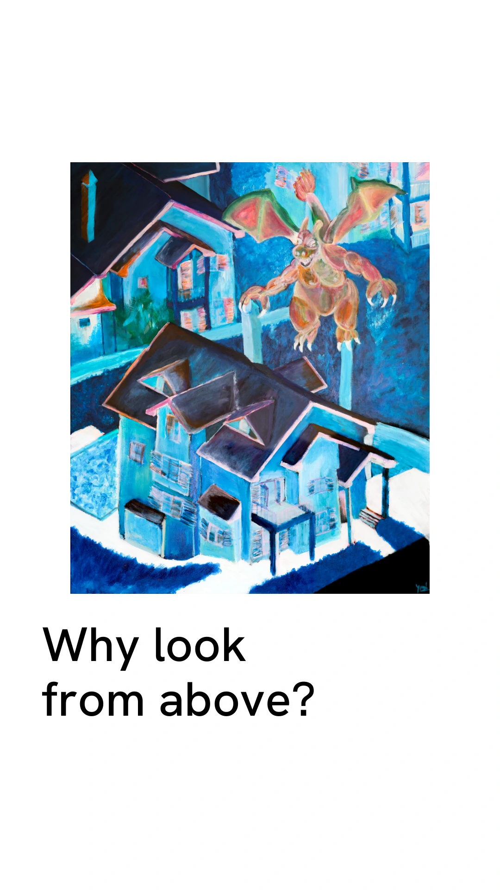

**Reel · 19:00 Europe/Paris · Hedef G1**

**İçerik:** Sanatçının izometrik bakış anlatımı ve kendi bütününde çatı/cephelerin aynı anda okunması.

**Neden bu gönderi?:** Mekânı figür kadar etkin yapan somut bakış seçimini görünür kılar.

**Neden bu sırada?:** Mandarin’de dikey sahne ekseninden Angora’da yukarıdan bakışa; P043 çizgiden renk alanına başka yapıyı kurar.

**Yeni inceleme değeri:** P001 çocukluk bilgisi ve P021 süreçten ayrı perspektif sorusu.

**Üretim:** A1632 224–252 ve364–420sn izometrik kompozisyon anlatısı; yeni İngilizce ses. 3B referansları gerçek resim yapma anı olarak gösterme.

**Ölçüm:** Takipçi dışı erişim ile varsa gönderiye atfedilen takibi aynı ölçüm yaşında birlikte kaydet.

**English caption:**

```text
The elevated view exposes roofs, walls and passages at once. The house takes an active part in the scene.

Angora Mergvs
2026 · Acrylic on canvas
120 × 100 cm (h × w).
```


## P043 · Gün 99 · The face, the table, the space between.

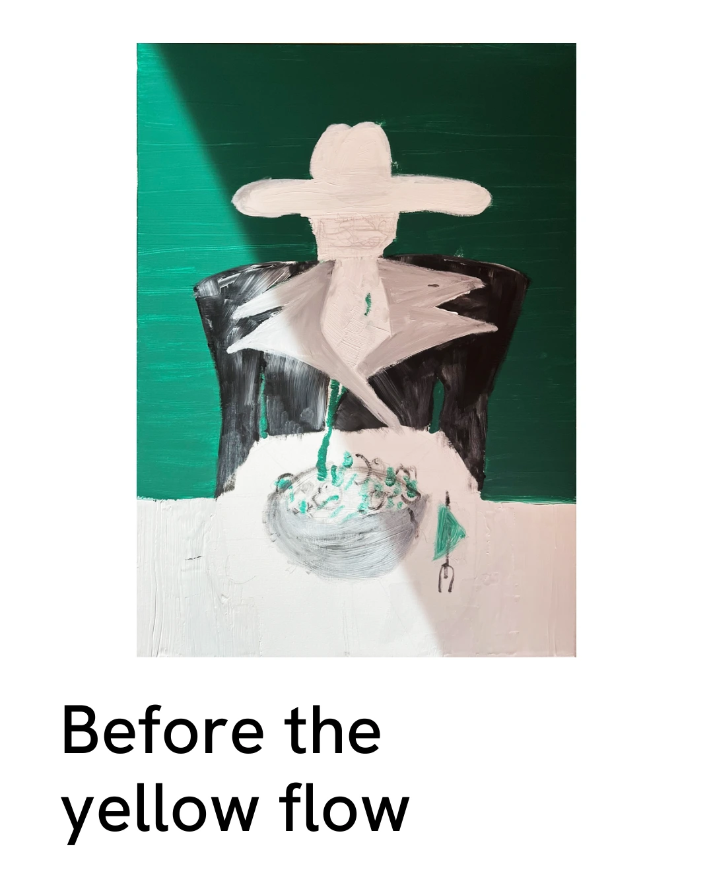

**Carousel · 19:00 Europe/Paris · Hedef G3**

**İçerik:** Gerçek üç aşama; aradaki sarı akışın boyalı kompozisyonda yerleşmesini aşamalarla incelet.

**Neden bu gönderi?:** Tek motifin çizim ve boya arasında nasıl yer tuttuğunu gerçek kayıtla destekler.

**Neden bu sırada?:** P042 bakış açısının kurduğu mekândan burada iki form arasındaki boyalı bağlantıya; P044 parçalı yüzün arşiv karşılığı.

**Yeni inceleme değeri:** P015 bitmiş sarı bağın yerine gerçek aşamalar; efekt varyantı kullanılmaz.

**Üretim:** İlk sayfa/kapak A0262 gerçek ara aşaması: yeşil çevre ve açık figür, sarı akış henüz yok. Sonraki sayfalarda A0260 gerçek çizimi ve A0264 ileri boya aşaması gösterilir; her kaynak aşama olarak açıkça etiketlenir. A0260 soluk çizimi kapak yerine içeride büyük görüntüyle sunulur.

**Ölçüm:** Kaydetme/erişim ve esere özgü farklı kişi sorularını kaydet; yorum yoksa ilgi yok hükmü verme.

**English caption:**

```text
Recorded stages of walls of perception: a figure and a table become connected by paint.

walls of perception
2026 · Acrylic on canvas
70 × 50 cm (h × w).
```


## P044 · Gün 101 · il sbagliato di rompipalle · 2019

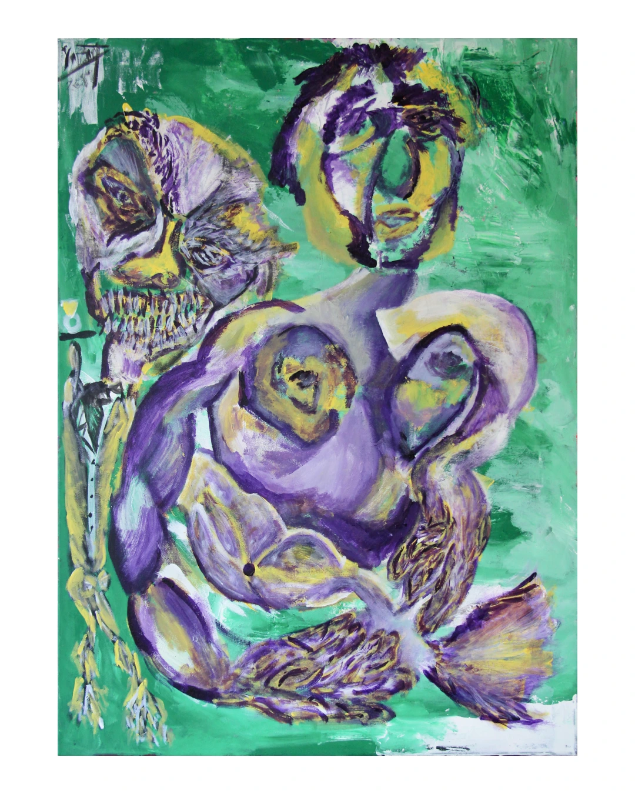

**Single · 19:00 Europe/Paris · Hedef G2**

**İçerik:** Bütün eser; yüzün parçaları ile yeşil alanın farkını koru.

**Neden bu gönderi?:** Güncel yüz seçkisinin daha eski, farklı renk ve diş çözümünü getirir.

**Neden bu sırada?:** Wall’un yüz-nesne akışından Rompi’nin yüz içinde kırılan düzenine; P045 stüdyoda sahneyi bir arada tutma çalışması.

**Yeni inceleme değeri:** İlk arşiv sunumu; Painstaking’in kaynağı olduğu iddia edilmez.

**Üretim:** Belirtilen özgün arşiv görsellerinden hazırlanacak; fotoğraf hareketli üretim kaydı diye sunulmayacak.

**Ölçüm:** Yorumlarda gösterilen biçimsel ilişkiye ilişkin somut gözlemleri kaydet; yalnız beğeniyle tanınma sonucu çıkarma.

**English caption:**

```text
A fragmented face and a toothed form emerge from purple and yellow against green.

il sbagliato di rompipalle
2019 · Acrylic on canvas
90 × 65 cm (h × w).
```


## P045 · Gün 103 · Painting with the paper beside the canvas.

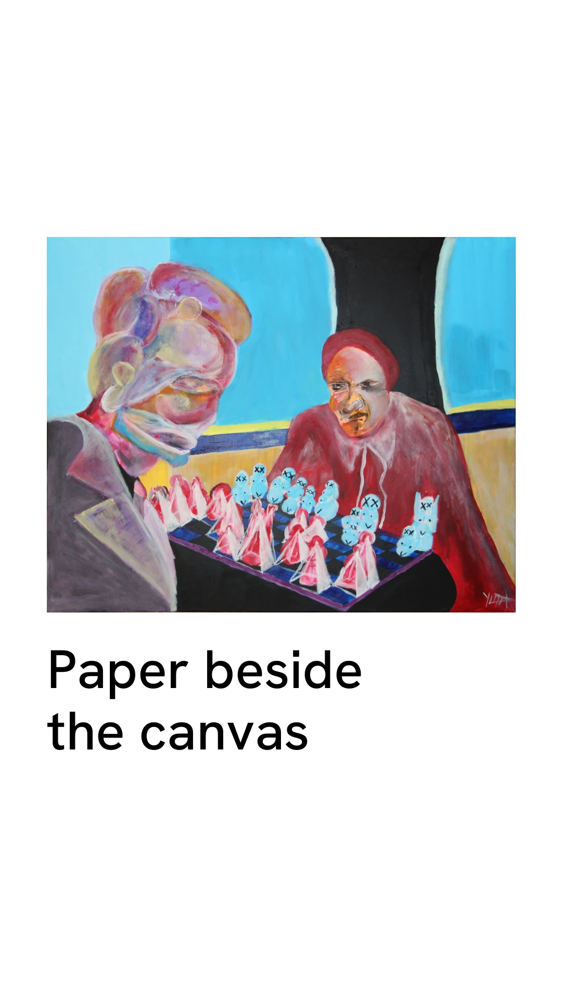

**Reel · 19:00 Europe/Paris · Hedef G1**

**İçerik:** Gerçek kayıtta kâğıt referans ile tuvale bakma/çalışma hareketi; basılı kaynağın ne olduğunu teyitsiz adlandırma.

**Neden bu gönderi?:** Üretimin yalnız fırçanın tuvale dokunması değil bakma ve karar verme olduğunu görünür eylemle gösterir.

**Neden bu sırada?:** P044 bitmiş kırılmadan sahneyi bir arada tutmaya çalışan stüdyo hareketine; P046 eski kağıt eseri sunar.

**Yeni inceleme değeri:** P007 sohbet/P028 kırmızı boya yerine bakışın kâğıt ve tuval arasında dolaşması.

**Üretim:** A0631 ilk49dk içinden kâğıtla görünen çalışma; son49–57dk boş atölye elenir. Türkçe ortam medyası kullanılmaz.

**Ölçüm:** Takipçi dışı erişim ile varsa gönderiye atfedilen takibi aynı ölçüm yaşında birlikte kaydet.

**English caption:**

```text
A recorded studio session shows painting and paper references sharing the same working space.

7 fam board game
2026 · Acrylic on canvas
80 × 100 cm (h × w).
```


## P046 · Gün 106 · good people helping bad ones · 2019

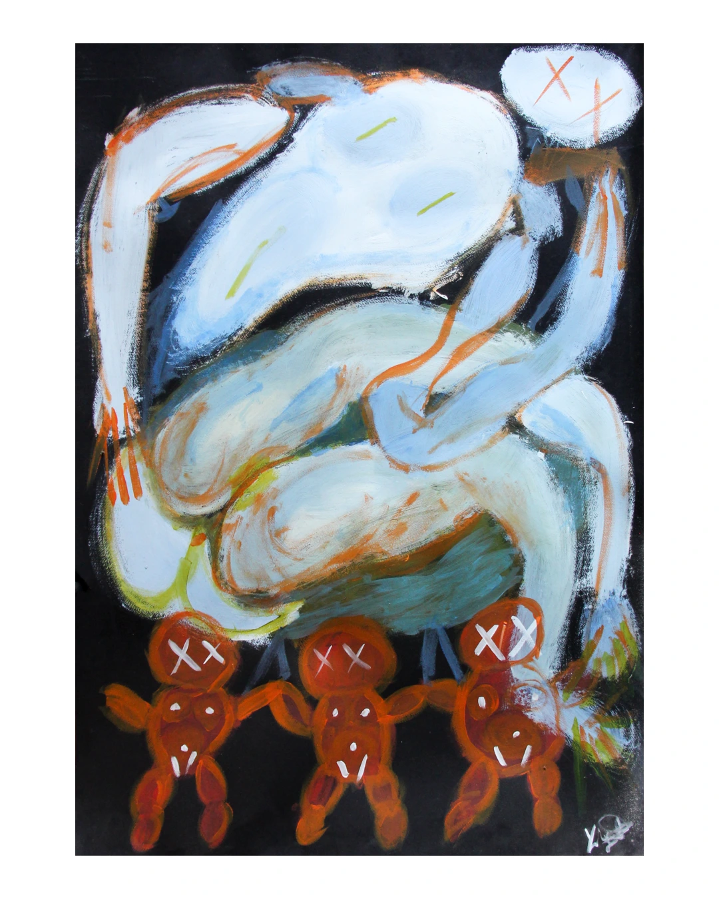

**Single · 19:00 Europe/Paris · Hedef G3**

**İçerik:** Bütün eser, siyah kâğıt mediumu açıkça belirtilir.

**Neden bu gönderi?:** P024 çizim ailesinin tamamlanmış renk ve boyut karşılığını gösterir; kâğıt eserin maddi bilgisi de yeni.

**Neden bu sırada?:** Board’da kâğıt referansla üretimden burada kâğıdın bitmiş eserin zemini oluşuna; P047 diğer çizim/boya bağı.

**Yeni inceleme değeri:** Önceki tarihsiz eskizden ayrı, 2019 bitmiş akrilik/kâğıt eser.

**Üretim:** Belirtilen özgün arşiv görsellerinden hazırlanacak; fotoğraf hareketli üretim kaydı diye sunulmayacak.

**Ölçüm:** Kaydetme/erişim ve esere özgü farklı kişi sorularını kaydet; yorum yoksa ilgi yok hükmü verme.

**English caption:**

```text
Large pale forms meet smaller orange figures on black paper.

good people helping bad ones (that’s why they’re bad too)
2019 · Acrylic on black paper
100 × 70 cm (h × w).
```


## P047 · Gün 108 · The group before the dark field.

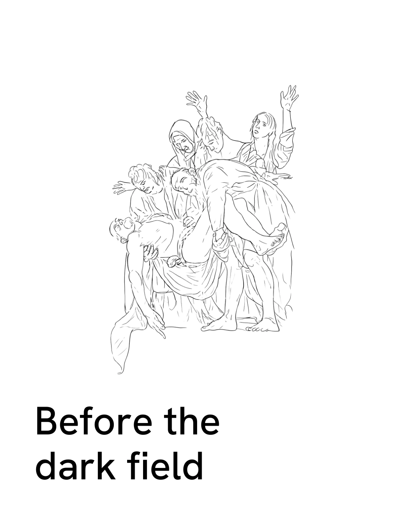

**Carousel · 19:00 Europe/Paris · Hedef G3**

**İçerik:** Temiz taslak, boyalı ara aşama, son bütün; karanlık fonun grup çevresindeki payına bak.

**Neden bu gönderi?:** Kaynak hikâyesinin ötesinde kendi çiziminden kendi resmine somut bir karar yolu.

**Neden bu sırada?:** P046 siyah kâğıdın açık biçimleri taşımasından Gxd’de boyanan koyu alanın grubu taşımasına; P048 küçük el hareketinin sahne kurması.

**Yeni inceleme değeri:** P022 kaynak/P037 ağırlık yerine çizimden boyalı zemin ilişkisine geçiş.

**Üretim:** Belirtilen özgün arşiv görsellerinden hazırlanacak; fotoğraf hareketli üretim kaydı diye sunulmayacak.

**Ölçüm:** Kaydetme/erişim ve esere özgü farklı kişi sorularını kaydet; yorum yoksa ilgi yok hükmü verme.

**English caption:**

```text
A drawing, a recorded painted stage, and the completed group show different states of the same composition.

Gxd is AFK, We banned it
2026 · Acrylic on canvas
80 × 60 cm (h × w).
```


## P048 · Gün 110 · Rounded masses, visible brush marks.

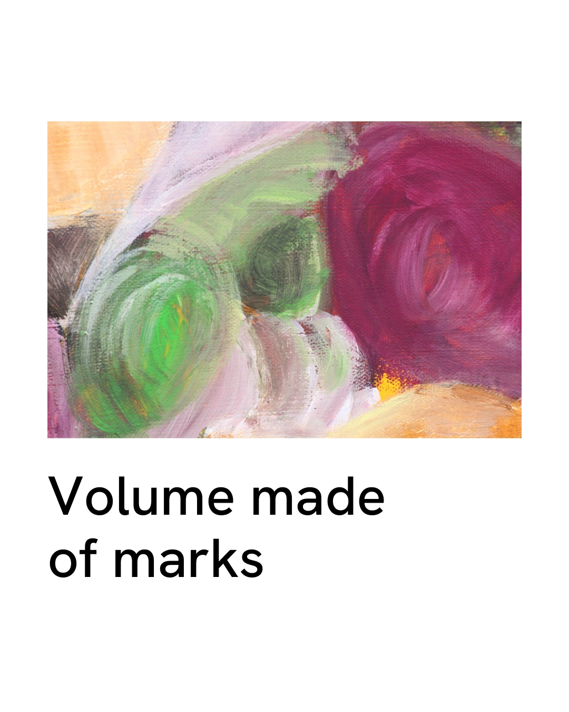

**Carousel · 19:00 Europe/Paris · Hedef G3**

**İçerik:** A0291 gövdedeki yuvarlak izler, A0294 omuzdaki geniş vuruşlar, sonra bütün. Aynı renk kütlesinin yakından yüzey olarak okunması.

**Neden bu gönderi?:** Görüntüde doğrulanabilir vuruş–hacim farkı, resmin dijital karakter çizimi değil boyalı yüzey olarak incelenmesini sağlar.

**Neden bu sırada?:** Gxd çizim/zemin karşılaştırmasından Gary’nin doğrudan boyalı yüzeyine; P049 farklı eski bedende uzun renk alanına geçer.

**Yeni inceleme değeri:** P020 nesneler/P033 aşamalarından ayrı, büyük hacim ile tekil fırça izleri arasındaki gözlenebilir fark.

**Üretim:** A0291/A0294 hazır detaylar doğrudan incelendi; boya yüksekliği/kalınlığı fotoğraftan ölçülmüş gibi söylenmez.

**Ölçüm:** Kaydetme/erişim ve esere özgü farklı kişi sorularını kaydet; yorum yoksa ilgi yok hükmü verme.

**English caption:**

```text
The body looks rounded from a distance. Up close, the green and purple masses remain separate brush marks.

gary grills cooper
2026 · Acrylic on canvas
75 × 55 cm (h × w).
```


## P049 · Gün 113 · viperella · 2020

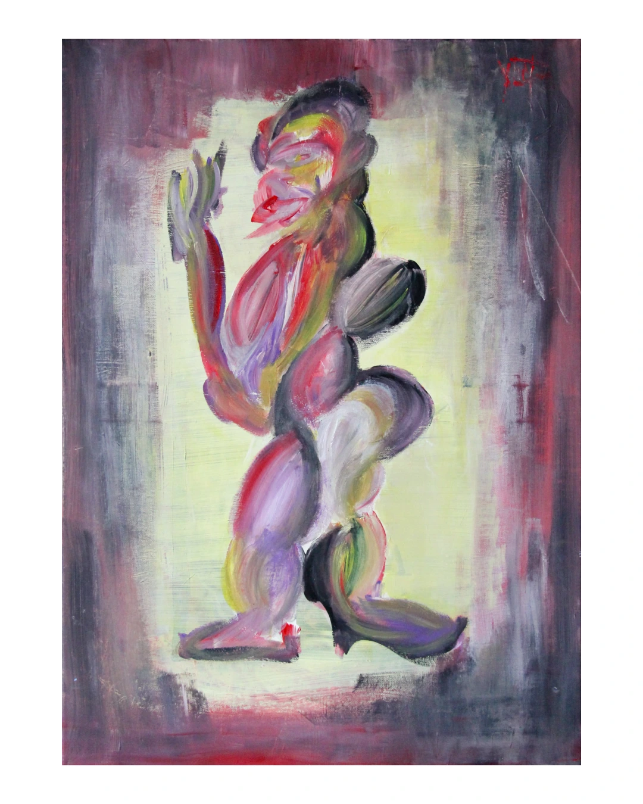

**Single · 19:00 Europe/Paris · Hedef G2**

**İçerik:** Tam eser; el, uzun beden ve kırmızı dudak aynı kompozisyonda.

**Neden bu gönderi?:** Elin küçük gündelik hareket yerine bütün bedenin yönünü belirlediği eski karşılık.

**Neden bu sırada?:** Gary’de yuvarlak fırça vuruşlarının ardından daha uzun ve dikey Viperella gövdesi; P050 figürlerin odadaki farklı desteklerine geçer.

**Yeni inceleme değeri:** Yeni eski eser; medya dosyasını sırf video adı var diye Reel saymıyor.

**Üretim:** Belirtilen özgün arşiv görsellerinden hazırlanacak; fotoğraf hareketli üretim kaydı diye sunulmayacak.

**Ölçüm:** Yorumlarda gösterilen biçimsel ilişkiye ilişkin somut gözlemleri kaydet; yalnız beğeniyle tanınma sonucu çıkarma.

**English caption:**

```text
A long purple-pink figure raises one hand against a pale field.

viperella
2020 · Acrylic on canvas
70 × 50 cm (h × w).
```


## P050 · Gün 115 · Two seats, two bodies.

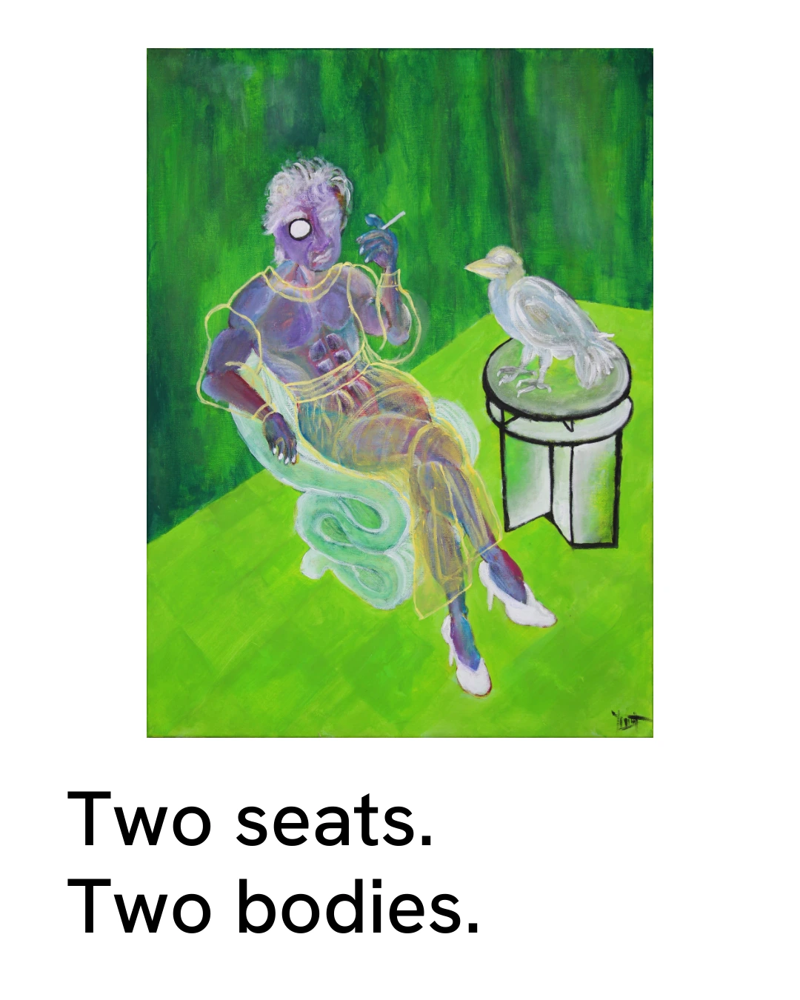

**Carousel · 19:00 Europe/Paris · Hedef G3**

**İçerik:** Bütün; insanın kıvrımlı koltuğu ve kuşun çizgisel taburesi ayrı crop, yapı farkı açıklanır.

**Neden bu gönderi?:** Aynı odada iki oturma düzeneğinin bedenleri nasıl farklı taşıdığını göstermeye elverişli.

**Neden bu sırada?:** P049 yükselen elin ardından burada yerleşen bedenlerin desteğine; P051 kutu çizgisinin başka destek/sınır görevine.

**Yeni inceleme değeri:** Önceki renk/boş siluet/kontur videolarından ayrı olarak iki mobilya ve iki beden ilişkisi.

**Üretim:** Belirtilen özgün arşiv görsellerinden hazırlanacak; fotoğraf hareketli üretim kaydı diye sunulmayacak.

**Ölçüm:** Kaydetme/erişim ve esere özgü farklı kişi sorularını kaydet; yorum yoksa ilgi yok hükmü verme.

**English caption:**

```text
The chair and the bird’s perch create two places to sit inside the green room.

sept neuf
2026 · Acrylic on canvas
75 × 55 cm (h × w).
```


## P051 · Gün 117 · An open frame and a solid block.

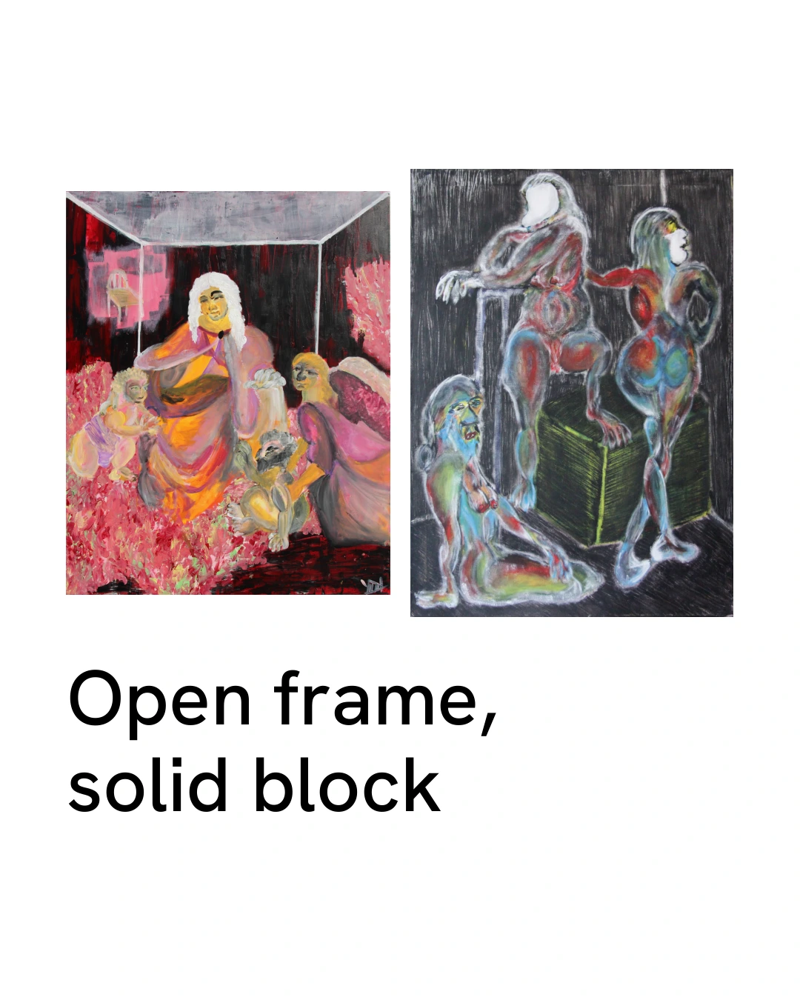

**Carousel · 19:00 Europe/Paris · Hedef G3**

**İçerik:** İki bütün ayrı sayfalar; Virgil beyaz açık çerçeve ve Capricorn dolu yeşil geometrik nesne yan yana karşılaştırma.

**Neden bu gönderi?:** Araştırmadaki Y10–Y08 eşleştirmesine somut bir fark ekler: çevreleyen çizgi ile içeride duran renkli kütle.

**Neden bu sırada?:** Sept’in iki mobilyasından başka iki resimdeki geometrinin farklı görevlerine; P052 merkez mekanik nesnenin eski karşılığıyla genişler.

**Yeni inceleme değeri:** P008/009 eserleri ayrı tanıtmıştı; bu kez açık çerçeve–dolu nesne karşıtlığı aynı karşılaştırmada görünür.

**Üretim:** İki mevcut bütün; araştırmadaki biçimsel ilişki, sanatçının geçmişten etkilenme beyanı sayılmaz.

**Ölçüm:** Kaydetme/erişim ve esere özgü farklı kişi sorularını kaydet; yorum yoksa ilgi yok hükmü verme.

**English caption:**

```text
White lines frame the bodies in Virgil on Virtual Cage. A solid green form sits among the bodies in caprocorn sister. Geometry has a different job in each painting.

Virgil on Virtual Cage (final_final-finalV9)
2026 · Acrylic on canvas
100 × 80 cm (h × w).

caprocorn sister: war, plague, earthquake
2020 · Acrylic on canvas
90 × 65 cm (h × w).
```


## P052 · Gün 120 · A machine between two bodies.


**Single · 19:00 Europe/Paris · Hedef G2**

**İçerik:** Tam yatay eser; soldaki pembe ve sağdaki sarı beden, merkez mekanik form ve resmin kendi yazıları birlikte.

**Neden bu gönderi?:** Sahneyi yalnız beden ve nesneyle değil yazıyla da kuran farklı arşiv karşılığını gösterir.

**Neden bu sırada?:** Virgil’de figürleri çevreleyen çizgiden burada iki beden arasına giren mekanik nesne ve yazıya; P053 yeniden mimari geçitlere döner.

**Yeni inceleme değeri:** Daha önce sunulmamış eski bütün; ilk Capricorn kaydının yavaş sürümüyle sayı doldurulmaz.

**Üretim:** A2213 bütün. Resimdeki yazıları caption içinde sanatçının güncel beyanı gibi yeniden yazma.

**Ölçüm:** İzleyicinin yazı, merkez nesne ve beden ilişkisine ilişkin somut sorularını ayrı kaydet.

**English caption:**

```text
Two bodies face a black mechanical form, with painted words sharing the blue field. Century of 0 & 1 / Transhumanism, 2019.

Century of 0 & 1 / Transhumanism
2019 · Acrylic on canvas
65 × 90 cm (h × w).
```


## P053 · Gün 122 · Ways into the house.


**Carousel · 19:00 Europe/Paris · Hedef G3**

**İçerik:** Alt ev, merdiven/geçit ve çatı detayları; fotoğraftaki tuval dışı ahşabı kırp, mimari içeriği koru.

**Neden bu gönderi?:** Evin anı olarak değil resimde gezinilen bir yapı olarak somut incelemesi.

**Neden bu sırada?:** P052’de iki beden arasındaki mekanik nesne ve yazıdan burada ev içinde geçiş sağlayan boşluklara; P054 iki beden arasındaki boşluğa taşınır.

**Yeni inceleme değeri:** P001 biyografi/P042 bakış açısı yerine kapı, merdiven ve geçit düzeni.

**Üretim:** Belirtilen özgün arşiv görsellerinden hazırlanacak; fotoğraf hareketli üretim kaydı diye sunulmayacak.

**Ölçüm:** Kaydetme/erişim ve esere özgü farklı kişi sorularını kaydet; yorum yoksa ilgi yok hükmü verme.

**English caption:**

```text
Doors, steps and roof edges divide the house into routes for the eye.

Angora Mergvs
2026 · Acrylic on canvas
120 × 100 cm (h × w).
```


## P054 · Gün 124 · ciao capo, sono squalo · 2020


**Single · 19:00 Europe/Paris · Hedef G3**

**İçerik:** Bitmiş bütün; P006 çiziminden ayrı tarihli tam eser sunumu.

**Neden bu gönderi?:** Daha önceki konturlu aşamanın boya ve renk sonrasındaki ayrı okunma fırsatı.

**Neden bu sırada?:** Angora’daki geçit boşluğundan iki bedenin arasındaki ayrılmaya; P055 başka dönemde aşamaların tüm kompozisyonu değiştirmesine.

**Yeni inceleme değeri:** P006 çizim kırmızı/pale; bu yayın 2020 son mavi/beyaz gövdeleri getirir.

**Üretim:** Belirtilen özgün arşiv görsellerinden hazırlanacak; fotoğraf hareketli üretim kaydı diye sunulmayacak.

**Ölçüm:** Kaydetme/erişim ve esere özgü farklı kişi sorularını kaydet; yorum yoksa ilgi yok hükmü verme.

**English caption:**

```text
Two elongated blue and white bodies hold their outlines against red and black.

ciao capo, sono squalo
2020 · Acrylic on canvas
90 × 65 cm (h × w).
```


## P055 · Gün 127 · Three recorded stages of a square painting.


**Carousel · 19:00 Europe/Paris · Hedef G3**

**İçerik:** A2740 erken durum; A2741 sarı gövdeli ara durum; A2743 son sunum. A2742/43 ton farkı ayrı fiziksel aşama olarak sayılmaz.

**Neden bu gönderi?:** Kare kompozisyonun çizgi/akış ilişkisini zaman içindeki kayıtlarla açar.

**Neden bu sırada?:** Ciao’nun nihai sonucundan burada boyalı durumların farkına; P056 farklı fiziksel bölünme olarak triptiğe.

**Yeni inceleme değeri:** P017 yalnız gerçek ölçekti; şimdi farklı durumlar arasındaki yüzey düzeni.

**Üretim:** Üç görsel gerçek farklı durumları gösterir. A2742 veA2743 arasında ton/kontrast farkı bulunması dördüncü boyama olayı kanıtı değildir.

**Ölçüm:** Kaydetme/erişim ve esere özgü farklı kişi sorularını kaydet; yorum yoksa ilgi yok hükmü verme.

**English caption:**

```text
Three recorded stages of penguin is not a friend, only a sinner. Painted in 2023.

penguin is not a friend, only a sinner
2023 · Acrylic on canvas
120 × 120 cm (h × w).
```


## P056 · Gün 129 · One triptych, three separate canvases.


**Carousel · 19:00 Europe/Paris · Hedef G4**

**İçerik:** Doğru bütün yanında her panelin ayrı tam hali ve 40×30 künye; toplam genişliğe aralık ölçüsü uydurma.

**Neden bu gönderi?:** Ekran görüntüsünün tek yatay resim sanılmasını önler; fiziksel eseri incelemeye yarayan doğru bilgi.

**Neden bu sırada?:** Penguin’in tek kare yüzeyinden üç ayrı dikey tuvale; P057 tuval içindeki başka bir fiziksel bağlantıya döner.

**Yeni inceleme değeri:** P005 biçim karşılaştırması/P018 göz/P036 ağızdan ayrı nesne ve ölçü bilgisi; aynı panellerin tekrar gerekçesi açık.

**Üretim:** Belirtilen özgün arşiv görsellerinden hazırlanacak; fotoğraf hareketli üretim kaydı diye sunulmayacak.

**Ölçüm:** Gönderiden izlenebiliyorsa seçki/portföy ziyareti ve gerçek eser bilgisi talebini ayrı kaydet.

**English caption:**

```text
Painstaking is a triptych of three canvases, each 40 × 30 cm. The gaps belong to the arrangement; they are not painted stripes.

Painstaking
2026 · Acrylic on canvas
Triptych · 3 panels, each 40 × 30 cm (h × w).
```


## P057 · Gün 131 · A small purple flower beside the face.


**Carousel · 19:00 Europe/Paris · Hedef G3**

**İçerik:** Bütün veA0226 çiçek detayı; büyük sarı akışın dışındaki küçük mor/yeşil alanın farklı görsel yoğunluğu.

**Neden bu gönderi?:** Baskın motifi tekrar anlatmadan resimde daha sakin bir karşı alanı inceletir; detay görüntüde gerçekten var.

**Neden bu sırada?:** P056 fiziksel panel sınırından burada tek resimdeki ayrı dikkat alanına; P058 temiz kadrajın dışındaki fiziksel tuvale çıkar.

**Yeni inceleme değeri:** P015/P043 sarı akış ve aşamaları yerine daha önce incelenmemiş mor çiçek–yeşil zemin ilişkisi.

**Üretim:** A0226 doğrudan kontrol edildi: yeşil zemin önünde mor çiçek; ağız akışının detayı diye etiketlenmez.

**Ölçüm:** Kaydetme/erişim ve esere özgü farklı kişi sorularını kaydet; yorum yoksa ilgi yok hükmü verme.

**English caption:**

```text
Beside the face, a small purple flower stands against the green field. It sits away from the stronger movement of yellow paint.

walls of perception
2026 · Acrylic on canvas
70 × 50 cm (h × w).
```


## P058 · Gün 134 · The painting beyond the cropped image.


**Carousel · 19:00 Europe/Paris · Hedef G4**

**İçerik:** Gerçek stüdyo fotoğrafı A0194 ve temiz bütün A0192; kare tuvalin kenarı/çevresi görünen gerçek nesne sunumu.

**Neden bu gönderi?:** Dijital kadrajdan fiziksel esere geçişi somut, doğru ölçüyle incelemeye açar.

**Neden bu sırada?:** P056’da triptiğin ayrı yüzeylerini tanımladıktan sonra P057 resme yakın bakış, burada kare tek tuvalin stüdyodaki karşılığı; P059 çizime geçer.

**Yeni inceleme değeri:** P010/P027/P041 sahne ve süreç okumalarından farklı fiziksel tuval/ölçek bilgisi; belirsiz son rötuş videosu yerine gerçek kanıt.

**Üretim:** A0194 gerçek stüdyo fotoğrafı ve A0192. Fotoğraftaki ölçü katalogdan; bir insanla karşılaştırılan ölçek veya sergi kurulumu iddiası yok.

**Ölçüm:** Ölçü, malzeme veya tam eser seçkisine ilişkin gerçek bilgi talebini kaydet.

**English caption:**

```text
articulo attack on mandarin, shown in the studio and as a full painting. Acrylic on canvas, 80 × 80 cm.

articulo attack on mandarin
2026 · Acrylic on canvas
80 × 80 cm (h × w).
```


## P059 · Gün 136 · A drawing from the lucid drowning archive.


**Single · 19:00 Europe/Paris · Hedef G3**

**İçerik:** Çalışma çizimi ve görünür renk notlarını koru; notları sanatçı adına geniş bir hikâyeye çevirmeden.

**Neden bu gönderi?:** Bitmiş kararlardan önceki düşünme malzemesine yeni arşiv kapısı açar.

**Neden bu sırada?:** P058 son aşama ile burada ilk taslak arasında anlamlı zaman farkı; P060 dönemler arasındaki ortak kütle dilini özetler.

**Yeni inceleme değeri:** Bu işin ilk taslak sunumu; 2019 bitmiş resim tarihi çizime atanmaz.

**Üretim:** Belirtilen özgün arşiv görsellerinden hazırlanacak; fotoğraf hareketli üretim kaydı diye sunulmayacak.

**Ölçüm:** Kaydetme/erişim ve esere özgü farklı kişi sorularını kaydet; yorum yoksa ilgi yok hükmü verme.

**English caption:**

```text
An undated drawing from the remixed execution of lucid drowning archive, with its working notes still visible.
```


## P060 · Gün 138 · Three bodies, three different edges.


**Carousel · 19:00 Europe/Paris · Hedef G4**

**İçerik:** Üç bütün, her birinde kütle ve sınırın tek farkı; son sayfa bu beden seçkisinin doğru künyeleri.

**Neden bu gönderi?:** Araştırmanın açık Gary–Cellular–STLOP eşleştirmesini kullanılabilir küçük seçki haline getirir.

**Neden bu sırada?:** İkinci bölümün tek karar incelemelerini bir ilişkiye toplar; P061 yeni kültürel/kavramsal girişlerle aynı pratiğin sahne ayağına geçecek.

**Yeni inceleme değeri:** P030 genel hesap girişi yerine belirli üç eser ve sınır farkına dayanan beden seçkisi.

**Üretim:** Belirtilen özgün arşiv görsellerinden hazırlanacak; fotoğraf hareketli üretim kaydı diye sunulmayacak.

**Ölçüm:** Gönderiden izlenebiliyorsa seçki/portföy ziyareti ve gerçek eser bilgisi talebini ayrı kaydet.

**English caption:**

```text
Rounded masses in gary grills cooper and cellular spleens meet a less settled edge in s(t)lop. Three paintings, two periods.

gary grills cooper
2026 · Acrylic on canvas
75 × 55 cm (h × w).

cellular spleens
2020 · Acrylic on canvas
120 × 100 cm (h × w).

s(t)lop
2026 · Acrylic on canvas
75 × 55 cm (h × w).
```


## P061 · Gün 141 · AFK. Banned. Painted.


**Reel · 19:00 Europe/Paris · Hedef G1**

**İçerik:** A1340 308–476 sn anlatısından AFK/ban ve dışarı çıkarılan beden bağlantısını 25–35 sn İngilizce uyarlamayla kur; kendi pembe bedenini aynı kadrajda göster.

**Neden bu gönderi?:** Müzik kapağından ayrı bir giriş: dijital sözcüklerin fiziksel figür grubuna dönüşmesi, kültürel merakı resme taşır.

**Neden bu sırada?:** P60 biçimsel beden seçkisinden sonra aynı beden dilinin güncel bir kelimeyle nasıl anlamlandığını açar; P62 başlıktan bağımsız beden okumasını dener.

**Yeni inceleme değeri:** Albümün kaynağını tekrarlamaz; başlıktaki uzaklaştırma fiilini taşıyan/taşınan figürlerle bağlar.

**Üretim:** A1340 konuşma kaydı kullanılacak; 308–476 aralığı dinlenerek seçilecek. Yeni İngilizce VO gerekir; eski altyazı temizlenmeli.

**Ölçüm:** Paylaşıma eşlik eden görünür yorumlarda başlık ile taşınan beden ilişkisinin fark edilmesi; yalnız AFK kelimesine tepki ayrı kaydedilir.

**English caption:**

```text
The title uses the language of an online server. In the painting, exclusion takes the form of a body being carried away.

Gxd is AFK, We banned it
2026 · Acrylic on canvas
80 × 60 cm (h × w).
```


## P062 · Gün 143 · A doubled face and a single raised hand.


**Carousel · 19:00 Europe/Paris · Hedef G2**

**İçerik:** İki bütün üzerinden başın ve elin dikkati nasıl topladığını karşılaştır. Tarih ve eser bilgileri ayrı kalsın.

**Neden bu gönderi?:** Gxd'nin güncel dijital başlığına ihtiyaç duymadan figür düzeniyle ilgi kurulabildiğini sınar.

**Neden bu sırada?:** P61'in taşınan bedeninden P63'ün karşılaşan bedenlerine, 2019'daki ölçek farkıyla geçer.

**Yeni inceleme değeri:** P35 ve P49 tekil bütünleri yerine iki ayrı eserde dikkatin baş ve el arasında dağılımı.

**Üretim:** A1945 bütün; oranı koru, küçük figürü kırpma. Yıl 2019.

**Ölçüm:** Yorumdaki ilk tarif büyük portreden küçük figüre geçiyor mu; esere özgü farklı kişi sorusu sayısı.

**English caption:**

```text
Two archive paintings distribute the figure differently: a doubled face and smaller body in one, a long figure and raised hand in the other.

duality of the angelic summarization
2019 · Acrylic on canvas
90 × 65 cm (h × w).

viperella
2020 · Acrylic on canvas
70 × 50 cm (h × w).
```


## P063 · Gün 145 · There are more than two players.


**Carousel · 19:00 Europe/Paris · Hedef G3**

**İçerik:** Bütün sahne → tahtadaki figürler için bütün içinden işaretli alan → karşıt iki baş. Detay ID'leri önizlemede konuma göre seçilecek; sırf dokuz hazır detay var diye dokuz sayfa yok.

**Neden bu gönderi?:** Tanınan satranç karşılaşmasını, resmin eklediği figür ilişkisine çevirir.

**Neden bu sırada?:** P62'de büyük/küçük figür vardı; burada küçük figürler iki büyük figürün arasındaki alanı doldurur. P64 tek karakterle karşılaştırır.

**Yeni inceleme değeri:** Önceki stüdyo konuşması ve piyonları koyulaştırma kararından farklı olarak sahnedeki kişi sayısı ve aradaki alan okunur.

**Üretim:** A0592 esas; tahtanın kırpması masterdan. A0706/A0714 yalnız seçili detay uygunluğu kontrolünden sonra.

**Ölçüm:** Kaydetme/erişim yanında, iki ana figür dışındaki bedenleri tarif eden görünür karşılık.

**English caption:**

```text
Two figures face each other across the board. Smaller bodies occupy the space between them.

7 fam board game
2026 · Acrylic on canvas
80 × 100 cm (h × w).
```


## P064 · Gün 148 · A cartoon body beside a familiar smoker.


**Carousel · 19:00 Europe/Paris · Hedef G1**

**İçerik:** 2020 Unemployed ve2026 Gary bütünlerini, yuvarlak gövde ile yüzü tanınır yapan nesne/diş farkını göstererek karşılaştır.

**Neden bu gönderi?:** Tanınabilir karakterin ötesinde beden dilinin devamını ve değişen yüz işaretlerini gösterir.

**Neden bu sırada?:** P63'te kalabalık olan sahne tek figüre iner; P65 küçük bir el hareketinin hacimli bedeni nasıl değiştirdiğini açar.

**Yeni inceleme değeri:** P19 tekil Unemployed sunumundan farklı olarak iki işin tanınabilirlik araçları karşılaştırılır.

**Üretim:** A2388 veA0298; aynı karakter veya doğrudan etkilenme iddiası yok.

**Ölçüm:** Takipçi dışı erişim varsa kaydet; yorumlarda yalnız 'cute' ile diş/gövdeye özgü okumayı ayır.

**English caption:**

```text
Rounded bodies appear in both paintings. Sharp teeth and a cigar give them different kinds of familiarity.

cute but unemployed cartoon figure
2020 · Acrylic on canvas
90 × 65 cm (h × w).

gary grills cooper
2026 · Acrylic on canvas
75 × 55 cm (h × w).
```


## P065 · Gün 150 · Cover the orange. What changes?


**Reel · 19:00 Europe/Paris · Hedef G1**

**İçerik:** Gary'nin basılı bütününün önüne iki nötr kartı getirip turuncu kenar alanını geçici daralt; tek çekimde açıp kapatırken oval gövdenin çevresiyle ilişkisini anlat.

**Neden bu gönderi?:** Gövdeye odaklanan önceki içeriklerden sonra o gövdenin etrafında bırakılan alanı görünür kılar.

**Neden bu sırada?:** P64 iki karakteri karşılaştırdı; P65 birinin etrafındaki renk alanını inceler. P66 başka resimde gerçekten değiştirilmiş renge geçer.

**Yeni inceleme değeri:** P48 el/kibrit ölçeği yerine dış turuncu alan ve alt kenar aralığı. Negatif alan miktarı bir el hareketiyle değişir; video hareketi doğrudan incelenen soruyu taşır.

**Üretim:** YENİ ÇEKİM: A0298 baskısı ve elde iki nötr kart; yeni İngilizce konuşma. Filtre/yeniden boyama değil, bugün yapılan inceleme. Video üretilemezse turuncu alanı işaretleyen mevcut carousel yedeği.

**Ölçüm:** Takipçi dışı erişim ve varsa gönderiye atfedilen takip; açıklanan kenar/alan/beden ilişkisine ilişkin gerçek devam soruları. Yalnız görüntülenme kazanımı yeterli değil.

**English caption:**

```text
The orange field gives the figure room. Briefly covering its edges changes how much space the body seems to occupy.

gary grills cooper
2026 · Acrylic on canvas
75 × 55 cm (h × w).
```


## P066 · Gün 152 · The colours changed while the house stayed.


**Reel · 19:00 Europe/Paris · Hedef G2**

**İçerik:** A1632 868–952 sn renk kararları anlatısından kısa bölüm; sanatçı hareketli görüntüsü sürerken yalnız iki gerçek boyama aşaması karşılaştırma kanıtı olur.

**Neden bu gönderi?:** Evi yalnız kişisel hikâyeye değil gerçek resimsel karara bağlar.

**Neden bu sırada?:** P65 küçük hareketin etkisini gösterdi; P66 aynı değişim sorusunu resmin renk düzenine taşır. P67 değişmeyen geometrinin farklı işe geçişidir.

**Yeni inceleme değeri:** Çocukluk evi ve izometrik bakış tekrar anlatılmaz; sanatçının kayıtlı renk değişikliği anlatısı açılır.

**Üretim:** Yeni EN VO; A1632 868–952 dinleme kontrolü. A1555/A1559 karşılaştırması yalnız gerçek aşamalar; dijital remix yok.

**Ölçüm:** İlgili takip veya yorumda evi tanıma ile renk kararını fark etme ayrı not edilir.

**English caption:**

```text
The house remained recognisable as the colours changed. These are recorded stages of Angora Mergvs.

Angora Mergvs
2026 · Acrylic on canvas
120 × 100 cm (h × w).
```


## P067 · Gün 155 · From a rocky setting to a drawn enclosure.


**Carousel · 19:00 Europe/Paris · Hedef G2**

**İçerik:** Arşivdeki tarihsel referans A0427 ve kendi A0582 resmi ayrı etiketlenir. Kayalık çevre ile çizgisel kutunun farkı gösterilir; küçük figürleri yeniden sayma.

**Neden bu gönderi?:** Referansı tanımayı son nokta yapmadan, çevrenin neye dönüştüğünü görünür kılar.

**Neden bu sırada?:** P66 evin değişen renklerini anlattı; P67 tanınan bir grubun çevresinin değişmesini gösterir. P68 iki farklı resmedilmiş sandalyeye geçer.

**Yeni inceleme değeri:** P39 küçük beden/merkez veya P51 kutu kenarı tekil incelemesi değil; gerçek kaynak ile kendi sahnesi arasındaki çevre farkı.

**Üretim:** A0427 audit'te tarihsel referanstır, Yiğit'in eseri diye künyelenmez. Kendi eser A0582. Referansın kaynak/kredi bilgisi yayın paketinde ayrıca yazılacak.

**Ölçüm:** Resme özgü yorumlarda merkez/çevre ilişkisi var mı; kültürel kaynağı bilmeyi önkoşul yapma.

**English caption:**

```text
The historical reference places its figures among rocks. Virgil on Virtual Cage rebuilds the grouping inside a different kind of enclosure.

Virgil on Virtual Cage (final_final-finalV9)
2026 · Acrylic on canvas
100 × 80 cm (h × w).
```


## P068 · Gün 157 · Two bodies, two ways of drawing a chair.


**Carousel · 19:00 Europe/Paris · Hedef G2**

**İçerik:** Peachy ve Sept bütünlerini ve yalnız sandalye bölgelerini karşılaştır; çizgisel nesne ile renkli hacim farkını somut göster.

**Neden bu gönderi?:** Sandalye motifini tek eserin detayı olmaktan çıkarıp farklı mekân kuruluşlarını karşılaştırmaya dönüştürür.

**Neden bu sırada?:** P67'de bedenler arası düzen vardı; P68 bir bedenin çizgisel nesneyle ilişkisine geçer. P69 mobilyanın çağdaş portredeki rolünü açar.

**Yeni inceleme değeri:** P26 tekil Peachy ve P50 iki koltuk/beden konusundan farklı: iki dönem arasında sandalye çizgisi ve renk hacmi.

**Üretim:** A2156 veA0947; ikisini gerçek ölçekte eşit sanacak kurulum maketi yapılmaz.

**Ölçüm:** Sandalye çizgisini ve bedenin yönünü ayıran gerçek yorum/inceleme.

**English caption:**

```text
A pale line describes the chair in the 2019 painting. In sept neuf, the seat occupies a broader coloured area.

victim psycho-logique II : the peachy pharaoh connects with the chair
2019 · Acrylic on canvas
65 × 90 cm (h × w).

sept neuf
2026 · Acrylic on canvas
75 × 55 cm (h × w).
```


## P069 · Gün 159 · The pose stayed. The setting changed.


**Reel · 19:00 Europe/Paris · Hedef G1**

**İçerik:** A0943'te sanatçının kaynak portre ve kendi sahnesi anlatımından 25–35 sn. Kendi bütününde oturma pozu, giysi ve çevreyi göster; harici resim kopyası zorunlu değil.

**Neden bu gönderi?:** Tarihsel portre merakını sanatçının kendi yeniden kuruluşuna bağlayan yeni keşif kapısıdır.

**Neden bu sırada?:** P68 çizgisel sandalye örneğinden, burada mobilya ve bedenin birlikte değiştirdiği sahneye geçer. P70 aynı dönüşümü kolektif sahnede sürdürür.

**Yeni inceleme değeri:** Sarıdan mora boyama veya kuş detayı değil; sanatçı açıklamasındaki oturan portreyi başka çevreye taşıma kararı.

**Üretim:** A0943 28–56 ve 224–336 sn kaynak anlatısı dinlenerek seçilecek; yeni EN VO. İsim/nesne markaları ASR'den aktarılmayacak.

**Ölçüm:** Kaynağa değil kendi resmindeki değişime dair yorum ve posta atfedilen takip varsa ayrı kayıt.

**English caption:**

```text
A seated portrait was the starting point for sept neuf. The body, furniture and room became a different scene.

sept neuf
2026 · Acrylic on canvas
75 × 55 cm (h × w).
```


## P070 · Gün 162 · A line of faces and a knot of bodies.


**Carousel · 19:00 Europe/Paris · Hedef G3**

**İçerik:** Mandarin alt kayık grubu ile Gxd taşıyan grubu aynı karşılaştırmada göster; yatay sıra ile sıkışık bağlantının farkını bütünlerde tamamla.

**Neden bu gönderi?:** İki kültürel sahnenin kaynağından daha fazlasını, kendi resimlerindeki topluluk düzenini görünür kılar.

**Neden bu sırada?:** P69 tek oturan portreyi açtı; P70 iki çok figürlü sahneye geçer. P71 çizimde tek yaratığın yapısını ele alır.

**Yeni inceleme değeri:** P10 üst/alt yön veya P37 ağırlık tek başına tekrarı değil; sıra halinde ve birbirine bağlanmış iki grup karşılaştırması.

**Üretim:** A0192/A1209 masterlarından gerçek kırpmalar ve ayrı bütünler.

**Ölçüm:** Yorumların kayık grubuna özgü olması; kaydetme/erişim tek başına anlama kanıtı değil.

**English caption:**

```text
Small faces gather along the boat in one painting. In the other, bodies cluster around the figure being carried.

articulo attack on mandarin
2026 · Acrylic on canvas
80 × 80 cm (h × w).

Gxd is AFK, We banned it
2026 · Acrylic on canvas
80 × 60 cm (h × w).
```


## P071 · Gün 164 · What the drawing leaves open.


**Carousel · 19:00 Europe/Paris · Hedef G2**

**İçerik:** Çizim A2795 ve bitmiş A2451 üzerinde aynı gövde bölgesini eşleştir. Açık sayfa alanı ile dolu boya alanının farkını göster; notları niyet açıklamasına çevirmeden koru.

**Neden bu gönderi?:** Arşiv çizimini bitmiş eserin küçük kopyası gibi sunmaz; çizgi ve renk arasındaki belirli farkı inceletir.

**Neden bu sırada?:** P70 büyük/küçük uçan biçimlerden çizgideki yaratık kuruluşuna geçer; P72 tekrar insan figürlerinin yönüne döner.

**Yeni inceleme değeri:** P12 çizim veP40 bütün ayrı sunumlardı; burada ortak bir alanın çizgide açıklığı ve boyada doluluğu karşılaştırılır.

**Üretim:** Çizim tarihi bilinmiyor; A2451 bitmişeser2019. İki nesne ayrı künyelenir.

**Ölçüm:** Çizime veya notlara ilişkin somut soru; niyet notlarda açık değilse yorum olarak kalır.

**English caption:**

```text
An undated drawing and the finished wings of abyss. The line drawing leaves areas open that the painting fills with colour.

wings of abyss
2019 · Acrylic on canvas
90 × 65 cm (h × w).
```


## P072 · Gün 166 · The raised hands do not settle the scene.


**Carousel · 19:00 Europe/Paris · Hedef G3**

**İçerik:** Bütün → üstteki ellerin ve bakış yönünün masterdan kırpması → taşıyan grubun yönü. A1340 728–840 anlatısı içerik kontrolü için, carousel'e video kotası için eklenmez.

**Neden bu gönderi?:** Tanınan gömülme sahnesini tek duyguya kapatmadan resmin kendi figür yönlerini okutur.

**Neden bu sırada?:** P71 çizim bedeninden tekrar yüz ve jestin karşılaşmasına geçer; P73 jestten boyanın fiilen değiştirdiği alana iner.

**Yeni inceleme değeri:** Taşınan beden ve başlığın uzaklaştırma fikrinden ayrı olarak üst figürün bakış/elleri ve grubun farklı yönleri.

**Üretim:** A1209 üzerinden 3 sayfa; bakış yönü kaynağa göre işaretlenir. Kişilere doğrulanmamış duygu etiketi koyma.

**Ölçüm:** İki farklı bakış yönünü fark eden görünür inceleme; paylaşma sayısı yardımcı.

**English caption:**

```text
The hands rise above the group, but the figures do not all look in the same direction.

Gxd is AFK, We banned it
2026 · Acrylic on canvas
80 × 60 cm (h × w).
```


## P073 · Gün 169 · Two pale faces, one more explicit face.


**Carousel · 19:00 Europe/Paris · Hedef G2**

**İçerik:** A1832 bütünüyle bağlamı kur; A1814 hazır detayında iki üst yüzün açık alanını, A1818 hazır detayında alt figürün belirgin göz/burun/ağız izlerini karşılaştır. Her detayın bütündeki yerini belirt.

**Neden bu gönderi?:** Aynı sahnede yüzlerin eşit miktarda bilgi vermediğini görünür kılar.

**Neden bu sırada?:** P72 bir gruptaki bakış yönlerini açtı; P73 başka grupta yüz bilgisinin dağılımına geçer. P74 kenarların farklı davranışını gösterir.

**Yeni inceleme değeri:** Önceki Capricorn boya müdahalesi veya Virgil ile geometrik karşılaştırma değil; bir resimde açık yüz alanı ve belirgin alt yüz karşılaştırması.

**Üretim:** Doğrulanmış kaynaklar: A1832 bütün, A1814 iki üst yüz, A1818 alt belirgin yüz. A1811 yüz olmadığı için çıkarıldı. Yeni tahmini master kırpması gerekmez.

**Ölçüm:** Üç yüzün aynı ayrıntı yoğunluğuna sahip olmadığını belirten esere özgü yorum.

**English caption:**

```text
The upright faces remain pale and comparatively open. The lower face carries more explicit features.

caprocorn sister: war, plague, earthquake
2020 · Acrylic on canvas
90 × 65 cm (h × w).
```


## P074 · Gün 171 · Follow the edge until it disappears.


**Reel · 19:00 Europe/Paris · Hedef G1**

**İçerik:** Sanatçı kendi eser görselinin üstündeki ayrı şeffaf dijital katmanda bir sınırı canlı kalem hareketiyle takip eder; figür/zemin birleştiği yerde durup bölgeyi işaret eder. Bu, bugünkü eser incelemesidir.

**Neden bu gönderi?:** Aynı resimde yumuşak beden ve sert nesne çizgisini ayırarak pratiğin ayırt edilebilir gerilimini kurar.

**Neden bu sırada?:** P73 gerçek bir sınırın boyayla kapanmasını gösterdi; P74 bitmiş resimde iki farklı sınır davranışını açar. P75 beden ile nesne arasındaki akışı gösterir.

**Yeni inceleme değeri:** Genel yüz tanıma veya pastel palet açıklaması değil; iki kenarın somut farkı. Sınırın kesintiye uğradığı noktaya varma eylemi anlatıyı ileri taşır; yalnız yakınlaşma değil.

**Üretim:** YENİ EKRAN/KAMERA KAYDI: A0134 açık, ayrı açıklama katmanı, gerçek kalem hareketi ve İngilizce ses. Hazır fotoğrafların animasyonu yapılmaz. Çekim olmazsa aynı iki sınırı karşılaştıran carousel yedeği.

**Ölçüm:** Takipçi dışı erişim ve varsa gönderiye atfedilen takip; açıklanan kenar/alan/beden ilişkisine ilişkin gerçek devam soruları. Yalnız görüntülenme kazanımı yeterli değil.

**English caption:**

```text
Some parts of s(t)lop have a clear edge. Elsewhere, the same colours and marks continue into the surrounding field.

s(t)lop
2026 · Acrylic on canvas
75 × 55 cm (h × w).
```


## P075 · Gün 173 · Two faces connected to objects.


**Carousel · 19:00 Europe/Paris · Hedef G3**

**İçerik:** Walls ağız–kap hattı veGary ağız–puro ilişkisini iki bütünle göster; akışkan bağlantı ile tutulan nesnenin farkını tamamla.

**Neden bu gönderi?:** Ortak nesne tanıma girişini aynı ressamın iki farklı beden/nesne kararına taşır.

**Neden bu sırada?:** P74 bedenin nerede bittiğini sordu; P75 o sınırın ağızdan kaba uzanan bağlantısını gösterir. P76 arşiv çiziminde bedenlerin birbirine geçişine gider.

**Yeni inceleme değeri:** P57 ağızdan kaba tekil ayrıntı yerine iki resmin farklı bağ kurma biçimleri.

**Üretim:** A0258/A0298 bütünü ve master kırpmaları; böcek görselleri kullanılmaz.

**Ölçüm:** Ağız/kap bağlantısını tarif eden somut karşılık; rastgele yüz yorumundan ayır.

**English caption:**

```text
A yellow form links one face to a bowl. A cigar gives the other face a different connection to the scene.

walls of perception
2026 · Acrylic on canvas
70 × 50 cm (h × w).

gary grills cooper
2026 · Acrylic on canvas
75 × 55 cm (h × w).
```


## P076 · Gün 176 · Black paper changes the spaces between the bodies.


**Carousel · 19:00 Europe/Paris · Hedef G2**

**İçerik:** A0004 çizim ileA2014 tamamlanmış kâğıt eser; açık çizim zemini ve bitmiş işte bedenler arasında kalan koyu alanı karşılaştır.

**Neden bu gönderi?:** Arşivde farklı bir fiziksel yüzeyin, beden aralarının okunmasını nasıl değiştirdiğini gösterir.

**Neden bu sırada?:** P75 bir bedenden çıkan bağlantıyı gösterdi; burada birkaç biçimin çizgisel komşuluğu görülür. P77 çizgiden büyük boya alanına geçer.

**Yeni inceleme değeri:** P24 çizim veP46 bütün tekrarları değil; zemin ile beden arasındaki alanın iki nesnede karşılaştırılması.

**Üretim:** A0004 tarihsiz çalışma, A2014 2019 akrilik/siyah kâğıt; tek künye altında birleştirme.

**Ölçüm:** Çizgideki ilişkiye veya çizim–resim farkına dair gerçek soru.

**English caption:**

```text
The undated drawing and the finished work have different grounds. The painting was made in acrylic on black paper.

good people helping bad ones (that’s why they’re bad too)
2019 · Acrylic on black paper
100 × 70 cm (h × w).
```


## P077 · Gün 178 · A dark shape divides the scene.


**Reel · 19:00 Europe/Paris · Hedef G2**

**İçerik:** A0626 ilk 0–7 dk içindeki geniş fırça ile koyu dikey alan kurma eylemini 20–25 sn'ye sıkıştır; son karede aynı alanı bütün içinde göster.

**Neden bu gönderi?:** Mekânın bir arka fon olarak hazır bulunmadığını, figürlerden önce kurulmuş büyük ayrımı kanıtlar.

**Neden bu sırada?:** P76 çizgideki bağlantıdan boyanın ayırdığı alana geçer; P78 aynı resim dilinin başka kanatlı figürlerde neyi koruduğunu karşılaştırır.

**Yeni inceleme değeri:** Önceki kırmızı gövde çalışması, piyon konuşması ve kâğıt referans kayıtlarından ayrı oturum/karar.

**Üretim:** A0626 gerçek ham boyama; 0–7 dk sınırları içinden hareket seç. Fon müziği varsa kaynak sesi kapat; İngilizce kısa ekran metni.

**Ölçüm:** Koyu alanın hangi figürler arasına geldiğini doğru gösteren tepki; izleme süresi yardımcı.

**English caption:**

```text
A broad dark form is painted between the blue areas. The figures will share the space around it.

7 fam board game
2026 · Acrylic on canvas
80 × 100 cm (h × w).
```


## P078 · Gün 180 · Creatures in two different worlds.


**Carousel · 19:00 Europe/Paris · Hedef G2**

**İçerik:** 2019 Wings ve 2026 Angora bütünleriyle yaratıkların yönü ve mekânla ilişkisini karşılaştır: Wings içinde uzayan başlar/spiral bedenler, Angora içinde ev üstündeki kanatlı figür. İki eserde de kanat bulunduğu söylenmez; iki tarih ayrı gösterilir.

**Neden bu gönderi?:** Kültürel karakterin tek başına sanatçı kimliği olmadığını, başka dönemde başka yaratık kuruluşuyla sınar.

**Neden bu sırada?:** P77 alanı bölen koyu şekilden boşluğa yön veren kanatlara geçer; P79 mekanik çevredeki bedenlerle sınırı genişletir.

**Yeni inceleme değeri:** Angora'nın çocukluk anlatısı değil; dönme hareketi ile ev üstündeki konumun iki farklı çözümü.

**Üretim:** A2451 veA1378; iki ayrı eser. Etkilenme veya aynı karakter soy ağacı iddiası yok.

**Ölçüm:** İki resim arasındaki benzerlik kadar farkı da tarif eden yorum; yalnız karakter adı yorumunu ayrı tut.

**English caption:**

```text
In wings of abyss the creature turns through a dark field. In Angora Mergvs, a winged visitor occupies the space above a house.

Angora Mergvs
2026 · Acrylic on canvas
120 × 100 cm (h × w).

wings of abyss
2019 · Acrylic on canvas
90 × 65 cm (h × w).
```


## P079 · Gün 183 · Painted words and a digital title.


**Carousel · 19:00 Europe/Paris · Hedef G1**

**İçerik:** 2019 işinin fiziksel yüzey yazılarını veGxd'nin başlığını açık ayrı etiketlerle karşılaştır; sözcüğün resmin içinde veya dışında olmasının farklı okuma yolunu göster.

**Neden bu gönderi?:** Teknolojik bağlamı yalnız güncel karakter tanınırlığı yerine iki dönemde farklı görsel/anlamsal işle kurar.

**Neden bu sırada?:** P78 iki kanatlı beden arasında ilişki kurdu; P79 benzer kültürel alanın iki farklı taşıyıcısını gösterir. P80 resim içi merkez düzenine döner.

**Yeni inceleme değeri:** P52 Transhumanism bütünü tekrar değil; resmin üzerindeki yazı ile başka eserin başlığındaki dilin karşılaştırması.

**Üretim:** A2213 üzerindeki yazıları yakın okumayla doğrula; anlamı belirsiz sözcükleri caption'a tahminle yazma. A1209 kendi eseri.

**Ölçüm:** Yazının resim yüzeyinde mi başlıkta mı bulunduğunu ve iki eserdeki farkı anlayan yorum.

**English caption:**

```text
Words and signs occupy the surface of Century of 0 & 1 / Transhumanism. In Gxd is AFK, We banned it, the digital language sits in the title.

Century of 0 & 1 / Transhumanism
2019 · Acrylic on canvas
65 × 90 cm (h × w).

Gxd is AFK, We banned it
2026 · Acrylic on canvas
80 × 60 cm (h × w).
```


## P080 · Gün 185 · A group can gather around an empty centre.


**Carousel · 19:00 Europe/Paris · Hedef G3**

**İçerik:** Virgil ileBoard bütünü yan yana; birinde figürlerin arasındaki boşluk, diğerinde tahta. Çizgiler yalnız var olan yerleşimi işaretler.

**Neden bu gönderi?:** Sahne seçkisini kaynakların popülerliği yerine ortak bir kompozisyon sorusuyla okunur kılar.

**Neden bu sırada?:** P79 mekanik nesne merkezdeydi; P80 merkez dolu/boş olduğunda figür grubunun farkını gösterir. P81 tek figürün bakışına geri döner.

**Yeni inceleme değeri:** Beyaz kutu veya satranç piyonlarını yeniden açıklamaz; iki resmin ortak orta alanını karşılaştırır.

**Üretim:** A0582/A0592 bütünü; sayfa başına bir sahne ve karşılaştırma sayfası. Boşluğu büyütmek için eser oynanmayacak.

**Ölçüm:** İki merkez arasındaki farkı soran/inceleyen farklı kişi; kaydetme oranı yardımcı.

**English caption:**

```text
One scene gathers bodies around an open space; another places a board between them.

Virgil on Virtual Cage (final_final-finalV9)
2026 · Acrylic on canvas
100 × 80 cm (h × w).

7 fam board game
2026 · Acrylic on canvas
80 × 100 cm (h × w).
```


## P081 · Gün 187 · A portrait without a settled gaze.


**Reel · 19:00 Europe/Paris · Hedef G3**

**İçerik:** A0943 392–476 sanatçı göz/yüz anlatısını kendi portresinin gerçek göz alanıyla bağlayan25sn. Söyleşi görüntüsü hareketli; tek kendi-resim bindirmesi.

**Neden bu gönderi?:** Bir portreyi kimliği üzerinden değil izleyiciyle kuramadığı net bakış üzerinden yeniden inceletir.

**Neden bu sırada?:** P80 sahnenin merkeziyle ilgilendi; P81 merkezdeki tek yüzün izleyiciye nasıl açıldığını sorgular. P82 çizimde daha açık gövde bağlarına geçer.

**Yeni inceleme değeri:** Sept'in morlaşması, kuşu, mobilyası ve boş silueti değil; gözün kısmen yokluğu.

**Üretim:** A0943 392–476 dinleme/çeviri kontrolü; yeniENVO. Göz fotoğrafına yapay göz açma efekti yok.

**Ölçüm:** Yorumlarda bakışın belirsizliği somut olarak fark ediliyor mu; sanatçının psikolojisine tanı koyma.

**English caption:**

```text
The eye is partly withheld. The face does not offer a simple return of the viewer's gaze.

sept neuf
2026 · Acrylic on canvas
75 × 55 cm (h × w).
```


## P082 · Gün 190 · A drawing and the painting it belongs to.


**Carousel · 19:00 Europe/Paris · Hedef G2**

**İçerik:** A0001 çizim → A1809 bütün → yalnız ortak gövde bağlantısının karşılaştırması. Aynı tarihte çekilmiş önce/sonra diye adlandırma.

**Neden bu gönderi?:** Arşivdeki resim dilinin düşünme ve tamamlanma aşamalarını ayrı gerçek nesnelerle sunar.

**Neden bu sırada?:** P81 gizlenen bakıştan P82 birbirine bağlanan gövdelere geçer; P83 yüz parçalarının bağlantısını inceler.

**Yeni inceleme değeri:** Baby bütünü tek başına tekrarlanmaz; çizgideki bağın boyalı bütündeki karşılığı gösterilir.

**Üretim:** A0001'de 'Study image undated'; A1809'da2020resimkünyesi ayrı. İkisinin ölçüsünü eşitleyerek fizikselölçekiddiası kurma. Baby Rights: kaynak fotoğrafın oranı katalogdaki80×100cm oranıyla birebir eşleşmiyor; resmi ölçüye uydurmak için esnetme. Künye katalog beyanı; fiziksel teyit ayrı.

**Ölçüm:** Çizimden boyaya hangi ilişkinin değiştiği hakkında belirli soru.

**English caption:**

```text
The drawing and the finished painting organise several bodies together. The study is undated; the painting is from 2020.

baby rights 101
2020 · Acrylic on canvas
80 × 100 cm (h × w).
```


## P083 · Gün 192 · Three separate faces; one doubled figure.


**Carousel · 19:00 Europe/Paris · Hedef G3**

**İçerik:** Painstaking triptik bütünü ileDuality bütünü; yüzlerin ayrı fiziksel panelde durması ve aynı resim yüzeyinde içiçe okunması farkı.

**Neden bu gönderi?:** Yüzlerin çoğalmasını yalnız bozulmuş ağız/göz detayı olarak değil farklı bir resim düzeni olarak gösterir.

**Neden bu sırada?:** P82 çizim veboyadaki bağlantıyı gösterdi; P83 parçaların ayrı yüzeyde veya tek yüzeyde bulunmasını karşılaştırır. P84sahne formatına geçer.

**Yeni inceleme değeri:** P18/P36 göz ve ağız farklarından başka: çok yüzlülüğün tek tuval veya üç tuvalde kurulması.

**Üretim:** Kapak: A0025 Painstaking tam triptiği ve A1931 Duality hazır yüz detayı. Sonraki sayfalarda her eser kendi bütün görüntüsüyle gösterilir: A0025 ve A1945. A1931 kapak ayrıntısı auditten doğrulandı; yeni tahmini kırpma değildir. Bir bütün ile bir detayın kapaktaki gösterim büyüklükleri fiziksel eser ölçüsünü eşitlemez.

**Ölçüm:** Üç yüzün farkını en az birsomut parçayla tarif eden yorum; yalnız 'three faces' yanıtı ayrı.

**English caption:**

```text
Three separate faces in Painstaking; a divided face within one figure in duality of the angelic summarization.

The opening image pairs the full triptych with a face detail. The complete duality painting follows. The two images are not shown at the same physical scale.

Painstaking
2026 · Acrylic on canvas
Triptych · 3 panels, each 40 × 30 cm (h × w).

duality of the angelic summarization
2019 · Acrylic on canvas
90 × 65 cm (h × w).
```


## P084 · Gün 194 · A boat and a board make different stages.


**Carousel · 19:00 Europe/Paris · Hedef G2**

**İçerik:** İki bütün ve alttaki kayık ile orta tahta bölgesinin karşılaştırması; taşıyan nesnenin kalabalığı sıraya veya yüzleşmeye nasıl yerleştirdiğini göster.

**Neden bu gönderi?:** Tanınan nesneyi giriş yapar, kendi resimlerindeki farklı grup düzeninde sonuçlandırır.

**Neden bu sırada?:** P83 çoklu yüzlerin yüzey düzenini gösterdi; P84 küçük bedenlerin nesne etrafındaki yerleşimine çıkar. P85 eski işte bir çiftin benzer bağını ele alır.

**Yeni inceleme değeri:** P27/P41 Mandarin süreç ve dikey figür yerine iki farklı sahnenin küçük topluluk düzeni.

**Üretim:** A0192veA0592bütün/masterkırpmaları. A0218çizimdir; bu yayında süreç dosyası yok.

**Ölçüm:** Kayık sırası ile tahta yerleşimi arasındaki farkın görülmesi.

**English caption:**

```text
Small figures gather along a boat in one scene and across a board in the other.

articulo attack on mandarin
2026 · Acrylic on canvas
80 × 80 cm (h × w).

7 fam board game
2026 · Acrylic on canvas
80 × 100 cm (h × w).
```


## P085 · Gün 197 · A pair and a crowd use the same red differently.


**Carousel · 19:00 Europe/Paris · Hedef G2**

**İçerik:** İki2020işini kırmızının rolüyle karşılaştır; Ciao'da alan, Baby'de ince çizgi. Aynı pigment veya karışım olduğu iddia edilmez.

**Neden bu gönderi?:** Eski işleri tek üslup etiketiyle tüketmeden aynı rengin farklı yapısal görevini görünür kılar.

**Neden bu sırada?:** P84nesne etrafındaki topluluğu gösterdi; P85iki beden düzenindeki rengin görevini ayırır. P86taş zeminin mekân rolüne geçer.

**Yeni inceleme değeri:** P54Ciao bütününden veP82Baby çizim karşılaştırmasından farklı: alan olarak ve çizgi olarak kırmızı.

**Üretim:** A1903veA1809orijinalrenkleri; birbirine uydurmak için renk ayarı yok. Baby Rights: kaynak fotoğrafın oranı katalogdaki80×100cm oranıyla birebir eşleşmiyor; resmi ölçüye uydurmak için esnetme. Künye katalog beyanı; fiziksel teyit ayrı.

**Ölçüm:** Kontur veyaiki gövde ilişkisine özgü yorum/portföye geçiş varsa kayıt.

**English caption:**

```text
Red fills the ground behind the pair in ciao capo, sono squalo. Thin red lines pass through the bodies of baby rights 101.

ciao capo, sono squalo
2020 · Acrylic on canvas
90 × 65 cm (h × w).

baby rights 101
2020 · Acrylic on canvas
80 × 100 cm (h × w).
```


## P086 · Gün 199 · The ground changes the way the bodies arrive.


**Reel · 19:00 Europe/Paris · Hedef G3**

**İçerik:** A1340 588–644 saniyedeki zemin ve açı değişikliği anlatısından25 saniyelik İngilizce uyarlama; kendi resmindeki taş düzlemi görünür kanıt olur.

**Neden bu gönderi?:** Kaynak ilişkisini isimlerden bağımsız, görülebilir tek bir mekân kararına çevirir.

**Neden bu sırada?:** P85 kırmızının görevini karşılaştırdı; P86 taş zeminin sahneye verdiği açıyı gösterir. P87 giysi ve beden sınırını ele alır.

**Yeni inceleme değeri:** Taşıyıcı ağırlığı veya albüm kaynağı yerine alt düzlem ve bakış açısı.

**Üretim:** A1340 588–644 aralığı dinlenerek terimler doğrulanır; yeni İngilizce VO kaydedilir. Resmin perspektifi değiştirilmez.

**Ölçüm:** Taş düzlemine ilişkin belirli soru veya yorum; hangi unsurun fark edildiği kaydedilir.

**English caption:**

```text
The group rests over an angled stone plane. Its edge gives the scene a different spatial weight.

Gxd is AFK, We banned it
2026 · Acrylic on canvas
80 × 60 cm (h × w).
```


## P087 · Gün 201 · Is that a garment or the body beneath it?


**Carousel · 19:00 Europe/Paris · Hedef G3**

**İçerik:** A0947 bütününden A1045 hazır gövde detayına geç; açık sarı çizgilerin mor bedenle üst üste gelmesini, el ve açık koltuk kenarıyla birlikte göster. İki ayrı ayrıntı varmış gibi sunma.

**Neden bu gönderi?:** Portrede figürün görülme biçimini, boya ve çizgi kanıtına bağlar.

**Neden bu sırada?:** P86 taş düzlemin kesin kenarını sundu; P87 daha belirsiz bir yüzey sınırına geçer. P88 organik silueti açar.

**Yeni inceleme değeri:** Açık konturun boyanma videosu yerine, giysi ile bedenin bitmiş resimde üst üste okunması.

**Üretim:** A0947 bütün ve A1045 hazır ayrıntı kullanılacak. A1034 imzalı yeşil alan olduğu için çıkarıldı. Görünmeyen kıyafet malzemesi veya kimlik iddiası ekleme.

**Ölçüm:** Giysi ve beden çizgisinin ayrıldığı veya karıştığına dair belirli yorum.

**English caption:**

```text
Pale lines cross the purple body without fully hiding it.

sept neuf
2026 · Acrylic on canvas
75 × 55 cm (h × w).
```


## P088 · Gün 204 · A creature that refuses one outline.


**Single · 19:00 Europe/Paris · Hedef G1**

**İçerik:** A2182 bütününü ver; iki organik yönü okunur bırak. Başlık yerine görünen biçimlere dikkat çek.

**Neden bu gönderi?:** Tanınmış karakter bilgisi gerektirmeyen bir figür merakı açar.

**Neden bu sırada?:** P87 giysi ve beden sınırını inceledi; bu eski resim belirsizliği organik bir siluete taşır. P89 mimari kenarlara döner.

**Yeni inceleme değeri:** 2023 Penguin ile aynı eser değildir. Bu resimdeki dallanan biçim ve bükülen gövde ayrı kanıttır.

**Üretim:** A2182 doğru Milan masterı. A2743 ile birleştirme.

**Ölçüm:** Hangi biçimin görüldüğüne dair esere özgü yorum; başlıktan psikolojik tanı çıkarılmaz.

**English caption:**

```text
A bent green and dark body meets a branching yellow-headed form. From the 2019 archive.

morbid forebodings triggered by childish landscape
2019 · Acrylic on grey carton
80 × 73 cm (h × w).
```


## P089 · Gün 206 · The roof sets the direction.


**Carousel · 19:00 Europe/Paris · Hedef G3**

**İçerik:** A1410 çatı düzlemi ile A1412 çatı/kanat alanını karşılaştır. Bütünde iki farklı diyagonal yönü işaretle.

**Neden bu gönderi?:** Biyografik ev hikâyesinin ötesinde, mimariyle figürün görsel ilişkisini inceletir.

**Neden bu sırada?:** P88 belirsiz siluet sundu; P89 birbirinden seçilebilen çatı ve kanat yönlerini açar. P90 farklı beden/nesne çözümlerini toplar.

**Yeni inceleme değeri:** Kapı, merdiven veya genel izometrik bakış yerine, aynı resimdeki iki çapraz yön karşılaştırılır.

**Üretim:** A1410/A1412 fotoğraflarındaki dış ahşabı kırp; boyalı çatıyı ve kanadı koru.

**Ölçüm:** Çatı ile kanadın farklı yönlerini tarif eden somut yorum.

**English caption:**

```text
The roof planes and the wing pull the eye along different diagonals.

Angora Mergvs
2026 · Acrylic on canvas
120 × 100 cm (h × w).
```


## P090 · Gün 208 · Two ways a figure meets an object.


**Carousel · 19:00 Europe/Paris · Hedef G4**

**İçerik:** İki künyeli bütün ve bir karşılaştırma sayfası: Walls'ta akış, STLOP'ta sert nesneyle temas.

**Neden bu gönderi?:** Bölümde incelenen beden/nesne ilişkilerini iki eserlik okunabilir bir seçkiye dönüştürür.

**Neden bu sırada?:** P74/P75 kanıtlarını birlikte sınar. P91 fiziksel ölçü incelemesine geçer.

**Yeni inceleme değeri:** Tekil detayların özeti yerine, bağlantının akışla veya sert temasla kurulması arasındaki fark.

**Üretim:** A0258 ve A0134 bütünleri, ayrı ölçüler ve başlıklar. Sergi veya satış statüsü eklenmez.

**Ölçüm:** Hangi eser ve hangi bilgi için inceleme talep edildiği; genel beğeni ayrı kalır.

**English caption:**

```text
In walls of perception, a yellow form links the face to a bowl. In s(t)lop, a softer body meets a rigid upright shape.

walls of perception
2026 · Acrylic on canvas
70 × 50 cm (h × w).

s(t)lop
2026 · Acrylic on canvas
75 × 55 cm (h × w).
```


## P091 · Gün 211 · The same height does not make the same painting.


**Carousel · 19:00 Europe/Paris · Hedef G4**

**İçerik:** 120×120 Penguin ve120×100 Angora'yı aynı ölçeğe göre iki düz dikdörtgen içinde sun; ikinci ve üçüncü sayfalarda eserler kendi oranıyla bütündür.

**Neden bu gönderi?:** Telefonda benzer büyüklükte görünen iki resmin gerçek en/alan farkını anlaşılır kılar; eser incelemesinin doğru başlangıcıdır.

**Neden bu sırada?:** P90 iki eser seçkisini kurdu; P91 seçkiye bakan kişinin fiziksel boyutu anlamasını sağlar. P92 çok parçalı eserde aynı incelemeyi sürdürür.

**Yeni inceleme değeri:** Penguin'in insanla ölçek fotoğrafını veya dört aşamasını tekrarlamaz; eşit yüksekliğin farklı genişlik ve alan üretmesi.

**Üretim:** Kapak iki formatı gösterir; fiziksel ölçü diyagramı sonraki sayfada katalogdaki120cm ortak yüksekliğe göre kurulacak.

**Ölçüm:** Gerçek genişlik/ölçek veya portföy dosyası talebi; şemayı gerçek kurulum sanan varsa sunumu düzelt.

**English caption:**

```text
Both paintings are 120 cm high. One is square; the other is 100 cm wide.

penguin is not a friend, only a sinner
2023 · Acrylic on canvas
120 × 120 cm (h × w).

Angora Mergvs
2026 · Acrylic on canvas
120 × 100 cm (h × w).
```


## P092 · Gün 213 · One panel is 40 × 30 cm. This canvas is 100 × 80 cm.


**Carousel · 19:00 Europe/Paris · Hedef G4**

**İçerik:** Bir Painstaking paneli ile Virgil bütününü ölçülü düz şemada karşılaştır. Ardından triptiğin üç panelini kendi düzeninde sun.

**Neden bu gönderi?:** Ekranda aynı büyüklükte görünen yüz ile figür grubunun fiziksel boyut farkını gösterir.

**Neden bu sırada?:** P91 eşit yükseklik ve farklı eni gösterdi; P92 farklı boyut ve parça sayısına geçer. P93 gerçek çalışma ortamını açar.

**Yeni inceleme değeri:** Triptik künyesini tekrarlamak yerine küçük bir panel ile daha büyük tek tuvali karşılaştırır.

**Üretim:** 40×30 cm panel; Virgil 100×80 cm. Bilinmeyen panel aralığından toplam kurulum eni türetilmez.

**Ölçüm:** Panelin ve bütünün boyutuna ilişkin soruların doğru nesneye bağlanması.

**English caption:**

```text
Painstaking consists of three separate small canvases. Virgil on Virtual Cage occupies one larger canvas.

Painstaking
2026 · Acrylic on canvas
Triptych · 3 panels, each 40 × 30 cm (h × w).

Virgil on Virtual Cage (final_final-finalV9)
2026 · Acrylic on canvas
100 × 80 cm (h × w).
```


## P093 · Gün 215 · This painting began flat on a table.


**Reel · 19:00 Europe/Paris · Hedef G3**

**İçerik:** A0621 ilk 0–13 dakikadan, tuvalin masayla ve sanatçıyla ilişkisini koruyan 25 saniyelik gerçek boyama kesiti.

**Neden bu gönderi?:** Düzeltilmiş eser fotoğraflarından sonra üretimin fiziksel nesne ve insan ölçeğini gösterir.

**Neden bu sırada?:** P91/P92 ölçü şemalarından gerçek çalışma ilişkisine geçer. P94 resmedilmiş odalardaki farklı beden yönlerini açar.

**Yeni inceleme değeri:** Kırmızı gövde, geri bildirim veya kâğıt referans yerine erken geniş alanların yatay çalışma düzeni.

**Üretim:** A0621 gerçek ham kaynak. Kesin kesim üretimde seçilecek; kaynakta müzik varsa ses kapatılır.

**Ölçüm:** Çalışma düzeni veya fiziksel eser hakkında somut soru; ekipman soruları ayrı.

**English caption:**

```text
An early studio session with 7 fam board game. The canvas lies on the table as the first blue and pale areas are laid in.

7 fam board game
2026 · Acrylic on canvas
80 × 100 cm (h × w).
```


## P094 · Gün 218 · Two rooms turn their bodies upside down.


**Carousel · 19:00 Europe/Paris · Hedef G2**

**İçerik:** Guard'daki ters kırmızı figür ile Peachy'nin eğilen uzun bedenini, kendi oda ve nesneleri içinde karşılaştır.

**Neden bu gönderi?:** Aynı yılın eski işlerini iki farklı mekânsal çözüm olarak gösterir.

**Neden bu sırada?:** P93 gerçek çalışma düzeneğinden resimde tersine çevrilen beden yönlerine geçer. P95 grupların bütün yönünü ele alır.

**Yeni inceleme değeri:** İki eserin tekil yeniden paylaşımı yerine beden yönü ve oda kuruluşu birlikte karşılaştırılır.

**Üretim:** A2050/A2156, ayrı künyeler ve kendi oranları. Aynı fiziksel ölçü varsayımı yok.

**Ölçüm:** İki bedenin farklı yerleşimini tarif eden görünür karşılık.

**English caption:**

```text
A hanging figure appears in one room; a long bent body occupies the other. The rooms organise those positions differently.

guarding holy mountains from malice
2019 · Acrylic on canvas
65 × 90 cm (h × w).

victim psycho-logique II : the peachy pharaoh connects with the chair
2019 · Acrylic on canvas
65 × 90 cm (h × w).
```


## P095 · Gün 220 · A group can hold a centre in two ways.


**Carousel · 19:00 Europe/Paris · Hedef G3**

**İçerik:** Virgil'de merkeze toplanma ve Gxd'de yana taşınma düzenini, iki bütün üzerindeki açıklama çizgileriyle karşılaştır.

**Neden bu gönderi?:** Referans isimlerine ihtiyaç duymadan iki grup resminin ayrı düzenlerini inceletir.

**Neden bu sırada?:** P94 tek bedenlerin yönlerini gösterdi; P95 grubun yönüne geçer. P96 grubun çevresindeki boşluğu açar.

**Yeni inceleme değeri:** Çocuk detayı veya ağırlık tek başına değil; merkezde toplanma ve taşınma arasındaki yeni karşılaştırma.

**Üretim:** A0582/A1209. Açıklama çizgileri ayrı katman; kaynak resim değiştirilmez.

**Ölçüm:** İki grup düzenini ayrı tarif eden yorum; kaynak eser adını bilmek başarı ölçütü değildir.

**English caption:**

```text
In one painting, smaller figures gather around a central body. In the other, several figures carry a body across the scene.

Virgil on Virtual Cage (final_final-finalV9)
2026 · Acrylic on canvas
100 × 80 cm (h × w).

Gxd is AFK, We banned it
2026 · Acrylic on canvas
80 × 60 cm (h × w).
```


## P096 · Gün 222 · The empty area is not an unfinished area.


**Carousel · 19:00 Europe/Paris · Hedef G3**

**İçerik:** Bitmiş bütün, üst boş alan/alt grup oranı, ardından aynı alanı gösteren erken ve ileri kayıt. Boşluğu dolduran animasyon yapılmaz.

**Neden bu gönderi?:** Bırakılmış alanın da bitmiş resmin yapısına ait olduğunu inceletir.

**Neden bu sırada?:** P95 grubun hareketini gösterdi; P96 etrafındaki boşluğu açar. P97 boşluğun bedenleri ayırmasını başka resimlerde sınar.

**Yeni inceleme değeri:** Çizimden koyu zemine dönüşüm yerine bitmiş kompozisyondaki üst alanın payı incelenir.

**Üretim:** A1209 ana kanıt; A1314/A1323 gerçek aşamalar. 'Unfinished' yalnız olası bir ilk okuma, eser statüsü değil.

**Ölçüm:** Boş alanı nasıl okuduğunu belirten somut yorum; cevap yoksa sonuç bilinmiyor.

**English caption:**

```text
The figures occupy the lower portion of the painting. A broad dark field remains above them.

Gxd is AFK, We banned it
2026 · Acrylic on canvas
80 × 60 cm (h × w).
```


## P097 · Gün 225 · Three separated bodies; bodies that overlap.


**Carousel · 19:00 Europe/Paris · Hedef G2**

**İçerik:** Capricorn ve Baby bütünlerinde ayrı beden sınırlarıyla üst üste çizgilerin işleyişini karşılaştır.

**Neden bu gönderi?:** Aynı yılın arşivini tek bir eski stil gibi sunmadan iki ayrı çözümü gösterir.

**Neden bu sırada?:** P96 grubun çevresindeki boşluğu açtı; P97 boşluğun ayırması ve konturun bağlaması farkına geçer. P98 fiziksel çizgi çalışmasını gösterir.

**Yeni inceleme değeri:** Capricorn boya videosu değil; iki tamamlanmış 2020 eserinin grup sınırları karşılaştırması.

**Üretim:** A1832 ve A1809. A1833/A1834 yanlış Capricorn etiketiyle kullanılmaz. Baby Rights: kaynak fotoğrafın oranı katalogdaki80×100cm oranıyla birebir eşleşmiyor; resmi ölçüye uydurmak için esnetme. Künye katalog beyanı; fiziksel teyit ayrı.

**Ölçüm:** Ayrı beden ile iç içe çizgi düzenini tarif eden karşılık.

**English caption:**

```text
Two paintings from 2020 organise multiple bodies differently: one separates them across a dark field, while the other brings their contours together.

caprocorn sister: war, plague, earthquake
2020 · Acrylic on canvas
90 × 65 cm (h × w).

baby rights 101
2020 · Acrylic on canvas
80 × 100 cm (h × w).
```


## P098 · Gün 227 · A paper guide crosses the canvas.


**Reel · 19:00 Europe/Paris · Hedef G3**

**İçerik:** A1161'de tuval üstündeki beyaz kâğıt kılavuz ve çizgi çalışmasının birlikte görüldüğü 20–25 saniyelik kesit.

**Neden bu gönderi?:** Sonuçtaki çizginin fiziksel üretim içindeki karşılığını gösterir.

**Neden bu sırada?:** P97 konturun görevi üzerinde durdu; P98 çalışma sırasında kullanılan kılavuzu gösterir. P99 fiziksel boyuta geçer.

**Yeni inceleme değeri:** Renk değişimi, boş siluet veya rötuş yerine kâğıtla tuvalin gerçek çalışma ilişkisi.

**Üretim:** A1161 gerçek ham. Kâğıdın çıkarıldığı an görülmeden çıkarılma anlatısı yazılmaz. Kaynak müziği varsa kapatılır.

**Ölçüm:** Kılavuz ile son boyalı yüzeyin farkını doğru anlayan soru.

**English caption:**

```text
A studio record from sept neuf: paper, painted lines and the figure share the work surface.

sept neuf
2026 · Acrylic on canvas
75 × 55 cm (h × w).
```


## P099 · Gün 229 · The figure fills the screen. The canvases are different sizes.


**Carousel · 19:00 Europe/Paris · Hedef G4**

**İçerik:** İki bütünü gerçek ölçülerine göre düz şemada karşılaştır; ardından ayrı tam sayfalar. Oval kütle açıklamasını yeniden anlatma.

**Neden bu gönderi?:** Benzer gövde diliyle tanışan kişinin iki eserin farklı fiziksel boyutunu anlamasını sağlar.

**Neden bu sırada?:** P98 üretim yüzeyini gösterdi; P99 resimlerin gerçek boyutuna geçer. P100 renk ve zemin ilişkisini açar.

**Yeni inceleme değeri:** P60 kütle seçkisinden farklı görev: benzer görünen iki eserin ölçü ve alan farkı.

**Üretim:** A0298: 75×55 cm; A1862: 120×100 cm. Şema gerçek sergileme fotoğrafı gibi sunulmaz.

**Ölçüm:** İki eserden biri için gerçek ölçü veya portföy talebi.

**English caption:**

```text
gary grills cooper is 75 × 55 cm. cellular spleens is 120 × 100 cm.

gary grills cooper
2026 · Acrylic on canvas
75 × 55 cm (h × w).

cellular spleens
2020 · Acrylic on canvas
120 × 100 cm (h × w).
```


## P100 · Gün 232 · A green ground; a green body.


**Carousel · 19:00 Europe/Paris · Hedef G2**

**İçerik:** Rompi ve Unemployed bütünlerinde yeşilin figürün dışında veya içinde kalmasını karşılaştır.

**Neden bu gönderi?:** Aynı renk ailesini bütün eski eserlere tek atmosfer olarak atamak yerine rol farkını gösterir.

**Neden bu sırada?:** P99 ölçü karşılaştırmasından P100 renk/figür sınırına geçer. P101 sahneye ayrılan genişliği açar.

**Yeni inceleme değeri:** İki arşiv eseri arasında yeşilin zemin veya beden olarak yer değiştirmesi.

**Üretim:** A1750/A2388 orijinal tonları korunur; renkleri eşitlemek için yeniden boyama yok.

**Ölçüm:** Rengin hangi işte figüre, hangisinde çevreye ait olduğuna dair yorum.

**English caption:**

```text
In one painting, green surrounds the figure. In the other, a green-grey body occupies a red ground.

il sbagliato di rompipalle
2019 · Acrylic on canvas
90 × 65 cm (h × w).

cute but unemployed cartoon figure
2020 · Acrylic on canvas
90 × 65 cm (h × w).
```


## P101 · Gün 234 · The same height, a different stage.


**Carousel · 19:00 Europe/Paris · Hedef G4**

**İçerik:** 80×80 cm Mandarin ile80×100 cm Board bütünlerini aynı yükseklikte düz şemada göster. Alttaki figür sırası ve yatay masa formatlarla birlikte okunur.

**Neden bu gönderi?:** Format farkını iki gerçek eserin incelenebilir özelliği yapar.

**Neden bu sırada?:** P100 rengin rolünü karşılaştırdı; P101 sahneye ayrılan en farkını gösterir. P102 geniş sahnenin iki ucundaki yüzlere yaklaşır.

**Yeni inceleme değeri:** Üst/alt yön veya piyon ayrıntısı yerine gerçek format ile sahne genişliği karşılaştırılır.

**Üretim:** A0192/A0592. 80×80 ve80×100 cm doğru ölçüler; şema gerçek kurulum fotoğrafı değildir.

**Ölçüm:** Boyut/format hakkında gerçek inceleme sorusu; iki eserin aynı ölçüde sanılması varsa düzelt.

**English caption:**

```text
Both paintings are 80 cm high. One is square; the board-game scene extends to 100 cm wide.

articulo attack on mandarin
2026 · Acrylic on canvas
80 × 80 cm (h × w).

7 fam board game
2026 · Acrylic on canvas
80 × 100 cm (h × w).
```


## P102 · Gün 236 · The two sides do not share the same face.


**Carousel · 19:00 Europe/Paris · Hedef G3**

**İçerik:** Sol baş A0705; sağ baş A0592 masterından kırpma. İki yüz ayrı karşılaştırılır, son sayfada sahnenin bütünü görülür.

**Neden bu gönderi?:** Karşılaşmadaki gerilimi iki yüzün farklı kuruluşuyla somutlaştırır.

**Neden bu sırada?:** P101 resmin genişliğini gösterdi; P102 iki uçtaki yüzleri açar. P103 eski yatay resimde iki başın başka ilişkisini gösterir.

**Yeni inceleme değeri:** Piyon düzeni veya genel satranç sahnesi yerine büyük yüzlerin biçimsel asimetrisi.

**Üretim:** A0705 hazır sol baş; sağ baş masterdan. Resmi ayna gibi çevirme.

**Ölçüm:** İki baş arasındaki farkı somut bir unsurla belirten yorum.

**English caption:**

```text
The left head breaks into swollen forms; the figure opposite it holds a more directed gaze.

7 fam board game
2026 · Acrylic on canvas
80 × 100 cm (h × w).
```


## P103 · Gün 239 · A face at each end of the painting.


**Single · 19:00 Europe/Paris · Hedef G1**

**İçerik:** A2063 yatay bütününü, iki uçtaki başlar ve aralarındaki boya alanı kesilmeden sun.

**Neden bu gönderi?:** Dikey portrelerin dışında yatay bir beden sahnesiyle ilgili yeni karşılaşma açar.

**Neden bu sırada?:** P102 karşılaşan iki yüzün farkını gösterdi; P103 iki uca dağılan eski düzeni sunar. P104 bedenin yüzeye karışmasına geçer.

**Yeni inceleme değeri:** Bu arşiv eserinin kendi bütün ve katman düzeni; başka bir portre kotası değildir.

**Üretim:** A2063 kendi oranında. Başlıktaki yalnızlık sanatçı biyografisi gibi yorumlanmaz.

**Ölçüm:** İki uçtaki başlara ilişkin somut yorum; başlık merakı ayrı tutulur.

**English caption:**

```text
A face on the left and a smiling head on the right occupy this crowded horizontal composition. From 2019.

How to materialize your loneliness by using an animal in somewhere concrete or technologic
2019 · Acrylic on canvas
65 × 90 cm (h × w).
```


## P104 · Gün 241 · A body can lose its edge in more than one way.


**Carousel · 19:00 Europe/Paris · Hedef G2**

**İçerik:** STLOP'ta dikey açık fırça alanı ile Materialize'daki yatay yoğun boya katmanını karşılaştır; her kırpmayı kendi bütününe bağla.

**Neden bu gönderi?:** Pratiğin devamını aynı motif yerine iki farklı figür/zemin çözümüyle gösterir.

**Neden bu sırada?:** P103 eski yatay işi tanıttı; P104 güncel dikey resimle karşılaştırır. P105 keskin bir grup sahnesindeki uzuv belirsizliğine geçer.

**Yeni inceleme değeri:** STLOP'taki sert nesne/beden kenarından farklı olarak iki resmin boya alanıyla sınır kaybetmesi.

**Üretim:** A0134/A2063 gerçek kırpmaları. Bulanıklaştırma veya yeni doku yok.

**Ölçüm:** İki resmin aynı olduğunu değil, farklı nasıl çözüldüğünü tarif eden yorum.

**English caption:**

```text
The pale vertical marks of s(t)lop and the crowded painted field of the 2019 work blur figure and surrounding space differently.

s(t)lop
2026 · Acrylic on canvas
75 × 55 cm (h × w).

How to materialize your loneliness by using an animal in somewhere concrete or technologic
2019 · Acrylic on canvas
65 × 90 cm (h × w).
```


## P105 · Gün 243 · Whose feet are those?


**Reel · 19:00 Europe/Paris · Hedef G3**

**İçerik:** A1340 840–896 saniyedeki ayak ilişkisi anlatısını A1209'daki gerçek alanla eşleştir. Sonuç aynı Reel'de verilir.

**Neden bu gönderi?:** Grubun tek bakışta çözülemeyen bir bedensel bağlantısını inceletir.

**Neden bu sırada?:** P104 boyada kaybolan sınırı açtı; P105 birbirine geçen uzuvlara geçer. P106 aynı sınır sorusunu eski işlerde sınar.

**Yeni inceleme değeri:** Taşıma yönü veya zemin açısı değil; hangi ayağın hangi bedene ait olduğunun belirsizliği.

**Üretim:** Kaynak anlatısı dinlenir ve yeni İngilizce VO kaydedilir. Görselde netleşmeyen aidiyet kesin cümleye dönüştürülmez.

**Ölçüm:** Uzuv bağlantısına ilişkin özgül okuma; yanlış yanıt toplamak amaçlanmaz.

**English caption:**

```text
Near the lower edge, the limbs overlap. Their ownership is less immediate than the group first suggests.

Gxd is AFK, We banned it
2026 · Acrylic on canvas
80 × 60 cm (h × w).
```


## P106 · Gün 246 · A crowd and a pair share the same problem.


**Carousel · 19:00 Europe/Paris · Hedef G3**

**İçerik:** Baby'deki iç içe beden bağlantısı ile Ciao'nun iki gövdesinin komşuluğunu karşılaştır; her ayrıntı kendi bütünüyle görünür.

**Neden bu gönderi?:** Aynı konturun ayırma ve bağlama işini iki farklı toplulukta gösterir.

**Neden bu sırada?:** P105 ayak bağlantısını açtı; P106 beden sınırını takip etmeye geçer. P107 fiziksel eserin kaydını gösterir.

**Yeni inceleme değeri:** P82 çizim/boya ve P85 kırmızı alan/çizgi karşılaştırmalarından farklı: beden konturunun teması ve ayrımı.

**Üretim:** A1809/A1903 gerçek master kırpmaları. Fiziksel ölçüler eşit sayılmaz. Baby Rights: kaynak fotoğrafın oranı katalogdaki80×100cm oranıyla birebir eşleşmiyor; resmi ölçüye uydurmak için esnetme. Künye katalog beyanı; fiziksel teyit ayrı.

**Ölçüm:** Konturun nerede ayrım veya temas yaptığına ilişkin belirli soru.

**English caption:**

```text
In both 2020 paintings, a contour separates one body from another. It also brings them into contact.

baby rights 101
2020 · Acrylic on canvas
80 × 100 cm (h × w).

ciao capo, sono squalo
2020 · Acrylic on canvas
90 × 65 cm (h × w).
```


## P107 · Gün 248 · The painting has another side.


**Reel · 19:00 Europe/Paris · Hedef G4**

**İçerik:** Eser fiziksel olarak erişilebiliyorsa ön yüzden arkasına tek yavaş dönüş; mevcut arka yüz kaydındaki künye bölgesinde dur, sonra tekrar ön yüz. Okunmayan yazıyı tamamlayarak yazma.

**Neden bu gönderi?:** Çalışmayı ekran görüntüsünden fiziksel nesneye taşır; eser kaydını incelemeyi kolaylaştırır.

**Neden bu sırada?:** P106 resim içindeki sınırları gösterdi; P107 tuvalin iki yüzüne geçer. P108 planlama kaydındaki belirli bir motifi açar.

**Yeni inceleme değeri:** Gerçek arka yüz ilk kez kendi bilgi göreviyle sunulur; yeni eser veya başka aşama sayılmaz. Dönüş hareketi aynı nesnenin iki yüzü arasındaki bağı kurar. Resmi yalnız ön görüntü olarak görmeye yeni maddi bilgi ekler.

**Üretim:** YENİ FİZİKSEL ÇEKİM: sept neuf'e erişim gerekir. A0945/A1011 arka yüz fotoğrafları doğrulama kaynağıdır, hareketli kayıt değildir. Erişim yoksa ön/arka fotoğraflı mevcut carousel yedeği.

**Ölçüm:** Ölçü, teknik veya tarih kaydı hakkında gerçek soru; okunmayan alan ayrıca doğrulanır.

**English caption:**

```text
A painting has a front and a reverse. The reverse carries another part of the object’s record.

sept neuf
2026 · Acrylic on canvas
75 × 55 cm (h × w).
```


## P108 · Gün 250 · The anchor stays near the edge.


**Carousel · 19:00 Europe/Paris · Hedef G3**

**İçerik:** A0211 veya A0218 çizimindeki sol alt çapayı göster; gerçek tam kare A0192 içinde aynı küçük motifin yerini bul. Son sayfada yazısız tam resim olsun.

**Neden bu gönderi?:** Yoğun resimde kolay kaçan küçük bir motifin çizimden boyaya korunmasını somut iki kayıtla inceletir.

**Neden bu sırada?:** P107 nesnenin arka kaydını gösterdi; P108 üretim çizimindeki bir işareti açar. P109 ayrı yaratık resimlerinde çizgi ve biçim farkına geçer.

**Yeni inceleme değeri:** Genel çizimden boyaya süreç özeti yerine, belirli bir küçük motifin yoğun kompozisyonda aynı kenara tutunması.

**Üretim:** A0192 gerçek tam kare master; A0160 sıkı yatay kırpmadır ve bütün diye kullanılmaz. A0211/A0218 çizimlerdir. Çapanın silindiği veya kaybolduğu iddia edilmez.

**Ölçüm:** Çapanın iki kayıtta da yerini bulabilen ve yoğun boyada neden daha az belirgin olduğunu tarif eden yorum.

**English caption:**

```text
The anchor sits near the lower-left edge in both the drawing and the painting. It is easier to miss among the blue and white painted forms.

articulo attack on mandarin
2026 · Acrylic on canvas
80 × 80 cm (h × w).
```


## P109 · Gün 253 · Two creatures, neither a stable silhouette.


**Carousel · 19:00 Europe/Paris · Hedef G2**

**İçerik:** Wings'in sivri baş/spiral gövdesi ile Morbid'in dallı form/bükülen gövdesini tam eserler ve gerçek kırpmalarla karşılaştır.

**Neden bu gönderi?:** Eski yaratık resimlerini tek fantastik etiket yerine iki ayrı kuruluş olarak gösterir.

**Neden bu sırada?:** P108 bir resmin çizim işaretini inceledi; P109 aynı yıldaki iki ayrı resmin farkına geçer. P110 detay ve fiziksel nesne ayrımını açar.

**Yeni inceleme değeri:** Wings çizimi veya bütününün tekrarı yerine, başka yaratıkla sivri/spiral/dallı yapı karşılaştırması.

**Üretim:** A2451/A2182; aynı ad benzerliği nedeniyle Penguin2023 kullanılmaz.

**Ölçüm:** İki yaratığın farklı tarif edilmesi ve başka esere yönelik inceleme talebi.

**English caption:**

```text
A pale pointed head and a coiled body in one work; a branching form and bent body in the other.

wings of abyss
2019 · Acrylic on canvas
90 × 65 cm (h × w).

morbid forebodings triggered by childish landscape
2019 · Acrylic on grey carton
80 × 73 cm (h × w).
```


## P110 · Gün 255 · This close-up belongs to a 40 × 30 cm canvas.


**Reel · 19:00 Europe/Paris · Hedef G4**

**İçerik:** Gerçek panelde göz detayıyla başla; kamera tek kesintisiz geri çekilişle panelin bütününü ve yanında duran kişiyi açsın. Kişinin boyundan yeni ölçü çıkarmadan kayıtlı panel ölçüsünü ver.

**Neden bu gönderi?:** Ekranı dolduran detayı ayrı büyük eser gibi algılamayı önler; kadrajla nesneyi ayırır.

**Neden bu sırada?:** P109 iki ayrı eseri karşılaştırdı; P110 detayın ayrı eser olmadığını gösterir. P111 o fiziksel yüzeyde çalışma ritmine geçer.

**Yeni inceleme değeri:** Parça sayısı veya eserler arası ölçek değil; tam ekran detayın gerçek panelde kapladığı alan. Kamera mesafesinin gerçekten değişmesi, detayın ayrı bir resim değil küçük bir panelin parçası olduğunu doğrudan gösterir.

**Üretim:** YENİ FİZİKSEL ÇEKİM: Painstaking paneline erişim, telefon ve sabit ışık. Mevcut fotoğrafa dijital zoom uygulanarak bu hareket yapılmış sayılmaz. Erişim yoksa mevcut detay-konum/ölçü carousel yedeği.

**Ölçüm:** Detayın hangi panele ait olduğu veya gerçek boyutu hakkında soru.

**English caption:**

```text
A close view of a face, followed back to the canvas it belongs to. Each panel of Painstaking measures 40 × 30 cm.

Painstaking
2026 · Acrylic on canvas
Triptych · 3 panels, each 40 × 30 cm (h × w).
```


## P111 · Gün 257 · Between the palette and the painting.


**Reel · 19:00 Europe/Paris · Hedef G3**

**İçerik:** A0624 12–26 dakika aralığından palet, tuval ve geri çekilme arasında gerçek bağlantılı bir eylem dizisi seç.

**Neden bu gönderi?:** Sonucun arkasındaki seçme, uygulama ve bakma ritmini fiziksel kayıtla gösterir.

**Neden bu sırada?:** P110 küçük boyalı yüzeyin ölçeğini açtı; P111 o yüzeye müdahalenin insan ölçeğini verir. P112 resmedilmiş el jestlerine geçer.

**Yeni inceleme değeri:** Referans kâğıdı veya kırmızı gövde yerine palet ile yüzey arasındaki çalışma ilişkisi.

**Üretim:** Hareketler kayıtta gerçekten ardışık bulunmalı. Yapay döngü veya aynı darbenin hız varyantı yok; kaynak müziği varsa ses kapatılır.

**Ölçüm:** Çalışma ritmi veya resimsel karar hakkında somut soru; ekipman sorusu ayrı.

**English caption:**

```text
A studio session moves between mixing paint, touching the canvas and stepping back.

7 fam board game
2026 · Acrylic on canvas
80 × 100 cm (h × w).
```


## P112 · Gün 260 · One hand opens; the other stays busy.


**Carousel · 19:00 Europe/Paris · Hedef G2**

**İçerik:** Viperella'daki kalkık el ile Gary'nin kibrit çevresindeki küçük hareketi, iki bütün üzerinde karşılaştır.

**Neden bu gönderi?:** Figürleri yalnız yüz rengiyle değil yaptıkları hareketlerle ayırt edilebilir kılar.

**Neden bu sırada?:** P111 çalışan sanatçının elinden P112 resmedilen iki farklı el ilişkisine geçer. P113 eldeki nesnenin portreyle ilişkisini açar.

**Yeni inceleme değeri:** Viperella bütünü ve Gary elleri tek başına değil; açık jest ile odaklı küçük hareket karşılaştırması.

**Üretim:** A1772/A0298. Detayları eşit ekrana getirmek gerçek fiziksel ölçek eşitliği değildir.

**Ölçüm:** İki jestin farkına ilişkin yorum; kurgusal kişilerin niyetleri kesinleştirilmez.

**English caption:**

```text
The raised hand in viperella and the small working hands in gary grills cooper give their figures different gestures.

viperella
2020 · Acrylic on canvas
70 × 50 cm (h × w).

gary grills cooper
2026 · Acrylic on canvas
75 × 55 cm (h × w).
```


## P113 · Gün 262 · A cigar and a cigarette do not make the same portrait.


**Carousel · 19:00 Europe/Paris · Hedef G3**

**İçerik:** Gary ve Sept bütünleriyle ilgili el/yüz alanlarını karşılaştır. Ortak nesne giriş, farklı beden ve mekân kuruluşu sonuç olur.

**Neden bu gönderi?:** Tanıdık aksesuarı ressamın iki farklı çözümünü görmek için kullanır.

**Neden bu sırada?:** P112 iki el işini ayırdı; P113 benzer nesneyi tutan jestlerin de farklı olduğunu gösterir. P114 figür grubunun süreçteki değişimine geçer.

**Yeni inceleme değeri:** Gary nesneleri veya Sept portre kaynağı yeniden anlatılmaz; aynı eylem ailesinin iki resimde farklı kuruluşu karşılaştırılır.

**Üretim:** A0298/A0947; nesneler kopyalanıp büyütülmez. Ürün adı veya önerisi eklenmez.

**Ölçüm:** Benzer aksesuarın ötesinde iki resmin farkını tarif eden görünür karşılık.

**English caption:**

```text
Two figures hold smoking objects, but their bodies, hands and surroundings organise the gesture differently.

gary grills cooper
2026 · Acrylic on canvas
75 × 55 cm (h × w).

sept neuf
2026 · Acrylic on canvas
75 × 55 cm (h × w).
```


## P114 · Gün 264 · The group changes as the surface fills.


**Carousel · 19:00 Europe/Paris · Hedef G3**

**İçerik:** A0428 çizim, A0433 orta aşama ve A0439 ileri aşamada belirli bir figürün çevresindeki hacim değişimini göster.

**Neden bu gönderi?:** Tarihsel grup yerleşiminin boyalı figürlere dönüşmesini gerçek yapım karşılığıyla inceletir.

**Neden bu sırada?:** P113 bir aksesuarın iki portredeki işini gösterdi; P114 aynı grubun kendi içindeki değişimine geçer. P115 başka dönemde baş ve zemini açar.

**Yeni inceleme değeri:** Çocuk, sandalye veya mekân çizgisi değil; belirli figürün aşamalarda görünür hale gelen boya kütlesi.

**Üretim:** A0428/A0433/A0439 fiziksel aşamalar. Referans A0427 ve çizgi kompozitleri gerçek boyama aşaması olarak kullanılmaz.

**Ölçüm:** Belirli hacmin hangi kayıtta görünür olduğu hakkında somut soru.

**English caption:**

```text
Early and later records show the same group taking on different painted masses.

Virgil on Virtual Cage (final_final-finalV9)
2026 · Acrylic on canvas
100 × 80 cm (h × w).
```


## P115 · Gün 267 · A large head, before the darker field settled.


**Carousel · 19:00 Europe/Paris · Hedef G2**

**İçerik:** Bitmiş A2423 ile gerçek A2307/A2311 aşamalarında büyük başın çevresindeki alanı karşılaştır; yalnız görünen iki farkı adlandır.

**Neden bu gönderi?:** Arşivdeki başka bir eserin baş/zemin kararını güncel üretim incelemesine bağlar.

**Neden bu sırada?:** P114 figür hacminin oluşumunu açtı; P115 aynı soruyu2020 başka eserle sınar. P116 fiziksel boya yüzeyine geçer.

**Yeni inceleme değeri:** Great Fire'ın bütün ve süreç kayıtları birlikte somut baş/zemin sorusuna cevap verir; başlıktan özel niyet çıkarılmaz.

**Üretim:** A2307/A2311 aynı eserin UNDONE aşamaları; A2423 final. Fotoğraf tarihleri bilinmiyorsa2020'de çekildi denmez.

**Ölçüm:** Baş ve zemin farkına ilişkin somut yorum; ara aşama ve finalin karıştırılması düzeltilir.

**English caption:**

```text
The finished 2020 painting and two recorded stages show the large head and raised hand within a changing field.

When the Darkness surrounds, be among those who burn the Great Fire
2020 · Acrylic on canvas
90 × 65 cm (h × w).
```


## P116 · Gün 269 · A painted surface, seen from another angle.


**Reel · 19:00 Europe/Paris · Hedef G4**

**İçerik:** Gerçek Angora tuvalinin önünde kamera/ışık açısı hafif değişir; görünen boya yüzeyi gösterilir, sonra aynı bölgenin ev/figür içindeki yerine geri çekilinir. Yüzeyde olmayan kabarıklık iddia edilmez.

**Neden bu gönderi?:** Dijital mekânı çağrıştıran imgenin fiziksel resim olduğunu gerçek yüzey kanıtıyla açıklar.

**Neden bu sırada?:** P115 ara aşama ile finali ayırdı; P116 boyalı yüzey ile dijital referans ayrımını somutlaştırır. P117 iki gerçek eserin formatını karşılaştırır.

**Yeni inceleme değeri:** Ev hikâyesi, çatı yönleri veya renk değişimi değil; fiziksel boya ve resmedilmiş mimari arasındaki ayrım. Görünen ışık ve mesafe değişimi, nesnenin boyalı yüzeyini bir görüntü dosyasından farklı biçimde inceletir.

**Üretim:** YENİ FİZİKSEL ÇEKİM: Angora'ya erişim ve gerçek hareketli yakın plan gerekir. Arşivdeki fotoğrafa yapay ışık efekti verilmez. Erişim yoksa mevcut fiziksel fotoğraf/ayrıntı carousel yedeği.

**Ölçüm:** Teknik veya malzeme hakkında gerçek soru; dijital çıktı/tuval karışıklığı varsa açıklama düzeltilir.

**English caption:**

```text
A close look at the painted surface of Angora Mergvs, then back to the house and figure within it.

Angora Mergvs
2026 · Acrylic on canvas
120 × 100 cm (h × w).
```


## P117 · Gün 271 · One group descends; another faces across a table.


**Carousel · 19:00 Europe/Paris · Hedef G4**

**İçerik:** Gxd80×60 veBoard80×100 cm bütünlerini aynı yükseklikte göster; dikey taşıma ile yatay karşılaşma düzenini karşılaştır.

**Neden bu gönderi?:** Grup sahnesi seçkisini gerçek boyut ve kompozisyon farkıyla incelenebilir bir portföy çiftine dönüştürür.

**Neden bu sırada?:** P116 tek eserin malzemesini gösterdi; P117 iki nesnenin formatına geçer. P118 anlatının dışında resme bakma alanı açar.

**Yeni inceleme değeri:** P95 grup yönü veyaP101 kare/geniş sahne yerine, eşit yükseklikte iki grup resminin çok farklı eni.

**Üretim:** A1209/A0592. Ölçü şeması etiketlenir; birlikte sergilendikleri iddia edilmez.

**Ölçüm:** Hangi iş veya seçki hakkında hangi bilginin istendiği kaydedilir.

**English caption:**

```text
Two figure groups occupy different formats: 80 × 60 cm and 80 × 100 cm.

Gxd is AFK, We banned it
2026 · Acrylic on canvas
80 × 60 cm (h × w).

7 fam board game
2026 · Acrylic on canvas
80 × 100 cm (h × w).
```


## P118 · Gün 274 · The explanation is not the painting.


**Reel · 19:00 Europe/Paris · Hedef G4**

**İçerik:** A0943 784–812 saniyedeki resmin kendi anlatısı üzerine konuşmadan20–25 saniyelik İngilizce uyarlama; sonunda5 saniye yazısız bütün.

**Neden bu gönderi?:** Sürekli açıklama arasında eseri bağımsız inceleme alanı bırakır; portföy devamını yalnız hikâyeye bağlamaz.

**Neden bu sırada?:** P117 ölçülü seçkiyi kurdu; P118 bunun ötesinde resme bakma alanı verir. P119 aynı bakışı daha geniş arşive taşır.

**Yeni inceleme değeri:** Kaynak portre, göz, giysi veya süreç değil; sanatçının anlatımının sınırı ve bağımsız eser incelemesi.

**Üretim:** Kaynak dinlenerek yeni İngilizce VO kaydedilecek. Metin uyarlama olarak tutulur; tam eser okunur boyutta görünür.

**Ölçüm:** Portföy, ölçü veya başka eser incelemesine dair gerçek talep.

**English caption:**

```text
The recorded conversation offers one way into sept neuf. The painting remains open to a longer look.

sept neuf
2026 · Acrylic on canvas
75 × 55 cm (h × w).
```


## P119 · Gün 276 · Three spaces, three different pressures.


**Reel · 19:00 Europe/Paris · Hedef G2**

**İçerik:** Peachy, Guard ve Materialize baskıları masada. Sanatçı ilk iki baskıda bedenin yönünü eliyle izler; üçüncüyü ekleyip çevrenin başka şekilde kurulmasını anlatır. Her resmin bütünü ve yılı görünür.

**Neden bu gönderi?:** Ayrı arşiv incelemelerini daha geniş bir erken iş gövdesi olarak görmeyi sağlar.

**Neden bu sırada?:** P118 bağımsız bakma alanı verdi; P119 bunu üç esere yayar. P120 güncel/arşiv mekân seçkisine geçer.

**Yeni inceleme değeri:** P94 iki beden yönüne üçüncü yoğun boya alanı eklenir; üç ayrı çevre çözümü karşılaştırılır. Seçkiyi kuran karşılaştırma gerçek el hareketi ve eşzamanlı anlatıyla görünür olur; sayfaların rastgele video geçişine dönüşmesi değil.

**Üretim:** YENİ ÇEKİM: mevcut masterlardan üç baskı, masada eller ve İngilizce anlatım. Görülenler açıkça reproductions diye etiketlenir; gerçek sergi/kurulum iddiası yok. Çekim yoksa mevcut üç-eser carousel yedeği.

**Ölçüm:** Hangi işin daha ayrıntılı incelenmesinin istendiğine dair somut talep; 'en çok sevilen' uydurulmaz.

**English caption:**

```text
A table-top look at three reproductions from the archive. Each painting gives the body a different relation to the space around it.

victim psycho-logique II : the peachy pharaoh connects with the chair
2019 · Acrylic on canvas
65 × 90 cm (h × w).

guarding holy mountains from malice
2019 · Acrylic on canvas
65 × 90 cm (h × w).

How to materialize your loneliness by using an animal in somewhere concrete or technologic
2019 · Acrylic on canvas
65 × 90 cm (h × w).
```


## P120 · Gün 278 · A house, an enclosure, a box.


**Carousel · 19:00 Europe/Paris · Hedef G4**

**İçerik:** Üç tam eser: Angora'da ev, Virgil'de çizgisel çevre, Capricorn'da sert geometrik nesne. Her birinin figürle farklı ilişkisini kısa cümle ve doğru künye tamamlar.

**Neden bu gönderi?:** Araştırmadaki mekân seçkisini gerçek arşiv kanıtlarıyla daha kapsamlı incelemeye açar.

**Neden bu sırada?:** P119 erken mekân çözümlerini gösterdi; P120 güncel ve eskiyi ortak inceleme sorusunda birleştirir. P121 dönemler arası süreklilik ve farkı sürdürür.

**Yeni inceleme değeri:** Tek mekân detayının tekrarı yerine üç farklı geometrinin üç ayrı figür ilişkisi. Tarihsel gelişim veya etkilenme iddiası yok.

**Üretim:** A1378/A0582/A1832; yıllar2026/2026/2020. Portföy bağlantısı yalnız gerçek seçki dosyası hazırsa eklenir.

**Ölçüm:** Üç işten hangisi ve hangi bilgi için inceleme istendiği; gerçek talep ayrı olay olarak kaydedilir.

**English caption:**

```text
Three paintings make geometry part of the figures' situation: a house, a drawn enclosure and a solid object.

Angora Mergvs
2026 · Acrylic on canvas
120 × 100 cm (h × w).

Virgil on Virtual Cage (final_final-finalV9)
2026 · Acrylic on canvas
100 × 80 cm (h × w).

caprocorn sister: war, plague, earthquake
2020 · Acrylic on canvas
90 × 65 cm (h × w).
```


## P121 · Gün 281 · Two faces emerge from very different fields.


**Carousel · 19:00 Europe/Paris · Hedef G2**

**İçerik:** İki2019bütünü ayrı sayfalar. Başların çevresindeki alanları koru: birinde geniş mavi/yeşil alan, diğerinde yoğun çizgi ve işaretler.

**Neden bu gönderi?:** Zaman bölümünü aynı yıl içinde bile farklı çözümler bulunduğunu göstererek açar; eskiyi tek bir başlangıç basamağına indirgemez.

**Neden bu sırada?:** 120 mekân seçkisinin ardından121 yüzün çevresindeki iki farklı alanı gösterir.122 bu alan ilişkisini iki güncel sahnede yukarı–aşağı düzenine taşır.

**Yeni inceleme değeri:** P83 Duality–Painstaking çoklu yüz karşılaştırması kaldırıldı; burada aynı2019tarihli iki yüzün çevresindeki yoğunluk farkı var.

**Üretim:** A1945/A2063 gerçek bütünler. Katalogdaki tam başlık ve teknik ayrı eklenir.

**Ölçüm:** Yorumlar iki yüzün çevresindeki alan yoğunluğunu ayırt ediyor mu?

**English caption:**

```text
duality of the angelic summarization places a tilted face above a loosely painted body. In How to materialize your loneliness, a large face sits inside a much denser field of drawn and painted marks. Both works are from 2019.

duality of the angelic summarization
2019 · Acrylic on canvas
90 × 65 cm (h × w).

How to materialize your loneliness by using an animal in somewhere concrete or technologic
2019 · Acrylic on canvas
65 × 90 cm (h × w).
```


## P122 · Gün 283 · A figure above a house; a figure above a boat.


**Carousel · 19:00 Europe/Paris · Hedef G3**

**İçerik:** İki bitmiş bütün ve üst figürlerin aşağıdaki ev/tekneyle ilişkisi. Her crop üst ve alt katmanı beraber korur.

**Neden bu gönderi?:** Mekânsal yerleşimin iki güncel sahnede farklı görev üstlendiğini görünür kılar.

**Neden bu sırada?:** 121 yüzün parçalanmasını gösterdi;122 bütün sahnede yukarı–aşağı ilişkisine çıkar.123 bu dikeyliği eski kuş gövdelerinde karşılaştırır.

**Yeni inceleme değeri:** Angora süreç veya kapı anlatısı değil; iki güncel eserin üst figür ve alt yerleşim ilişkisi birlikte okunur.

**Üretim:** A1378/A0192 normal masterlar. Karakteri arka plandan ayırıp yeniden yerleştirme yok.

**Ölçüm:** İzleyici iki üst figürün aşağıdaki sahneyle farklı ilişkisini adlandırıyor mu?

**English caption:**

```text
The winged figure in Angora Mergvs rises above the roofs. In articulo attack on mandarin, a suspended figure occupies the space above the boat. Height gives the two figures different relationships to the scene below.

Angora Mergvs
2026 · Acrylic on canvas
120 × 100 cm (h × w).

articulo attack on mandarin
2026 · Acrylic on canvas
80 × 80 cm (h × w).
```


## P123 · Gün 285 · Several pointed heads; one enlarged head.


**Carousel · 19:00 Europe/Paris · Hedef G2**

**İçerik:** İki arşiv bütünü ve başlarla gövdeleri birlikte koruyan karşılaştırma. Wings içindeki tüm figürleri tek canlı diye tanımlama.

**Neden bu gönderi?:** Başın sayısı ve gövdeye oranının biçimsel karşıtlığını kurar; iki eserin yalnız yaratık benzerliğiyle eşitlenmesini önler.

**Neden bu sırada?:** 122 üstteki figürlerin sahneyle ilişkisini açtı;123 birden çok dar başla tek büyük başı karşılaştırır.124 yakın yüzey incelemesine daralır.

**Yeni inceleme değeri:** P71 Wings eskiz/final tekrarı kaldırıldı; farklı iki bitmiş resimde baş sayısı ve baş–gövde oranı karşılaştırması.

**Üretim:** A2451/A2423 normal masterlar; tarihler 2019/2020 ayrı künyelerde.

**Ölçüm:** Başların sayısı/oranı üzerinden somut fark ifade ediliyor mu?

**English caption:**

```text
Several narrow heads rise from the spiralling bodies in wings of abyss. The large head in When the Darkness surrounds occupies much more of its single figure. Number and proportion make two different encounters with a face.

wings of abyss
2019 · Acrylic on canvas
90 × 65 cm (h × w).

When the Darkness surrounds, be among those who burn the Great Fire
2020 · Acrylic on canvas
90 × 65 cm (h × w).
```


## P124 · Gün 288 · The canvas texture remains visible through the colour.


**Carousel · 19:00 Europe/Paris · Hedef G4**

**İçerik:** Bütünün ardından A0098 de ince dikey çizgiler ve A0102 de geniş yuvarlak boya alanı. Görüntüde gerçekten görülen dokuyu göster; pigment kalınlığı ölçüsü iddia etme.

**Neden bu gönderi?:** Pastel figürün dijital renk yüzeyi değil fiziksel boyalı nesne olarak incelenmesini sağlar.

**Neden bu sırada?:** 123 baş ve gövde oranını bütünlerden okuttu;124 boya yüzeyine yaklaşır.125 yeniden gerçek tuval boyutlarına çıkar.

**Yeni inceleme değeri:** P74 sert parça/yumuşak beden sınırı yerine iki farklı fırça izi ve altındaki görünür dokunun karşılaştırması.

**Üretim:** A0098 ve A0102 bu tur doğrudan açıldı; fotoğraf keskinliğine yapay doku eklenmez.

**Ölçüm:** Yüzey/malzeme veya fiziksel eser inceleme sorusu geliyor mu?

**English caption:**

```text
Close views of s(t)lop show the canvas texture beneath pale and yellow marks. Broad strokes and finer lines occupy the same painted surface.

s(t)lop
2026 · Acrylic on canvas
75 × 55 cm (h × w).
```


## P125 · Gün 290 · A square canvas and three smaller panels.


**Carousel · 19:00 Europe/Paris · Hedef G4**

**İçerik:** Bütünlerden sonra ölçülü iki boyutlu çizelge:120cm kare ve üç ayrı40×30panel, aynı ölçek. Panel aralığı ölçüsü bilinmediği için toplam kurulum genişliği yazılmaz.

**Neden bu gönderi?:** Telefon ekranında aynı boy görünen iki işin fiziksel yapısı ve boyutu farklıdır; bu fark gerçek inceleme için görünür olur.

**Neden bu sırada?:** 124 dikey parçayı yakın okuttu;125 resimlerin kendilerinin ölçü ilişkisine çıkar.126 kare biçimin sahneyi nasıl taşıdığını açar.

**Yeni inceleme değeri:** P17 insan yanında ölçek kaydıydı; burada120cm kare ile40cm yüksek üç panelin ölçülü nesne karşılaştırması yapılır.

**Üretim:** A2743 ve Painstaking masterları. Yeni ölçü diyagramı gerekir; sahte oda veya fiziksel kurulum fotoğrafı üretilmez.

**Ölçüm:** Ölçü/çok parçalı yapı hakkında gerçek inceleme sorusu geliyor mu?

**English caption:**

```text
penguin is not a friend, only a sinner measures 120 × 120 cm. Each panel of Painstaking measures 40 × 30 cm. The diagram compares their canvas dimensions, not a proposed installation.

penguin is not a friend, only a sinner
2023 · Acrylic on canvas
120 × 120 cm (h × w).

Painstaking
2026 · Acrylic on canvas
Triptych · 3 panels, each 40 × 30 cm (h × w).
```


## P126 · Gün 292 · A crowded scene inside a square.


**Single · 19:00 Europe/Paris · Hedef G1**

**İçerik:** Bütün kare resim; kapak yazısını eserin üstüne bindirme. Caption üç yönü adlandırır, izleyici görüntüde kendi başına bulabilir.

**Neden bu gönderi?:** 80×80 karede çok yönlü hareket hesabın sahne vaadine güçlü ve doğrudan giriş verir.

**Neden bu sırada?:** 125 fiziksel kare ölçüsünü kurdu; 126 aynı biçimin daha küçük bir eserde kalabalığı nasıl taşıdığını gösterir.

**Yeni inceleme değeri:** Uçan form detayı yerine kare içindeki üç ayrı hareket yönünün bütünü.

**Üretim:** A0192 tam eser, renk/siyah zemin korunur.

**Ölçüm:** Takipçi dışı erişim varsa bunun yanında resimdeki belirli gruplara ilişkin soru/atfedilen takip kaydet.

**English caption:**

```text
Flying blue forms cross a mountain, a suspended figure and a boat full of small bodies. articulo attack on mandarin holds these different directions inside one square.

articulo attack on mandarin
2026 · Acrylic on canvas
80 × 80 cm (h × w).
```


## P127 · Gün 295 · Purple bodies, different structures.


**Carousel · 19:00 Europe/Paris · Hedef G2**

**İçerik:** 2019 Rompi ve2026Gary bütünleri ayrı sayfa; son sayfada gövde alanlarını eşboy resim kutularında göster, aynı fiziksel ölçü iddiası yapma.

**Neden bu gönderi?:** Arşivdeki mor/yeşil paletin güncel kullanımla akrabalığını gösterirken görsel farkı da korur.

**Neden bu sırada?:** 126 çoklu sahneden tek gövde yapısına geçiş; 128 tek bedenden iki kişi karşılaşmasına genişler.

**Yeni inceleme değeri:** Yıllar arası renk tekrarını benzerlik diye kapatmak yerine keskin açıklık/yuvarlak kütle ayrımı.

**Üretim:** A1750/A0298 bütünler; crop masterdan alınır, eser üzerindeki çizgiye yeni kontur eklenmez.

**Ölçüm:** Karşılaştırmaya gelen yanıt yalnız renk mi, yoksa gövde yapısındaki farkı adlandırıyor mu?

**English caption:**

```text
Purple gathers into round masses in gary grills cooper. In il sbagliato di rompipalle, the face and torso are broken by sharper openings and turns. Colour alone does not make them the same kind of body.

il sbagliato di rompipalle
2019 · Acrylic on canvas
90 × 65 cm (h × w).

gary grills cooper
2026 · Acrylic on canvas
75 × 55 cm (h × w).
```


## P128 · Gün 297 · The same layout, changing faces.


**Carousel · 19:00 Europe/Paris · Hedef G3**

**İçerik:** Numaralı kayıtlarda 9.png A0676, ardından 10.png A0664 ve temiz final A0592. İki kayıt da boyalı aşamadır; ilk boya veya tüm sürecin başlangıcı diye sunma. Masa ve iki beden ilişkisini koru, yalnız görünen değişiklikleri adlandır; dosya numarası kesin tarih veya süre kanıtı değildir.

**Neden bu gönderi?:** Sahnenin yalnız film referansı olmadığını, mevcut düzenin boya ile farklılaştırıldığını gösterir.

**Neden bu sırada?:** 127 bir bedenin kuruluşunu karşılaştırdı; burada karşılaşmanın iki tarafı aynı alan içinde ayrışıyor. 129 bir figürün el hareketine yaklaşır.

**Yeni inceleme değeri:** Film kaynağı anlatısından farklı olarak aynı sahne düzenindeki iki gerçek boyalı kaydın yerel biçim değişimleri karşılaştırılır. ID leksikografisi süreç sırası olarak kullanılmaz.

**Üretim:** A0664/A0676 framed gerçek fotoğraflar, A0592 final. İlk aşama numarasını tarihe çevirme.

**Ölçüm:** Erken–geç karşılaştırması hangi figüre özgü soru doğurdu; kaydetmelerle birlikte yaz.

**English caption:**

```text
Two recorded stages and the completed 7 fam board game. The table remains between the figures while the painted shapes within their heads and bodies change.

7 fam board game
2026 · Acrylic on canvas
80 × 100 cm (h × w).
```


## P129 · Gün 299 · The small raised hand meets a much larger head.


**Carousel · 19:00 Europe/Paris · Hedef G3**

**İçerik:** Tam eserin ardından kayıtlı baş detayı A2422; bütünün el/baş oranını crop öncesi görünür tut.

**Neden bu gönderi?:** 2020 arşivinde bedenin ölçüsel dengesizliğini açık bir iki-parça ilişkisiyle inceletir.

**Neden bu sırada?:** 128 karşılıklı iki figürden tek figürün kendi el/baş ilişkisine daralır; 130 eldeki ince çalışmanın gerçek hareketine geçer.

**Yeni inceleme değeri:** Baş ayrıntısını tek başına değil, küçük ele göre resimdeki büyüklüğüyle okutur.

**Üretim:** Kapak A2423 bütün; küçük el ve büyük baş birlikte görünür. Sonraki sayfada A2422 baş detayı.

**Ölçüm:** İzleyici başın yüzeyini mi el/baş oranını mı soruyor; ikisini ayrı not et.

**English caption:**

```text
A raised hand faces the enlarged head in When the Darkness surrounds, be among those who burn the Great Fire. The closer image shows how the pale marks break up the face.

When the Darkness surrounds, be among those who burn the Great Fire
2020 · Acrylic on canvas
90 × 65 cm (h × w).
```


## P130 · Gün 302 · Small pale marks pick out the fingers and feet.


**Carousel · 19:00 Europe/Paris · Hedef G3**

**İçerik:** Bütün→A1036 el/tırnak→A1037 kuş/ayak. Çok yakındaki beyaz boya izlerini büyüt; eli ve kuşu aynı uzuv gibi eşleme.

**Neden bu gönderi?:** Büyük figür ve kuşun genel yerleşiminden daha yakın bir boya/temas ayrıntısına geçer; gerçek seçili detay kullanılır.

**Neden bu sırada?:** 129 büyük baş ve küçük el oranından130 çok küçük temas noktalarına;131 sandalyelerin bütün içindeki konumuna döner.

**Yeni inceleme değeri:** P34 açık gövde konturu veya P50 iki oturma yeri değil; parmak uçları ve kuş ayaklarındaki açık boya izleri.

**Üretim:** A1036 ve A1037 bu tur doğrudan açıldı; seçili fiziksel detaylar carousel olarak kullanılır.

**Ölçüm:** Tırnak/ayak boya izine ilişkin yeni fark etme veya yüzey sorusu var mı?

**English caption:**

```text
Pale nails interrupt the purple hand in sept neuf. Nearby, the bird’s pale feet meet the green top of the stool. These small contact points are easy to miss in the whole painting.

sept neuf
2026 · Acrylic on canvas
75 × 55 cm (h × w).
```


## P131 · Gün 304 · A chair can be present without carrying the body.


**Carousel · 19:00 Europe/Paris · Hedef G2**

**İçerik:** İki bütünün ardından her sandalyenin bulunduğu bölge; küçük başlıklar Beside the body / At the room’s edge. Sandalye yönünü değiştirme.

**Neden bu gönderi?:** 2019 ve 2026 arasında gerçek bir nesnenin farklı mekânsal görevi üzerinden bağ kurar.

**Neden bu sırada?:** 130 kullanılan koltuğun çizgisinden sonra burada oturulmayan sandalyeler var; 132 çizimdeki oda/nesne planına geçer.

**Yeni inceleme değeri:** 2019–2026 sandalye yakınlığı, doğrudan etki iddiası değil; konum ve boş kullanım farkı.

**Üretim:** A2156/A0582 bütün; sandalyeleri kendi masterından crop, asılı sandalye detayı için A0502 eklenebilir.

**Ölçüm:** Yanıtlarda sandalye konumu üzerinden gerçek fark kuruluyor mu; benzerlik kelimesi tek başına yeterli değil.

**English caption:**

```text
A white outlined chair stands beside the bending figure in the 2019 painting. In Virgil on Virtual Cage, another chair hangs near the edge of the constructed room. Neither image needs a seated figure to make the chair matter.

victim psycho-logique II : the peachy pharaoh connects with the chair
2019 · Acrylic on canvas
65 × 90 cm (h × w).

Virgil on Virtual Cage (final_final-finalV9)
2026 · Acrylic on canvas
100 × 80 cm (h × w).
```


## P132 · Gün 306 · The drawing plans the room. The painting changes its weight.


**Carousel · 19:00 Europe/Paris · Hedef G3**

**İçerik:** Eskiz ve renkli bütün; son sayfada iki kompozisyonu aynı yönde yan yana. Sarı kütlenin yerini ve duvar düzlemlerini karşılaştır.

**Neden bu gönderi?:** Az kullanılan 2019 eseri, renk kütlesinin oda içindeki ağırlığını gösteren net bir kaynak çifti sağlıyor.

**Neden bu sırada?:** 131 nesnenin mekândaki yerinden132 bütün oda planına genişler;133 çizimin bir figür grubunda görevine döner.

**Yeni inceleme değeri:** Çizimdeki renk notuyla sonuç arasındaki görsel ağırlık; ara aşama diye fotoğraf uydurma yok.

**Üretim:** Kapak A1695 büyük bütün; sonraki sayfada A1696 tarihsiz çizim, ardından iki kompozisyonun ayrı ve büyük karşılaştırması.

**Ölçüm:** İzleyici sarı form/duvar düzlemi farkını belirtiyor mu; çalışma tarihini sorarsa bilinmiyor denir.

**English caption:**

```text
An undated study and the 2019 painting remixed execution of lucid drowning. The room remains divided into strong planes, while the painted yellow form takes up far more attention.

remixed execution of lucid drowning
2019 · Acrylic on canvas
65 × 90 cm (h × w).
```


## P133 · Gün 309 · Two group arrangements in the drawings.


**Carousel · 19:00 Europe/Paris · Hedef G3**

**İçerik:** Gxd temiz çizimi A1335 ile Virgil çizim aşaması A0428 ayrı sayfalar; sonra ilgili finaller. A1335'i ilk fiziksel tuval aşaması diye etiketleme. A1314 arşivde korunur, okunurluğu düşük olduğu için karşılaştırmanın ana sayfası olmaz. Taslak tarihlerini kesinleştirme.

**Neden bu gönderi?:** Kaynak sahnelerin adı yerine resimlerin temel grup düzenini boya öncesi iki farklı gerçek kayıtla incelenebilir kılar.

**Neden bu sırada?:** 132 çizimin oda içindeki ağırlığıyla finali karşılaştırdı;133 iki ayrı çizimin figür düzenini karşılaştırır.134 örtüşen bedenleri tek bitmiş resimde izlemeye davet eder.

**Yeni inceleme değeri:** İki farklı arşiv çiziminde taşınan bedene yönelme ile merkez etrafında toplanma karşılaştırılır; temiz çizim ile fiziksel tuval aşaması aynı belge türü diye birleştirilmez.

**Üretim:** Kapak A1335 temiz çizim kaydı; fiziksel ilk tuval aşaması veya kesin kronoloji iddia edilmez. Virgil A0428 ayrı büyük sayfada.

**Ölçüm:** Karşılaştırmada iki çizimin grup yönü farkı anlaşılabiliyor mu?

**English caption:**

```text
A clean drawing from the Gxd archive and a recorded drawing stage of Virgil show different group arrangements. One leans around a carried body; the other gathers beneath a central figure. The finished paintings follow for orientation.

Gxd is AFK, We banned it
2026 · Acrylic on canvas
80 × 60 cm (h × w).

Virgil on Virtual Cage (final_final-finalV9)
2026 · Acrylic on canvas
100 × 80 cm (h × w).
```


## P134 · Gün 311 · Can you follow this arm?


**Reel · 19:00 Europe/Paris · Hedef G1**

**İçerik:** Eser görseli üzerinde ayrı açıklama katmanında bir kolun konturu gerçek kalem hareketiyle takip edilir. Birleştiği/kesiştiği yerde durulur, diğer bedenin sınırı ayrı renkle kısa gösterilir. Anatomi sonucu uydurulmaz.

**Neden bu gönderi?:** 2020işinde ilk bakışta anlaşılır görsel düğüm yeni izleyiciyi doğrudan resmin içine getirir.

**Neden bu sırada?:** 133 taşınan bedeni okunur bağlantılarla gösterdi;134 kol çizgisinin daha zor takip edildiği bir karşılık kurar. 135tek açık akışla kontrast oluşturur.

**Yeni inceleme değeri:** Siyah beyaz bedenler ile ince kırmızı hattın farklı güzergâhlarını birarada izleme görevi. Gözün izleyeceği rotayı gerçek hareket kurar; tek karedeki karışıklığın nerede oluştuğu görünür olur.

**Üretim:** YENİ EKRAN KAYDI: A1809 üzerindeki ayrı açıklama katmanı ve İngilizce ses. Orijinal görüntüye kalıcı çizim yapılmaz. Kayıt olmazsa mevcut bütün/kol detayı carousel yedeği; dijital slayt Reel değil. Baby Rights: kaynak fotoğrafın oranı katalogdaki80×100cm oranıyla birebir eşleşmiyor; resmi ölçüye uydurmak için esnetme. Künye katalog beyanı; fiziksel teyit ayrı.

**Ölçüm:** Takipçi dışı erişim ve varsa gönderiye atfedilen takip; açıklanan kenar/alan/beden ilişkisine ilişkin gerçek devam soruları. Yalnız görüntülenme kazanımı yeterli değil.

**English caption:**

```text
An arm travels into a tangle of other bodies. A closer look at how the contours meet in baby rights 101, 2020.

baby rights 101
2020 · Acrylic on canvas
80 × 100 cm (h × w).
```


## P135 · Gün 313 · Repeated marks fill a plate; repeated bodies fill a boat.


**Carousel · 19:00 Europe/Paris · Hedef G1**

**İçerik:** İki bütün ardından tabak ve tekne bölgeleri. Sarı parçaları insan veya belirli madde diye adlandırma; biçimsel tekrar farkını görünür tut.

**Neden bu gönderi?:** Aynı ressamın küçük tekrarlarla doluluk kurmasını iki farklı nesne ve sahnede inceletir.

**Neden bu sırada?:** 134 birbirine geçen bedenlerden135 tekrarlanan küçük birimlere;136 bir merkez nesnenin iki bedeni ayırmasına geçer.

**Yeni inceleme değeri:** P15/P57 ağızdan kaba akışın tekrarı değil; iki eserde bir alanı dolduran farklı birimlerin karşılaştırması.

**Üretim:** A0258/A0192 normal masterlarından bütün ve gerekli crop. Eserler yeni kolajda birleşmez.

**Ölçüm:** Yanıtlarda tekrarın iki farklı görevine dair somut gözlem var mı?

**English caption:**

```text
Yellow marks gather inside the plate in walls of perception. Small repeated bodies gather along the boat in articulo attack on mandarin. Repetition makes two very different kinds of crowding.

walls of perception
2026 · Acrylic on canvas
70 × 50 cm (h × w).

articulo attack on mandarin
2026 · Acrylic on canvas
80 × 80 cm (h × w).
```


## P136 · Gün 316 · Different devices between bodies.


**Carousel · 19:00 Europe/Paris · Hedef G2**

**İçerik:** 2019 bütün,2026bütün; üçüncü sayfa merkez nesne ile çevreleyen çizgiyi ayrı göster. Tablo üzerindeki yazıları tarihsel eserin parçası olarak koru.

**Neden bu gönderi?:** Arşivdeki teknoloji motifini güncel mekânın aynısı saymadan ayırır; pratiğin tek kategoriye kapanmamasını sağlar.

**Neden bu sırada?:** 135bedeni nesneye bağladı;136nesneyle ayrılan bedenler ve çizgiyle çevrelenen grup farkı.137çizgilerin evdeki görevini açacak.

**Yeni inceleme değeri:** Merkezde ayıran nesne ile çevreden sınırlayan çizgi arasındaki yapısal fark.

**Üretim:** A2213/A0582 gerçek bütün; yeni kolajda iki eseri aynı nesneymiş gibi birleştirme.

**Ölçüm:** İzleyicinin karşılaştırmayı aynı konu yerine farklı yerleşim olarak okuyup okumadığına bak.

**English caption:**

```text
A dark mechanical form separates pink and yellow bodies in the 2019 painting. In Virgil on Virtual Cage, white room lines surround a group instead. Objects and structures organise the encounter in different ways.

Century of 0 & 1 / Transhumanism
2019 · Acrylic on canvas
65 × 90 cm (h × w).

Virgil on Virtual Cage (final_final-finalV9)
2026 · Acrylic on canvas
100 × 80 cm (h × w).
```


## P137 · Gün 318 · Warm colour moves from figure to background.


**Carousel · 19:00 Europe/Paris · Hedef G3**

**İçerik:** İki bütün ayrı sayfa, son sayfada sıcak alanların figürde mi zeminde mi bulunduğunu kısa iki etiketle göster. Rengi dijital değiştirme.

**Neden bu gönderi?:** Güncel işler arasındaki ortak renk enerjisinin tek bir sabit palet dağılımına bağlı olmadığını gösterir.

**Neden bu sırada?:** 136 merkez nesne/çevreleyen çizgi farkından137 figür/zemin renk farkına;138 yoğun işaretli2019yüzeyine geçilir.

**Yeni inceleme değeri:** Angora aşama/ev rotası yerine iki tamamlanmış resimde sıcak rengin görev değiştirmesi.

**Üretim:** A1378/A0298 gerçek normal bütünler; karşılaştırmada beyaz dengesi veya doygunluk oynanmaz.

**Ölçüm:** Rengin hangi alana verildiği üzerinden resme özgü soru veya devam ilgisi oluşuyor mu?

**English caption:**

```text
Angora Mergvs places a warm-coloured figure over blue architecture. gary grills cooper gives much of its warm orange colour to the surrounding field instead. The figure and its background divide colour differently.

Angora Mergvs
2026 · Acrylic on canvas
120 × 100 cm (h × w).

gary grills cooper
2026 · Acrylic on canvas
75 × 55 cm (h × w).
```


## P138 · Gün 320 · The face has a painted border of its own.


**Carousel · 19:00 Europe/Paris · Hedef G3**

**İçerik:** İlk sayfa bütün. Sonraki sayfada büyük sol başın geniş dış çevresi ve daha ince iç çizgiler aynı crop içinde kalır. Yeni bir çizgi overlayi ekleme.

**Neden bu gönderi?:** 2019işini genel iki yüz tanıtımından farklı olarak kalın/dar hat ayrımıyla yeniden inceletir.

**Neden bu sırada?:** 137 iki eserde renk alanının görevini değiştirdi;138 tek yüz içinde çizgi kalınlığının farkını açar.139 giysinin gövdeye verdiği ikinci sınırı getirir.

**Yeni inceleme değeri:** P103 iki uçtaki yüzler yerine yalnız sol büyük yüzün kalın çevresi ve içerideki ince çizgiler arasındaki fark.

**Üretim:** A2063 masterdan bir yakın crop üretilecek; yüzün dış çevresi bütünüyle korunur.

**Ölçüm:** Kalın dış sınır ve ince iç çizgilere ilişkin somut gözlem var mı?

**English caption:**

```text
A broad curved outline surrounds the large face on the left of How to materialize your loneliness. Inside it, the eyes and mouth are crossed by finer coloured lines; outside it, the marks become more densely layered.

How to materialize your loneliness by using an animal in somewhere concrete or technologic
2019 · Acrylic on canvas
65 × 90 cm (h × w).
```


## P139 · Gün 323 · Clothing gives the body another outline.


**Carousel · 19:00 Europe/Paris · Hedef G3**

**İçerik:** İki bütün, omuz/yaka/göğüs alanlarını içeren crop. Puro, kibrit, ızgara veya ağız akışını bu kartın ana bilgisi yapma.

**Neden bu gönderi?:** Bedeni yalnız kas veya yüz parçalarıyla değil, çevresindeki giysi geometrisiyle inceletir.

**Neden bu sırada?:** 138 yoğun çizgili yüzlerden139 giysinin belirlediği dış sınıra;140 iki eski bedenin baş yönüne geçer.

**Yeni inceleme değeri:** P20/P48 el ve nesneleri yerine açık yaka ile koyu ceketin gövdeyi çerçeveleme farkı.

**Üretim:** A0298/A0258 whole ve master crop. Giysinin markası/kişinin rolü hakkında çıkarım yok.

**Ölçüm:** İzleyici giysi çizgisinin beden biçimine katkısını söylüyor mu?

**English caption:**

```text
The pale collar spreads across the shoulders in gary grills cooper. The dark jacket in walls of perception makes sharper edges around the chest. Clothing adds another shape to each painted body.

gary grills cooper
2026 · Acrylic on canvas
75 × 55 cm (h × w).

walls of perception
2026 · Acrylic on canvas
70 × 50 cm (h × w).
```


## P140 · Gün 325 · A sharp mouth and a nearly closed face.


**Carousel · 19:00 Europe/Paris · Hedef G2**

**İçerik:** 2020 ve 2019 bütünler; baş–gövde oranı korunmuş yakınlıklar. Daha eskiyi daha az gelişmiş diye adlandırma.

**Neden bu gönderi?:** İki organik bedenin benzer gövde birimlerine rağmen yüzü farklı görünür kıldığını kanıtlar.

**Neden bu sırada?:** 139 giysi sınırından140 başın görünürlüğüne;141 boya yüzeyinin en küçük kayıt işaretine çıkar.

**Yeni inceleme değeri:** P19 Unemployed bütün/dişli karakter tanıtımı değil; Morbid ile başın gövdedeki görsel ağırlık farkı.

**Üretim:** A2388 noeffect ve A2182 normal master. PENGUIN 2023 farklı iş; onun görseli kullanılmaz.

**Ölçüm:** Yorumlar iki başın görünürlük farkına mı, sadece canavar benzerliğine mi dayanıyor?

**English caption:**

```text
The teeth of cute but unemployed cartoon figure are prominent against the red field. In morbid forebodings triggered by childish landscape, the small dark face sits above a larger rounded body. The two heads direct attention differently.

cute but unemployed cartoon figure
2020 · Acrylic on canvas
90 × 65 cm (h × w).

morbid forebodings triggered by childish landscape
2019 · Acrylic on grey carton
80 × 73 cm (h × w).
```


## P141 · Gün 327 · The signed corner belongs to the painted surface.


**Carousel · 19:00 Europe/Paris · Hedef G4**

**İçerik:** İmza detayı A1034 ve bütün A0947. İmzayı fontla yeniden oluşturma; görünmeyen tarih veya yazıyı kesin okuyormuş gibi ekleme.

**Neden bu gönderi?:** Dijital görüntüyü gerçek boyalı yüzey olarak incelemeye küçük ama somut bir belge sağlar.

**Neden bu sırada?:** 140 figürün başından141 resmin en kenardaki gerçek boya izine;142 yeniden boya aşamalarına dönülür.

**Yeni inceleme değeri:** P50 figür/kuş koltuk ilişkisi değil; fiziksel imza ve tuval dokusunun yakın kaydı.

**Üretim:** A1034 bu tur açıldı: yeşil yüzey ve sağ alt koyu imza. Başka bir eserin imzası değil.

**Ölçüm:** Yüzey, imza veya fiziksel esere ilişkin gerçek soru var mı; okunamayan yazıya yorum ekleniyor mu?

**English caption:**

```text
The lower corner of sept neuf carries a dark painted signature over the green field. The closer image shows the marks within the texture of the surface, followed by the whole work for orientation.

sept neuf
2026 · Acrylic on canvas
75 × 55 cm (h × w).
```


## P142 · Gün 330 · Blue and white shapes keep the two bodies apart.


**Carousel · 19:00 Europe/Paris · Hedef G3**

**İçerik:** İleri renkli aşamaA1717ilefinalA1903aynı yönde; değiştiği açıkça görülen mavi/beyaz sınırlarını karşılaştır, zaman aralığı söyleme.

**Neden bu gönderi?:** 2020işini bitmiş bütünün tekrarı yerine gerçek ara aşamadan inceletir.

**Neden bu sırada?:** 141iki ayrı yükseklik verdi;142yan yana iki bedenin renklerle ayrılmasını gösterir.143panelle ayrılmış yüzlere bağlanır.

**Yeni inceleme değeri:** Önceki siyah konturluA1718aşamasından farklı: ileri renkli aşamada figür sınırlarının karşılaştırması.

**Üretim:** A1717 intermediateundated;A1903 final 2020. Aynı aşama veya aynı çekim diye sunma.

**Ölçüm:** Aşama farkına özgü sorular veya kaydetmeler var mı; bitmiş eserin tarihiyle ara fotoğraf tarihini ayır.

**English caption:**

```text
A recorded intermediate stage and the final ciao capo, sono squalo. Compare the blue and white shapes around the two figures against the red ground.

ciao capo, sono squalo
2020 · Acrylic on canvas
90 × 65 cm (h × w).
```


## P143 · Gün 332 · How much body surrounds a face?


**Carousel · 19:00 Europe/Paris · Hedef G2**

**İçerik:** Tam triptik ve tam Gary; başları crop yaparak eşitleme. Birinde dar yüz alanı, diğerinde bedene açılan alan görünür kalsın.

**Neden bu gönderi?:** Hesabın yüz/beden seçkisinde aynı figür temasının farklı resim kapsamlarını açıklığa kavuşturur.

**Neden bu sırada?:** 142 iki bedenin renk sınırlarından143 yüz çevresinde ne kadar beden gösterildiğine;144 büyük/küçük grup eskizine geçer.

**Yeni inceleme değeri:** P56 panel/ölçü tekrarı değil; yüz çevresindeki resim kapsamının iki eser arasındaki farkı.

**Üretim:** A0025/A0298 bütünler. Panel cropu ve ek ölçü infografiği yok.

**Ölçüm:** Karşılaştırmada izleyici yüz dışındaki beden bilgisinin farkını ifade ediyor mu?

**English caption:**

```text
Painstaking keeps the encounter close to three heads. gary grills cooper gives its face shoulders, hands and a larger body within the same painting. The amount around the face changes what can be read with it.

Painstaking
2026 · Acrylic on canvas
Triptych · 3 panels, each 40 × 30 cm (h × w).

gary grills cooper
2026 · Acrylic on canvas
75 × 55 cm (h × w).
```


## P144 · Gün 334 · The small figures survive a much larger change.


**Carousel · 19:00 Europe/Paris · Hedef G2**

**İçerik:** Eskizi ve finali bütün koru; alttaki küçük grup konumunu ayrı son sayfada yan yana göster.

**Neden bu gönderi?:** Sürekliliği bütün biçimin aynı kalması olarak değil, grup konumunun korunması üzerinden tanımlar.

**Neden bu sırada?:** 143ayrı panellerin düzeninden144tek sahnedeki büyük/küçük ayrımına;145güncelresimde mekânın sınırını açar.

**Yeni inceleme değeri:** Eskiz/sonuç arasında alt grubun sabit görevi; genel eskizdenboyayadönüşüm değil.

**Üretim:** A0004 tarihsizçizim;A2014 final 2019. Çizimi finalkünyesindenayrı kredilendir.

**Ölçüm:** Alttakigrubun sürekliliğini farkeden yorum var mı; çizim tarihini varsayan metin yok mu?

**English caption:**

```text
An undated study from the good people helping bad ones archive, followed by the 2019 painting. The small figures below remain a distinct group while the large body above takes a different form.

good people helping bad ones (that’s why they’re bad too)
2019 · Acrylic on black paper
100 × 70 cm (h × w).
```


## P145 · Gün 337 · Trace the room, then look at the bodies.


**Reel · 19:00 Europe/Paris · Hedef G1**

**İçerik:** Virgil görselinin ayrı şeffaf açıklama katmanında beyaz odanın kenarlarını canlı kalem hareketiyle izleme; üst köşeden alt sınıra tek rota, ardından çizimi kapatıp aynı sınırları boyalı eserde gösterme.

**Neden bu gönderi?:** Geometrinin yalnız dekor değil tüm resme yayılan yapısal ilişki olduğunu inceletir.

**Neden bu sırada?:** 144büyük/küçük beden gruplarından145onları çevreleyen mekâna;146çizgilerden arınmışorganikyüzeyegeçer.

**Yeni inceleme değeri:** Asılı sandalye yerine tavan–zemin devamı; aynı odayı yeni bir takip rotasıyla okutur. Bir geometrinin izlenerek kurulması, ayrı detay sayfalarından farklı mekânsal bir açıklama sağlar; geometrinin eksiksiz perspektif modeli olduğu iddia edilmez.

**Üretim:** YENİ EKRAN KAYDI ve İngilizce ses. A0582 yalnız kaynak görüntü; açıklama bugün kaydedilecek, tarihsel resim yapma kaydı değil. Üretilemezse üst/alt oda ayrıntılı mevcut carousel yedeği.

**Ölçüm:** Takipçi dışı erişim ve varsa gönderiye atfedilen takip; açıklanan kenar/alan/beden ilişkisine ilişkin gerçek devam soruları. Yalnız görüntülenme kazanımı yeterli değil.

**English caption:**

```text
The white edges continue above and below the group. Following those lines reveals how the room holds the figures together.

Virgil on Virtual Cage (final_final-finalV9)
2026 · Acrylic on canvas
100 × 80 cm (h × w).
```


## P146 · Gün 339 · An organic body can stand out or blend in.


**Carousel · 19:00 Europe/Paris · Hedef G2**

**İçerik:** İki bütün, ardından her işte bir gövde/zemin sınırı. Eski işi daha az gelişmiş diye sıralama.

**Neden bu gönderi?:** 2019–2026arasında konturun farklı kuvvetini göstererek zaman bölümünün ayrım hedefini karşılar.

**Neden bu sırada?:** 145 belirgin oda çizgilerini gösterdi;146 bedenin sert ve yumuşak sınırlarına geçer.147 grup sahnelerindeki destek nesnesine döner.

**Yeni inceleme değeri:** Palet veya yaratık benzerliği değil; dış konturun figürü zeminden ayırma gücü.

**Üretim:** A2182 veA0134normalmasterlar; A2182PENGUIN2023değildir.

**Ölçüm:** Yanıtlarda şekilbenzerliğinin yanında sınır farkı adlandırılıyor mu?

**English caption:**

```text
The dark outlines in morbid forebodings triggered by childish landscape hold the rounded body against the blue and pink ground. In s(t)lop, pale marks let parts of the figure meet the surrounding field more loosely.

morbid forebodings triggered by childish landscape
2019 · Acrylic on grey carton
80 × 73 cm (h × w).

s(t)lop
2026 · Acrylic on canvas
75 × 55 cm (h × w).
```


## P147 · Gün 341 · A box and a board organise different groups.


**Carousel · 19:00 Europe/Paris · Hedef G2**

**İçerik:** 2020 ve 2026 bütünleri; ardından geometrik nesnelerin konumlarını gösteren iki crop. Destek ve ayırma görevleri görüntüdeki konumlarından açıklanır.

**Neden bu gönderi?:** Gündelik geometrik nesnenin birden fazlafigürü düzenlemedeki rolünü iki gerçek sahnede kurar.

**Neden bu sırada?:** 146 tek bedenin sınırından147 çoklu beden ve düzenleyici nesneye;148 başka nesnelerin sahneye katkısına geçer.

**Yeni inceleme değeri:** Capricorn–Virgil mekân ilişkisi yerine yeşil kutu ve satranç tahtasının farklı grup düzenleri.

**Üretim:** A1832Capricornnormalfinal;A0592Board; A1833Babyyanlışetiketkullanma.

**Ölçüm:** Nesnenin gruptaki konumuna ilişkin yorum/soru var mı; yalnız ikisinin de geometrik olması düzeyinde mi?

**English caption:**

```text
The green box in caprocorn sister sits among three bodies. In 7 fam board game, a diagonal board separates two larger figures and holds a smaller group.

caprocorn sister: war, plague, earthquake
2020 · Acrylic on canvas
90 × 65 cm (h × w).

7 fam board game
2026 · Acrylic on canvas
80 × 100 cm (h × w).
```


## P148 · Gün 344 · The object changes what the figure seems to be doing.


**Carousel · 19:00 Europe/Paris · Hedef G3**

**İçerik:** İki bütün ve alt nesnelerin eşleştirmesi; aynı kişi/aynı sahne olduklarını ima etme.

**Neden bu gönderi?:** Nesne detaylarını beden okumayla birleştirir; önceki gönderide kurulannesne ilişkisininiki2026karşılığınısunar.

**Neden bu sırada?:** 147grupları düzenleyennesneden148tekfigürüeylemedahil edennesneye;149gerçekboyamada bizzatbedenin kurulmasına geçer.

**Yeni inceleme değeri:** P135 küçük birimlerin bir alanı doldurmasını, P139 giysinin gövdeyi çerçevelemesini inceliyordu. Burada tabak ile ızgaranın tamamlanmış figürün eylemini ve sahnesini farklı kurması karşılaştırılır.

**Üretim:** A0258/A0298 bütün, cropsmasterdan. Maddedekimyasal/psikolojik anlamicatetme.

**Ölçüm:** Karşılaştırma iki işten birinin yeniden incelenmesi veya seçki sorusu doğuruyor mu?

**English caption:**

```text
A plate receives the yellow stream in walls of perception. A grill stands below the cigar-smoking figure in gary grills cooper. Each object gives the body a different kind of scene.

walls of perception
2026 · Acrylic on canvas
70 × 50 cm (h × w).

gary grills cooper
2026 · Acrylic on canvas
75 × 55 cm (h × w).
```


## P149 · Gün 346 · A painted surface becomes another figure.


**Reel · 19:00 Europe/Paris · Hedef G1**

**İçerik:** Gerçek videodaki örtme, pembe figür ve gölge ilerlemesinden bilgi taşıyan kesitler. Son altı saniyedeki arka yüz bu kurguya alınmaz; finalA1772ile gösterilir.

**Neden bu gönderi?:** Arşivde gerçekbir fiziksel dönüşüm yeni izleyici için görünür eylem sağlar;slayt yerine görüntüde gerçekboyamavar.

**Neden bu sırada?:** 148 nesneyle kurulan eylemden149 ressamın fiziksel boya eylemine;150 üç tarihli beden karşılaştırmasına açılır.

**Yeni inceleme değeri:** Final figürün yeni cropu değil; alt boyanın örtülmesi ve yeni figürün gerçek yapımı.

**Üretim:** A2815 gerçekişlemsüreçkurgusu; A2812 aynıaile,ikisiniyeniçekimsayma. Kesinyeniin/outkaynakizlenerek; yeniİngilizcesesgerekir.

**Ölçüm:** İzlemedevamıylabirlikteörtme/yeniboya veya finalesersorusu var mı?

**English caption:**

```text
The viperella archive records a lighter layer covering an earlier coloured surface before the pink figure develops. This is footage of that painting process, followed by the finished work.

viperella
2020 · Acrylic on canvas
70 × 50 cm (h × w).
```


## P150 · Gün 348 · Three dates, three different edges.


**Carousel · 19:00 Europe/Paris · Hedef G2**

**İçerik:** Her tarihe bir bütün sayfa; kapanışta üç sınır cropu. İlerleme veya daha iyiye gidiş iddiası yok.

**Neden bu gönderi?:** Zamanbölümünü2019dan2026ya tekstilöyküsüne indirgemeden üçsomutresim sınırıyla toplar.

**Neden bu sırada?:** 149 tek resmin fiziksel yeniden yapımından150 üç ayrı işin sınır kararına;151 güncel beden seçkisinin kapsamına geçer.

**Yeni inceleme değeri:** 2023 tarihini de dahil eden üç çözüm; yalnız eski/yeni ikiliği değil.

**Üretim:** A1945/A2743/A0134 normalbütünler; tarihlerkatalog 2019/2023/2026.

**Ölçüm:** İzleyiciler üç işarasında somutkontur/zeminfarkı kuruyormu; yaşvekalitesıralaması varsayımı doğuyor mu?

**English caption:**

```text
2019, 2023 and 2026: a blue-green figure, a grey and yellow body, and the pale marks of s(t)lop. In each painting, the edge between the figure and its ground is handled differently.

duality of the angelic summarization
2019 · Acrylic on canvas
90 × 65 cm (h × w).

penguin is not a friend, only a sinner
2023 · Acrylic on canvas
120 × 120 cm (h × w).

s(t)lop
2026 · Acrylic on canvas
75 × 55 cm (h × w).
```


## P151 · Gün 351 · Three ways to build a body.


**Carousel · 19:00 Europe/Paris · Hedef G4**

**İçerik:** Üç bütün ayrı sayfa; başlangıçta tek açık seçki başlığı, sonda eser adları ve boyutları. Her eserin altına yalnız ayrı panel / kütle / figür-zemin farkını yaz.

**Neden bu gönderi?:** Üç güncel işi tek tarz etiketiyle toplamadan, gerçekten incelenebilir üç farklı karar sunar; ilk küçük seçkinin kapsamı belirginleşir.

**Neden bu sırada?:** 150 tarihli farkları gösterdi;151 güncel eserler arasında beden seçkisini kurar.152 bu seçkiye otomatik dahil olmayan arşiv örneğini yanına getirir.

**Yeni inceleme değeri:** Tek eseri yeniden anlatmak yerine üç eserin seçkiye alınma nedenleri ve aralarındaki farklar birlikte görünür.

**Üretim:** Kapak Painstaking tek triptik eseridir; Gary ve STLOP sonraki sayfalarda kendi adlarıyla gösterilir. Üç panel üç ayrı eser diye sayılmaz.

**Ölçüm:** Belirli eser veya bu üçlü seçki için portföy inceleme isteği var mı; carousel erişiminden ayrı kaydet.

**English caption:**

```text
Separate panels, rounded masses, and a figure that meets its ground through pale marks. This selection brings together Painstaking, gary grills cooper and s(t)lop around three different ways of constructing a body.

Painstaking
2026 · Acrylic on canvas
Triptych · 3 panels, each 40 × 30 cm (h × w).

gary grills cooper
2026 · Acrylic on canvas
75 × 55 cm (h × w).

s(t)lop
2026 · Acrylic on canvas
75 × 55 cm (h × w).
```


## P152 · Gün 353 · Pointed heads do not make the same kind of figure.


**Carousel · 19:00 Europe/Paris · Hedef G2**

**İçerik:** İki arşiv bütünü, ardından başla gövdeyi beraber tutan iki crop. Yalnız diş veya gaga yakınlaştırmasıyla benzerliği abartma.

**Neden bu gönderi?:** 151 seçkisinin ortak dilini daha eski işlerde sınarken neden her benzer yüzün aynı seçki işi olmadığını gösterir.

**Neden bu sırada?:** 151 güncel beden seçkisinden sonra152 iki arşiv bedeninin açık farkını getirir;153 mekân sütununu yeniden görünür yapar.

**Yeni inceleme değeri:** Wings eskiz gelişimi veya Ciao renk aşaması değil; baş biçimi ile gövde kuruluşu arasındaki iki farklı ilişki.

**Üretim:** A2451 ve A1903 tam arşiv bütünler; tarihler 2019/2020 ayrı.

**Ölçüm:** İzleyici yalnız sivri yüz benzerliğini mi, spiral ve uzun gövde farkını mı ifade ediyor?

**English caption:**

```text
wings of abyss builds its bodies around spirals and several pointed heads. ciao capo, sono squalo stretches two blue and white figures across a red ground. Similar sharp features sit inside very different bodies.

wings of abyss
2019 · Acrylic on canvas
90 × 65 cm (h × w).

ciao capo, sono squalo
2020 · Acrylic on canvas
90 × 65 cm (h × w).
```


## P153 · Gün 355 · A small branching shape stands on the mountain.


**Carousel · 19:00 Europe/Paris · Hedef G3**

**İçerik:** Bütün→A0137 dağ tepesi. Detayın bütün içindeki yeri küçük bir konum işaretiyle gösterilebilir; şekle kesin mitolojik kimlik atama.

**Neden bu gönderi?:** Çok kalabalık sahnede önceki tekne/uçuş okumalarından uzakta kalan küçük bir gerçek ayrıntıyı keşfettirir.

**Neden bu sırada?:** 152 birden çok sivri başı karşılaştırdı;153 çok küçük dallanan şekle yaklaşır.154 bütündeki grup düzenlerini üç eserde toplar.

**Yeni inceleme değeri:** P89 Angora çatı/kanat tekrarı kaldırıldı; Mandarin dağ tepesindeki küçük açık şekil ilk ayrıntı konusu.

**Üretim:** A0137 bu tur doğrudan açıldı; A0192 normal bütün. A0137 de görülen şekil yeni çizimle tamamlanmaz.

**Ölçüm:** Detayı ilk kez fark ettiğini söyleyen resme özgü yanıt veya soru var mı?

**English caption:**

```text
A pale branching form sits at the top of the mountain in articulo attack on mandarin. In the closer image, its small scale becomes clear against the broad dark field and sloping pale paint below.

articulo attack on mandarin
2026 · Acrylic on canvas
80 × 80 cm (h × w).
```


## P154 · Gün 358 · Carrying, facing, gathering.


**Carousel · 19:00 Europe/Paris · Hedef G4**

**İçerik:** Üç işin bütünü: Gxd taşıma, Board karşılaşma, Mandarin tekne grubu. Kaynak sanat tarihini başlığa taşımadan kendi resimlerindeki gerçek grup düzenini okut.

**Neden bu gönderi?:** Sahne seçkisini popüler referans adları yerine incelenebilir figür ilişkileriyle kurar.

**Neden bu sırada?:** 153 iki farklı parçanın temasını gösterdi;154 temas/karşılaşma/toplanma üzerinden ikinci küçük seçkiyi açar.155 erken arşivin farklı grup yapısını ekler.

**Yeni inceleme değeri:** Üç kaynak hikâyesinin tekrarı değil; sahnenin grup düzenleme fiillerine göre seçilmiş üç bütün.

**Üretim:** A1209/A0592/A0192 kendi yerel eserleri; harici referans görseli gerekmez.

**Ölçüm:** Hangi eserin veya grup ilişkisinin seçki incelemesine yol açtığını kaydet; üçü eşit ilgi görmüş sayılmaz.

**English caption:**

```text
A carried body, two opposing figures, and a boat filled with smaller bodies. Three paintings organise a group through different actions and positions.

Gxd is AFK, We banned it
2026 · Acrylic on canvas
80 × 60 cm (h × w).

7 fam board game
2026 · Acrylic on canvas
80 × 100 cm (h × w).

articulo attack on mandarin
2026 · Acrylic on canvas
80 × 80 cm (h × w).
```


## P155 · Gün 360 · The ceiling can do more than enclose a room.


**Carousel · 19:00 Europe/Paris · Hedef G1**

**İçerik:** İki bütün ve tavanı figürle beraber tutan iki üst alan. Kırmızı figürü neden ters asılmış olduğuna ilişkin hikâye icat etme.

**Neden bu gönderi?:** 2019 ve 2026 arasında odanın yalnız renkli fon olmadığını belirli bir tavan ilişkisiyle gösterir.

**Neden bu sırada?:** 154 grup seçkisinin ardından155 grubu çevreleyen üst yapı;156 gerçek kâğıt kılavuzla çizilen mekâna geçer.

**Yeni inceleme değeri:** P38 Guard bütün tanıtımı yerine eski ve güncel iki eserde tavan çizgisinin farklı işlevi.

**Üretim:** A2050/A0582 gerçek bütünlerden crop. Yeni kurulum veya perspektif düzeltmesi yok.

**Ölçüm:** İki tavanın figürlerle ilişkisindeki fark hakkında yorum/soru var mı?

**English caption:**

```text
A thin line descends from the ceiling towards the inverted red figure in guarding holy mountains from malice. The pale ceiling of Virgil on Virtual Cage closes over the group. The upper part of the room has a different role in each painting.

guarding holy mountains from malice
2019 · Acrylic on canvas
65 × 90 cm (h × w).

Virgil on Virtual Cage (final_final-finalV9)
2026 · Acrylic on canvas
100 × 80 cm (h × w).
```


## P156 · Gün 362 · A colour plan and a line drawing record different decisions.


**Carousel · 19:00 Europe/Paris · Hedef G3**

**İçerik:** A0211 notlu renkli çalışma ve A0428 çizim ayrı sayfa; son iki sayfa ilgili bitmiş bütünler. Arşivdeki notları sanatçının yeni açıklaması diye alıntılama.

**Neden bu gönderi?:** Üretim bilgisinin her eserde aynı araçla kaydedilmediğini gösterir; çizimlerin gerçek bilgi görevini karşılaştırır.

**Neden bu sırada?:** 155 tavanın iki resimdeki işlevinden156 bu tip sahnelerin kayıtlı hazırlık araçlarına geçer.157 bitmiş gövdelerin yönünü okur.

**Yeni inceleme değeri:** P98 kâğıt kılavuz videosu tekrarı kaldırıldı; iki eserin renk notlu çalışma/çizgisel düzen kaydı farklı bilgi sunar.

**Üretim:** Kapak A0211 notlu renk çalışması. A0428 çizimi ayrı tam sayfa; ardından doğru iki final. Kayıt türleri açıkça ayrılır.

**Ölçüm:** İzleyici hazırlık kaydının iki farklı bilgi türünü ayırıyor mu?

**English caption:**

```text
A colour-noted study from the mandarin archive and a line drawing from the Virgil archive. One records colour choices alongside the shapes; the other makes the group arrangement visible mainly through lines.

articulo attack on mandarin
2026 · Acrylic on canvas
80 × 80 cm (h × w).

Virgil on Virtual Cage (final_final-finalV9)
2026 · Acrylic on canvas
100 × 80 cm (h × w).
```


## P157 · Gün 365 · A large torso can pull across the frame or rise through it.


**Carousel · 19:00 Europe/Paris · Hedef G3**

**İçerik:** İki tam eser kendi yatay/dikey oranında. El veya sandalye detayı yerine tüm gövdenin resim alanını hangi yönde doldurduğunu göster.

**Neden bu gönderi?:** 2019/2020arşivinde bedenin kompozisyonun formatıyla ilişkisinin değiştiğini somutlaştırır.

**Neden bu sırada?:** 156 bir gövdenin yapımındaki kılavuzdan157 tamamlanmış iki gövdenin ana yönüne;158 üç güncel mekân seçkisine geçer.

**Yeni inceleme değeri:** P26 bükülen beden/çizgisel sandalye değil; yatay ve dikey iki resimde gövdenin ana yönü.

**Üretim:** A2156/A2423 normalbütün; formatları eşit kare cropa zorlamadan sun.

**Ölçüm:** İzleyici yatay/dikey yönün beden okunmasına katkısını belirtiyor mu?

**English caption:**

```text
The long body in victim psycho-logique II reaches across the horizontal painting. The pink body in When the Darkness surrounds rises through a vertical field. Their different directions organise the surrounding space.

victim psycho-logique II : the peachy pharaoh connects with the chair
2019 · Acrylic on canvas
65 × 90 cm (h × w).

When the Darkness surrounds, be among those who burn the Great Fire
2020 · Acrylic on canvas
90 × 65 cm (h × w).
```


## P158 · Gün 367 · A house, an enclosure, a room.


**Carousel · 19:00 Europe/Paris · Hedef G4**

**İçerik:** Her eser ayrı tam sayfa; kapanışta üç konum cümlesi ve künye. Mekânı tek teknik adla sınıflama; nesnenin var olan konumunu göster.

**Neden bu gönderi?:** Üçüncü küçük seçki, mekân/bellek araştırmasının somut eser kapsamını görünür kılar.

**Neden bu sırada?:** 157 bedenin sandalyeyi aşmasından158 onu barındıran veya çevreleyen üç mekâna genişler.159 grup bedenlere döner; mekân alanı aylarca ayrı bir blokta tutulmaz.

**Yeni inceleme değeri:** 120Angora–Virgil–Capricorn ilişkisine karşı bu güncel üçlüde yerleşik ev / çizgisel çevre / oturma odası farkı.

**Üretim:** A1378/A0582/A0947 normal bütün; ev için kişisel hikâye gerekirse yalnız kaynaklı bilgi kullanılır.

**Ölçüm:** Seçki, gerçek eser/ölçü veya portföy talebine yol açıyor mu; hangi işten geldiğini kaydet.

**English caption:**

```text
Angora Mergvs gives the scene a house. Virgil on Virtual Cage surrounds a group with white lines; sept neuf places a seated figure and a bird inside a green room. This selection follows three different roles for painted space.

Angora Mergvs
2026 · Acrylic on canvas
120 × 100 cm (h × w).

Virgil on Virtual Cage (final_final-finalV9)
2026 · Acrylic on canvas
100 × 80 cm (h × w).

sept neuf
2026 · Acrylic on canvas
75 × 55 cm (h × w).
```


## P159 · Gün 369 · Connected bodies, different kinds of contact.


**Carousel · 19:00 Europe/Paris · Hedef G2**

**İçerik:** 2020 ve 2026 bütünler; son sayfada taşıyan kol ile çapraz uzuv bölgesini görüntüde açıkça göster. Büyük soyut temalar yerine görülen temas farkına sadık kal.

**Neden bu gönderi?:** Beden karışıklığının tüm işleri aynı okunur hikâyeye dönüştürmediğini açıklar; arşiv/güncel bağını farkıyla kurar.

**Neden bu sırada?:** 158 mekânın çevrelediği gruptan159 grubun kendi bağlarına dönülür.160 tek figürün yüzünü tanımaya indirger.

**Yeni inceleme değeri:** 133 çizim bağlantısı ve134 tek kol izleme görevinden farklı: iki bitmiş sahnede temasın okunabilirlik farkı.

**Üretim:** A1809/A1209 tam eser; temas cropunun hangi bütüne ait olduğu her sayfada açık. Baby Rights: kaynak fotoğrafın oranı katalogdaki80×100cm oranıyla birebir eşleşmiyor; resmi ölçüye uydurmak için esnetme. Künye katalog beyanı; fiziksel teyit ayrı.

**Ölçüm:** Yanıtta iki resmin temas farkı anlaşılıyor mu; karmaşıklık genel hükmü yerine somut kol/beden ilişkisi var mı?

**English caption:**

```text
baby rights 101 joins bodies through overlapping limbs. Gxd is AFK, We banned it gives the group a more identifiable carrying action. Contact makes both scenes, but it does not make the same scene.

baby rights 101
2020 · Acrylic on canvas
80 × 100 cm (h × w).

Gxd is AFK, We banned it
2026 · Acrylic on canvas
80 × 60 cm (h × w).
```


## P160 · Gün 372 · What lets this face stay recognisable?


**Reel · 19:00 Europe/Paris · Hedef G1**

**İçerik:** Yeni kaydedilecek İngilizce sunum: sanatçı gerçek resim veya açıkça ekranda gösterilen kendi masterı yanında yüzün göz–ağız–puro ilişkisini işaret eder. Yüz cropundan bütüne tek geçiş; slayt montajı değil gerçek anlatıcı eylemi.

**Neden bu gönderi?:** Hacimsel biçim diline ilk kez gelen kişiye tek okunur yüz sorusu sunar; karakterin adını bilmek gerekmez.

**Neden bu sırada?:** 159 çoklu bedenin zor okunan temasından160 tek yüzün tanınmasına daralır.161 iki eski sahnede figürün mekâna yerleşmesini genişletir.

**Yeni inceleme değeri:** 139 nesne dizisi ve127 mor gövde karşılaştırması yerine yüzü okunur tutan üç yerel işaret.

**Üretim:** A0298/A0289 kaynak görüntüler; hareketli sunum ve İngilizce ses YENİ ÇEKİM GEREKTİRİR. Bu sahne arşivde var sayılmaz; çekim olmadan Reel hazır değildir.

**Ölçüm:** Takipçi dışı izleme yanında yüzün belirli parçasına soru veya atfedilen takip var mı; yalnız karakter tanıması ayrı.

**English caption:**

```text
A face built from several colours still holds a cigar and a steady gaze. This close reading follows the face of gary grills cooper back into the larger painted body.

gary grills cooper
2026 · Acrylic on canvas
75 × 55 cm (h × w).
```


## P161 · Gün 374 · Two rooms tilt the encounter in different directions.


**Carousel · 19:00 Europe/Paris · Hedef G2**

**İçerik:** İki2019bütün; oda köşelerini kesmeden yan yana karşılaştırma ve ayrı sayfalar. Asılı/uzanan bedenlerin farklı yönlerini göster.

**Neden bu gönderi?:** Aynı yılın bile tek mekân çözümü olmadığı görülür; arşivi kronolojik evrim basamağına indirgemez.

**Neden bu sırada?:** 160 tek yüz ayrıntısından161 tüm oda içindeki beden yönlerine açılır.162 tek yüzün görünmesini zorlaştıran başlık/şapkaya döner.

**Yeni inceleme değeri:** Lucid’in eskiz/final farkı veya Guard’ın tekil tanıtımı değil; aynı tarihli iki mekânsal yön farkı.

**Üretim:** Kapak A1695 Lucid bütünü; Guard A2050 sonraki tam sayfa; sonrasında oda yönleri karşılaştırılır. Özgün kaynak kenarları korunur.

**Ölçüm:** Aynı yılın iki işine gelen yorumlar gerçek yerleşim farkına mı işaret ediyor?

**English caption:**

```text
The room in remixed execution of lucid drowning holds an extended body beside a large yellow form. guarding holy mountains from malice places a hanging red figure opposite a smaller group. Both paintings are from 2019.

remixed execution of lucid drowning
2019 · Acrylic on canvas
65 × 90 cm (h × w).

guarding holy mountains from malice
2019 · Acrylic on canvas
65 × 90 cm (h × w).
```


## P162 · Gün 376 · The hat hides the eyes. The mouth stays open.


**Single · 19:00 Europe/Paris · Hedef G3**

**İçerik:** Bütün görsel; yüzü kapatan yatay şapka çizgisi ile aşağı doğru akışı birlikte göster. Yalnız ağız cropu seçme.

**Neden bu gönderi?:** Yüzün tanınması için her parçanın gösterilmesi gerekmediğini görünen iki unsurla inceletir.

**Neden bu sırada?:** 160Gary açık yüz okuması ve161 mekân aralığından sonra162gizlenen gözler yeni karşılık;163 yuvarlak bedenlerin sınırına geçer.

**Yeni inceleme değeri:** 135 ağız–tabak bağlantısı değil, bu bağlantı sürerken gözlerin şapkayla saklanması.

**Üretim:** A0258 tam eser; karakterin psikolojisi veya gözsüz olduğu iddiası ekleme.

**Ölçüm:** Yorumlarda gizlenen göz ve görünen ağız ayrımına özgü yeni gözlem var mı?

**English caption:**

```text
The pale hat crosses the upper face in walls of perception. Below it, the red mouth and yellow stream keep the figure connected to the plate.

walls of perception
2026 · Acrylic on canvas
70 × 50 cm (h × w).
```


## P163 · Gün 379 · Rounded parts can gather into very different silhouettes.


**Carousel · 19:00 Europe/Paris · Hedef G2**

**İçerik:** İki bütünün dış sınırını çizmeden görünür bırak; üçüncü sayfada alt destek/ayak bölgelerini karşılaştır.

**Neden bu gönderi?:** Hacimsel bedenin arşivdeki tek biçim olmadığını aynı tarihte iki farklı silüetle gösterir.

**Neden bu sırada?:** 162 yüzün bir parçasını sakladı;163 uzaktan tüm dış sınırı okutuyor.164 bu gövdeyi boyayan gerçek el hareketine geçer.

**Yeni inceleme değeri:** Gary–Cellular renk kütlesi eşleşmesi yerine iki2020işinde parçalı küme ve tek karakter silüeti.

**Üretim:** A1862/A2388 noeffect; dış sınırın yanında orijinal zemin korunur.

**Ölçüm:** İzleyici parçaların benzerliğinden ayrı olarak iki dış sınırı ayırt ediyor mu?

**English caption:**

```text
cellular spleens gathers rounded parts above a small vehicle. cute but unemployed cartoon figure pulls similar bulging forms into a more recognisable single character. Both paintings are from 2020.

cellular spleens
2020 · Acrylic on canvas
120 × 100 cm (h × w).

cute but unemployed cartoon figure
2020 · Acrylic on canvas
90 × 65 cm (h × w).
```


## P164 · Gün 381 · The same height gives two groups different amounts of room.


**Carousel · 19:00 Europe/Paris · Hedef G4**

**İçerik:** Bütünler ve gerçek yüksekliği eşitlenmiş iki boyutlu ölçü karşılaştırması. Karede tekneye yayılan grup ile dikeyde üst üste toplanan grubu görsel olarak göster.

**Neden bu gönderi?:** Sahne seçkisinin fiziksel formatını koleksiyon/portföy incelemesine uygun açık bilgiyle bağlar.

**Neden bu sırada?:** 163 gövde dış sınırından164 tuval sınırına çıkar.165 resmin fiziksel yüzeyindeki sınıra yaklaşır.

**Yeni inceleme değeri:** P28 kırmızı gövde boyama tekrarı kaldırıldı; iki80cm yüksekliğin farklı genişlikte grup düzenlemesi yeni somut karşılaştırma.

**Üretim:** A0192/A1209 tam masterlar; ölçülü grafik üretilecek. Bu gerçek sergi kurulum fotoğrafı değildir.

**Ölçüm:** Tuval formatı/ölçü veya belirli eserin fiziksel incelemesi hakkında soru geliyor mu?

**English caption:**

```text
articulo attack on mandarin is 80 × 80 cm; Gxd is AFK, We banned it is 80 × 60 cm. Both paintings are 80 cm high, but their groups occupy a square and a narrower vertical field.

articulo attack on mandarin
2026 · Acrylic on canvas
80 × 80 cm (h × w).

Gxd is AFK, We banned it
2026 · Acrylic on canvas
80 × 60 cm (h × w).
```


## P165 · Gün 383 · A close studio view of Penguin.


**Carousel · 19:00 Europe/Paris · Hedef G3**

**İçerik:** İki sayfa: A2744 mevcut editli eğik stüdyo yakını; A2743 tamamlanmış resim bağlamı. Yakını finalin aynı gün veya aynı boya aşamasındaki detayı diye tanımlama. A2745 ham yakın fotoğraf aynı bilginin tekrarı olacağı için ayrı sayfa değil. Boya sırtları ve geniş açık izler görüldüğü kadar anlatılır.

**Neden bu gönderi?:** 2023işinin ölçek bilgisinden sonra gerçek yüzey ve figür-zemin sınırını incelenebilir kılar.

**Neden bu sırada?:** 164 gövdeye eklenen net kırmızı alandan165 zemine karışan gri sınır;166 başka güncel figürün ağız/çevre farkına geçer.

**Yeni inceleme değeri:** P017 insanla ölçeği, P125 tuval/panel ölçülerini inceliyordu. Bu yayın eğik stüdyo fotoğrafındaki boya yüzeyini gösterir; aynı fotoğrafın edit ve ham kopyalarını farklı bilgi diye çoğaltmaz.

**Üretim:** A2744 hazır editli yakın fotoğraf birinci sayfa; A2743 tamamlanmış bütün ikinci sayfa. Stüdyo fotoğrafının tarihi ve resmin o kayıttaki aşaması kesin değil; yalnız final künye yılını fotoğraf çekim tarihi diye kullanma.

**Ölçüm:** Ölçekten farklı olarak yüzey/kenar/malzeme sorusu geliyor mu?

**English caption:**

```text
A close studio photograph of Penguin. Broad pale strokes sit beside darker passages. The completed painting follows for context.

Studio photograph undated.

penguin is not a friend, only a sinner
2023 · Acrylic on canvas
120 × 120 cm (h × w).
```


## P166 · Gün 386 · Red marks, different edges.


**Carousel · 19:00 Europe/Paris · Hedef G2**

**İçerik:** Önce iki bütün, ardından STLOP A0101 kırmızı çizgisel izleri ve Walls A0224 ağız çevresi. STLOP izlerini ağız veya başka kesin bir anatomik nesne diye tanımlama. Her hazır detayı bütünüyle bağla; ortak renk ve farklı kenar kuruluşunu karşılaştır.

**Neden bu gönderi?:** Beden seçkisinde rengin tek başına kimlik olmadığı, çevresindeki ilişkiden görev kazandığı görülür.

**Neden bu sırada?:** 165 geniş gri sınırın ardından166 küçük kırmızı işarete daralır;167 tekrarlanan küçük bedenlerin sahne görevine genişler.

**Yeni inceleme değeri:** STLOP dikey nesnesi veya Walls şapkasının tekrarı değil; iki bitmiş resimde kırmızı izlerin çevredeki boya alanına farklı bağlanışı. Benzer renk aynı nesne anlamına gelmez.

**Üretim:** Kapak A0101 ve A0224 mevcut hazır detayları birlikte gösterir. A0134 ve A0258 bütünleri sonraki sayfalarda konumu açıklar. Yakınlar eş fiziksel ölçekli sunulmaz; STLOP kırmızı işaretleri ağız diye tanımlanmaz.

**Ölçüm:** İki kırmızı biçimin çevre ilişkisini adlandıran somut gözlem var mı?

**English caption:**

```text
Red linear marks interrupt the pale field in s(t)lop. In walls of perception, red sits around the mouth beneath the hat. Similar colour takes different roles within the surrounding painted forms.

s(t)lop
2026 · Acrylic on canvas
75 × 55 cm (h × w).

walls of perception
2026 · Acrylic on canvas
70 × 50 cm (h × w).
```


## P167 · Gün 388 · Small repeated figures can carry the scene.


**Carousel · 19:00 Europe/Paris · Hedef G2**

**İçerik:** Her bütün ayrı; son sayfada küçük figür sıralarının yerini göster. Eski işte3, Mandarin’de belirsiz sayıya rakam verme.

**Neden bu gönderi?:** Büyük karakter dışındaki küçük figürlerin de pratiğin belirgin unsuru olduğunu gösterir; sahne seçkisini genişletir.

**Neden bu sırada?:** 166 tek küçük yüz işaretinden167 çoklu küçük beden ritmine;168 geniş renkli mekâna geri çıkar.

**Yeni inceleme değeri:** 144 eskiz/sonuçta alt grup sürekliliği yerine2019ve2026da tekrarlı küçük bedenlerin farklı yerleşimi.

**Üretim:** A2014/A0192 gerçek bütün; küçük figürleri kompozisyondan koparılmış bağımsız eser gibi sunma.

**Ölçüm:** Küçük figürlere dair yorum veya seçki sorusu artıyor mu; büyük karakter tanımasından ayır.

**English caption:**

```text
Three small figures stand below the larger form in good people helping bad ones. articulo attack on mandarin gathers many small bodies along the boat. Their repeated shapes establish different kinds of groups.

good people helping bad ones (that’s why they’re bad too)
2019 · Acrylic on black paper
100 × 70 cm (h × w).

articulo attack on mandarin
2026 · Acrylic on canvas
80 × 80 cm (h × w).
```


## P168 · Gün 390 · Crossed eyes and an empty circle.


**Carousel · 19:00 Europe/Paris · Hedef G3**

**İçerik:** İki bütün ve gerçek A0139 küçük yüzler/A1038 göz detayı. X işaretlerini veya beyaz daireyi ölüm/körlük teşhisi diye açıklama.

**Neden bu gönderi?:** Yüzün az bilgiyle nasıl okunabildiğine iki güncel işten somut karşılık verir; tek portre açıklamasını aşar.

**Neden bu sırada?:** 167 küçük bedenlerin tekrarını gösterdi;168 onların yüz işaretlerini başka bir büyük portreyle karşılaştırır.169 bedenin jestine genişler.

**Yeni inceleme değeri:** P66 Angora renk anlatısı tekrarı kaldırıldı; küçük yüzlerde X ile büyük portrede beyaz göz alanının karşılaştırması.

**Üretim:** A0139 ve A1038 bu tur doğrudan açıldı. Fotoğraf carousel; yeni İngilizce ses gerekmiyor.

**Ölçüm:** İzleyici iki işaretin farklı yüz ölçeklerinde okunmasını ayırıyor mu?

**English caption:**

```text
Crosses mark several small faces in articulo attack on mandarin. A pale circle interrupts the much larger face in sept neuf. Neither mark describes a conventional pupil, but each changes how the face is read.

articulo attack on mandarin
2026 · Acrylic on canvas
80 × 80 cm (h × w).

sept neuf
2026 · Acrylic on canvas
75 × 55 cm (h × w).
```


## P169 · Gün 393 · A raised hand changes with the body around it.


**Carousel · 19:00 Europe/Paris · Hedef G2**

**İçerik:** İki bütün, elleri gövdeden koparmadan orta yakınlıkta iki crop. Jestlere selamlama/korku gibi niyet atama.

**Neden bu gönderi?:** Aynı yılın aynı hareket benzerliğinde bile beden ağırlığının farklı sahne etkisi oluşturduğunu gösterir.

**Neden bu sırada?:** 168 geniş renk karşıtlığından169 beden/jest oranına;170 çoklu figürlerin üzerindeki boş alanla ağırlık ilişkisine geçer.

**Yeni inceleme değeri:** Viperella yapım kaydı ve Greatfire baş detayı yeniden yayınlanmaz; iki bütün arasında el–gövde oranı ilk kez birlikte incelenir.

**Üretim:** A1772/A2423 normalbütün; fiziksel boyutlar ayrı künyede.

**Ölçüm:** İzleyici iki jestin gövdeyle ilişkisine dair fark söyleyebiliyor mu?

**English caption:**

```text
viperella holds a long, upright gesture beside a narrow figure. In When the Darkness surrounds, be among those who burn the Great Fire, the lifted hand sits beside a heavier head and torso. Both paintings are from 2020.

viperella
2020 · Acrylic on canvas
70 × 50 cm (h × w).

When the Darkness surrounds, be among those who burn the Great Fire
2020 · Acrylic on canvas
90 × 65 cm (h × w).
```


## P170 · Gün 395 · Two dark fields have different surfaces.


**Carousel · 19:00 Europe/Paris · Hedef G3**

**İçerik:** İki bütün ve koyu arka alanların cropu. MandarinA0137dağ üstü siyah alanı ve Gxdmaster üst alanı; eşit teşhir için fotoğraf keskinliğini yapay artırma.

**Neden bu gönderi?:** Sahne seçkisinde benzer koyu fonun farklı boya ve bakış görevlerine sahip olduğunu gösterir.

**Neden bu sırada?:** 169 iki büyük gövdeyi jestle karşılaştırdı;170 bedenlerden çevre yüzeyine açılır.171 boya izlerinin bedeni birleştirme yönüne döner.

**Yeni inceleme değeri:** P96 Gxd boş alanın büyüklüğü tekrarı kaldırıldı; iki koyu alandaki farklı boya hareketi karşılaştırması.

**Üretim:** A1209/A0192 bütün ve gerçekA0137detay; Gxd üst alanı masterdan crop. Işık/kamera farkını pigment özelliği diye kesinleştirme.

**Ölçüm:** Yanıtlarda iki koyu yüzeyin resimdeki görünür farkı dile geliyor mu?

**English caption:**

```text
The broad dark area above the Gxd group is comparatively quiet. Around the mountain in articulo attack on mandarin, pale strokes and visible marks interrupt the dark paint. Dark colour does not make the two grounds identical.

Gxd is AFK, We banned it
2026 · Acrylic on canvas
80 × 60 cm (h × w).

articulo attack on mandarin
2026 · Acrylic on canvas
80 × 80 cm (h × w).
```


## P171 · Gün 397 · Long marks can connect a face to the rest of the body.


**Carousel · 19:00 Europe/Paris · Hedef G3**

**İçerik:** İki bütün, yüzün altından gövdeye doğru devam eden çizgileri koruyan iki crop. Penguin şeklini kesin saç/sakal diye etiketleme.

**Neden bu gönderi?:** 2019 ve 2023 arasında figürün üst-alt devamını boya yönü üzerinden inceletir; tarihsel süreklilik soyut söz olmaktan çıkar.

**Neden bu sırada?:** 170 grup üzerindeki boşluktan171 tek bedeni birleştiren düşey boya izlerine;172 destekleyen/boş sandalye ilişkisine geçer.

**Yeni inceleme değeri:** P35 Duality net baş/silinen gövde bütününden farklı;2023işiyle çizgi yönünün bağlayıcı rolü karşılaştırılır.

**Üretim:** A1945/A2743 normalbütünler ve mastercrop; rengi veya boya akışını dijital değiştirme.

**Ölçüm:** İzleyici iki figürün üstten alta devamını farklı boya izleriyle tarif ediyor mu?

**English caption:**

```text
Dark beard marks descend from the face in duality of the angelic summarization. In the 2023 penguin painting, long pale and yellow strokes continue down through the central body. The vertical marks hold the two figures together differently.

duality of the angelic summarization
2019 · Acrylic on canvas
90 × 65 cm (h × w).

penguin is not a friend, only a sinner
2023 · Acrylic on canvas
120 × 120 cm (h × w).
```


## P172 · Gün 400 · A dense field of marks and a spare blue ground.


**Carousel · 19:00 Europe/Paris · Hedef G2**

**İçerik:** İki2019bütün ayrı sayfa ve yan yana. Büyük yüzleri değil aralarındaki/etrafındaki alanın ne kadar işaret taşıdığını karşılaştır.

**Neden bu gönderi?:** Aynı dönem için tek yüzey yoğunluğu varsayımını kırar; arşivdeki farkı somutlaştırır.

**Neden bu sırada?:** 171 bedeni birleştiren uzun boya izlerinden172 figürler arasındaki yüzey yoğunluğuna;173 fiziksel tuval nesnesine çıkar.

**Yeni inceleme değeri:** P68 Peachy–Sept sandalye karşılaştırması kaldırıldı; iki2019işinin yoğun işaret alanı/geniş boş mavi alan farkı.

**Üretim:** A2063/A2213 normal masterlar; renkleri birbirine benzetmek için yeniden düzenleme yok.

**Ölçüm:** İzleyici aynı tarihteki iki işin yüzey yoğunluğu farkını adlandırıyor mu?

**English caption:**

```text
Lines and patches of colour fill much of the space around the figures in How to materialize your loneliness. Century of 0 & 1 / Transhumanism leaves broader blue areas around its central dark form. Both paintings date from 2019.

How to materialize your loneliness by using an animal in somewhere concrete or technologic
2019 · Acrylic on canvas
65 × 90 cm (h × w).

Century of 0 & 1 / Transhumanism
2019 · Acrylic on canvas
65 × 90 cm (h × w).
```


## P173 · Gün 402 · Three separate canvases make one work.


**Reel · 19:00 Europe/Paris · Hedef G4**

**İçerik:** Yeni gerçek çekim: üç panel doğru sırada sabit dururken tek kamera hareketi kenarları, boşlukları ve bütünü gösterir. Fotoğraf panı veya sanal galeri kullanılmaz.

**Neden bu gönderi?:** Birleşik dosyanın gizlediği gerçek panel ayrımını fiziksel eser incelemesi için görünür kılar.

**Neden bu sırada?:** 172 figürler arasındaki boyalı alandan173 gerçek tuval nesnesine çıkar.174 yazının fiziksel yüzeydeki varlığına geçer.

**Yeni inceleme değeri:** 143 yüz çevresindeki resim alanını karşılaştırdı;173 panel kenarı ve aralığının yeni fiziksel kaydını sağlar.

**Üretim:** A0025/A0028/A0029/A0027 çekim referansı. YENİ FİZİKSEL ÇEKİM ve kısa İngilizce ses gerekir. Eser erişimi sağlanmadan hazır sayılmaz.

**Ölçüm:** Panel/ölçek/yüzey veya gerçek inceleme isteği geliyor mu; video görüntülenmesiG4sonucu değildir.

**English caption:**

```text
Painstaking is one work made of three separate canvases, each 40 × 30 cm. This filmed view shows their edges, gaps and shared left-to-right arrangement.

Painstaking
2026 · Acrylic on canvas
Triptych · 3 panels, each 40 × 30 cm (h × w).
```


## P174 · Gün 404 · The words are already in the painting.


**Carousel · 19:00 Europe/Paris · Hedef G3**

**İçerik:** İlk sayfa eserin bütünü. İkinci ve üçüncü sayfalarda gerçek yüzeydeki NO GENDER ve NO FAMILY IN 21ST CENTURY alanlarından crop. Metinleri fontla tekrar yazıp eserle karıştırma; geri kalan küçük yazıların tamamını okunmuş sayma.

**Neden bu gönderi?:** Görüntüde metinle karşılaşan kişinin onun hangi katmana ait olduğunu bilmesini sağlar; arşivin özgün kayıt niteliğini korur.

**Neden bu sırada?:** 173gerçektuvalkenarıyla nesneyi gösterdi;174gerçekyüzeydeki yazıyı ayırır.175yeniden çizgisel mekâna ve küçük figürlerin yerlerine döner.

**Yeni inceleme değeri:** P52 merkez mekanik nesne ve iki bedendi; bu kart fiziksel yüzeydeki iki okunabilir yazı alanını kendi dokusuyla inceletir.

**Üretim:** A2213 masterdan metin cropu üretilecek. Bütün görüntüdeki özgün yazının imlasını düzeltme veya sansürleme; caption yazının fiziksel katman olduğunu açıklar.

**Ölçüm:** İzleyici yazının dijital caption olmadığını doğru anlıyor mu; metin/yüzey ilişkisi üzerine soru var mı?

**English caption:**

```text
The handwritten words in Century of 0 & 1 / Transhumanism are part of its painted surface. They share the blue ground with two coloured bodies and the dark central form.

Century of 0 & 1 / Transhumanism
2019 · Acrylic on canvas
65 × 90 cm (h × w).
```


## P175 · Gün 407 · Some hands reach up; another opens across the group.


**Carousel · 19:00 Europe/Paris · Hedef G3**

**İçerik:** İki bütün ardından Gxdüstkolları ve Virgilaçıkeli; her crop sahibinin diğer figürlerle konumunu korur. Jestlere kutsama/yas gibi kesin rol verme.

**Neden bu gönderi?:** Sahne sütununda küçük figür sayısını tekrar etmek yerine açık el hareketlerinin yönünü karşılaştırır.

**Neden bu sırada?:** 174 yazılı sahneden175 sözsüz el yönlerine;176 renkli zemin değişimine geçer.

**Yeni inceleme değeri:** P39 anafigür/küçük beden ölçeği değil; iki eserde yukarı ve yana açılan el yönlerinin karşılaştırması.

**Üretim:** A0582/A0507/A1209 gerçek görüntüler. A0499 yaş/çocuk olarak etiketlenmez; bu kartta kullanılmaz.

**Ölçüm:** Yorumlarda el yönü ve grup içindeki bakış rotası farkı açık mı?

**English caption:**

```text
Two hands rise above the group in Gxd is AFK, We banned it. In Virgil on Virtual Cage, a pale hand opens outward near the centre. The gestures direct attention through the groups in different ways.

Virgil on Virtual Cage (final_final-finalV9)
2026 · Acrylic on canvas
100 × 80 cm (h × w).

Gxd is AFK, We banned it
2026 · Acrylic on canvas
80 × 60 cm (h × w).
```


## P176 · Gün 409 · The early ground is not the final ground.


**Carousel · 19:00 Europe/Paris · Hedef G3**

**İçerik:** A1716 erken mavi-yeşil aşama ile A1903 final: önce yan yana, ardından ayrı sayfalar. Kaydedilmemiş boyama eylemi animasyonla tamamlanmaz.

**Neden bu gönderi?:** Arşivdeki önemli zemin değişimini açık iki kayıtla gösterir.

**Neden bu sırada?:** 175 el yönlerinden176 figürlerin çevresindeki zemin değişimine geçer.177 küçük nesne ve jest ilişkisine döner.

**Yeni inceleme değeri:** 142 ileri renkli figür sınırını gösterdi;176 erken mavi-yeşil alt zemin ile kırmızı final zemin farkını gösterir.

**Üretim:** A1716 tarihsiz erken fiziksel aşama;A1903 bitmiş2020eser. Ara fotoğrafın tarihi ayrı kalır.

**Ölçüm:** Zemin değişimi hakkında somut soru var mı; erken aşama ayrı bitmiş eser sanılıyor mu?

**English caption:**

```text
An undated early stage from the ciao capo, sono squalo archive, followed by the finished 2020 painting. The blue-green underpainting gives way to the red field around the two bodies.

ciao capo, sono squalo
2020 · Acrylic on canvas
90 × 65 cm (h × w).
```


## P177 · Gün 411 · Small objects give the figures something to do.


**Carousel · 19:00 Europe/Paris · Hedef G3**

**İçerik:** İki bütün, ardından el ve nesnelerin yakınlığı. Küçük hareketler beden okumaya bağlanır; iki jestin aynı anlamı taşıdığı söylenmez.

**Neden bu gönderi?:** Son seçki girişlerinden önce iki güncel işin sahne kurma gücünü küçük gündelik nesnelerle görünür kılar.

**Neden bu sırada?:** 176 zemin değişiminden177 figürü eyleme dahil eden nesnelere;178–180 üç ayrı seçki girişine geçilir.

**Yeni inceleme değeri:** 148 Wall–Gary nesnelerini karşılaştırdı; burada tabak/çatal ile sigaranın farklı el ve beden ilişkileri.

**Üretim:** A0258/A0947 masterlar. Nesne croplarından önce bütün eserler gösterilir.

**Ölçüm:** Belirli nesnenin bedenle eylem ilişkisi soruluyor mu; yalnız tanıdık nesne tepkisi ayrı kaydedilir.

**English caption:**

```text
A plate, a fork and a stream of yellow connect the figure to the table in walls of perception. A cigarette held beside the seated figure adds a different small action to sept neuf.

walls of perception
2026 · Acrylic on canvas
70 × 50 cm (h × w).

sept neuf
2026 · Acrylic on canvas
75 × 55 cm (h × w).
```


## P178 · Gün 414 · Selected paintings: faces and rounded bodies.


**Carousel · 19:00 Europe/Paris · Hedef G4**

**İçerik:** Beden portföy giriş kartı: üç tam eser ve ayrı künyeler. Son sayfada eser adları, yılları, boyutları ve gerçekten erişilebilir seçki yolu.

**Neden bu gönderi?:** Farklı tarihler ve form çözümleriyle küçük, künyeli bir beden seçkisi oluşturur. Seçim ölçülmüş yüksek erişim iddiasına dayanmıyor.

**Neden bu sırada?:** 151 güncel beden çerçevesini açtı;178 STLOP yerine Cellular2020ile tarihli arşiv bağı ekler.179 ayrı sahne seçkisine geçer.

**Yeni inceleme değeri:** Serbest karşılaştırmadan künyeli inceleme girişine geçiş. Yeni seçki yolu yoksa yalnız eski görselleri yeniden sıralamak yeterli değildir.

**Üretim:** A0025/A0298/A1862; ayrı gerçek künyeler ve çalışır seçki yolu. Fiziksel müsaitlik veya fiyat varsayımı yok.

**Ölçüm:** Gerçek seçki/portföy inceleme talebi veya doğrulanabilir devam ziyareti var mı?

**English caption:**

```text
Painstaking, gary grills cooper and cellular spleens form this small selection. Separate faces, a rounded single figure and a clustered body offer three distinct constructions, across 2020 and 2026.

Painstaking
2026 · Acrylic on canvas
Triptych · 3 panels, each 40 × 30 cm (h × w).

gary grills cooper
2026 · Acrylic on canvas
75 × 55 cm (h × w).

cellular spleens
2020 · Acrylic on canvas
120 × 100 cm (h × w).
```


## P179 · Gün 416 · Selected paintings: bodies making a scene.


**Carousel · 19:00 Europe/Paris · Hedef G4**

**İçerik:** Sahne portföy giriş kartı: her bütün kendi oranında ve aynı sayfada künyesiyle. Son sayfa üç grup ilişkisini ve erişilebilir seçki yolunu verir.

**Neden bu gönderi?:** Sahne pratiğinin tek referanstan ibaret olmadığını üç farklı grup ilişkisiyle incelenebilir kılar.

**Neden bu sırada?:** 178 beden seçkisinden179 bedenler arası eyleme geçer.154te kurulan üçlü bu kez eser bilgileri ve gerçek devam yolu ile incelemeye açılır.180 mekân seçkisini ayrı gösterir.

**Yeni inceleme değeri:** 154 görsel sınıflandırmaydı;179 künyeli portföy girişidir. Gerçek inceleme yolu yoksa bu tekrar bekletilir.

**Üretim:** A1209/A0592/A0192; kaynaklı başlık, ölçü, teknik ve çalışır seçki yolu gerekir.

**Ölçüm:** Hangi esere ilişkin portföy veya proje talebi oluştu? Genel övgü ayrı kayıt.

**English caption:**

```text
A carried body, a confrontation across a board and a gathering inside a boat. This selection brings together three paintings through the relationships between their figures.

Gxd is AFK, We banned it
2026 · Acrylic on canvas
80 × 60 cm (h × w).

7 fam board game
2026 · Acrylic on canvas
80 × 100 cm (h × w).

articulo attack on mandarin
2026 · Acrylic on canvas
80 × 80 cm (h × w).
```


## P180 · Gün 418 · Selected paintings: spaces around bodies.


**Carousel · 19:00 Europe/Paris · Hedef G4**

**İçerik:** Mekân portföy giriş kartı: iki2026ve bir2020eser, doğru ayrı künyeler. Ev, çizgisel çevre ve geometrik nesnenin bedenle ilişkisini birer cümleyle açıkla.

**Neden bu gönderi?:** Araştırmadaki mekân seçkisini tarihli arşiv karşılığıyla gerçek inceleme paketine dönüştürür. Bu kart pratiğin sonu değil, sonraki döneme açılan giriş olarak tasarlanır.

**Neden bu sırada?:** 179 figürler arası ilişkiden180 onları yerleştiren mekâna çıkar.120deki üçlü burada gerçek seçki bilgisi ve erişim yoluyla kullanılır. Sonraki dönem aynı vaadin yeni eser veya kararlarla devamıdır.

**Yeni inceleme değeri:** 120 karşılaştırmaydı;180 künyeli inceleme girişidir. Yeni inceleme yolu yoksa sırf180sayısını tamamlamak için aynı üçlüyü yeniden yayımlama.

**Üretim:** A1378/A0582/A1832 gerçek masterlar. Çalışır seçki yolu hazırlanır; veri yokken kazanan eser veya seri ifadesi kullanılmaz.

**Ölçüm:** Mekân seçkisine gerçek devam/inceleme veya belirli eser sorusu var mı?180 gönderinin tamamlanması tek başına başarı değildir.

**English caption:**

```text
A house, a white-lined enclosure and a geometric object among three figures. Angora Mergvs, Virgil on Virtual Cage and caprocorn sister form a small selection around the spaces that position bodies.

Angora Mergvs
2026 · Acrylic on canvas
120 × 100 cm (h × w).

Virgil on Virtual Cage (final_final-finalV9)
2026 · Acrylic on canvas
100 × 80 cm (h × w).

caprocorn sister: war, plague, earthquake
2020 · Acrylic on canvas
90 × 65 cm (h × w).
```
